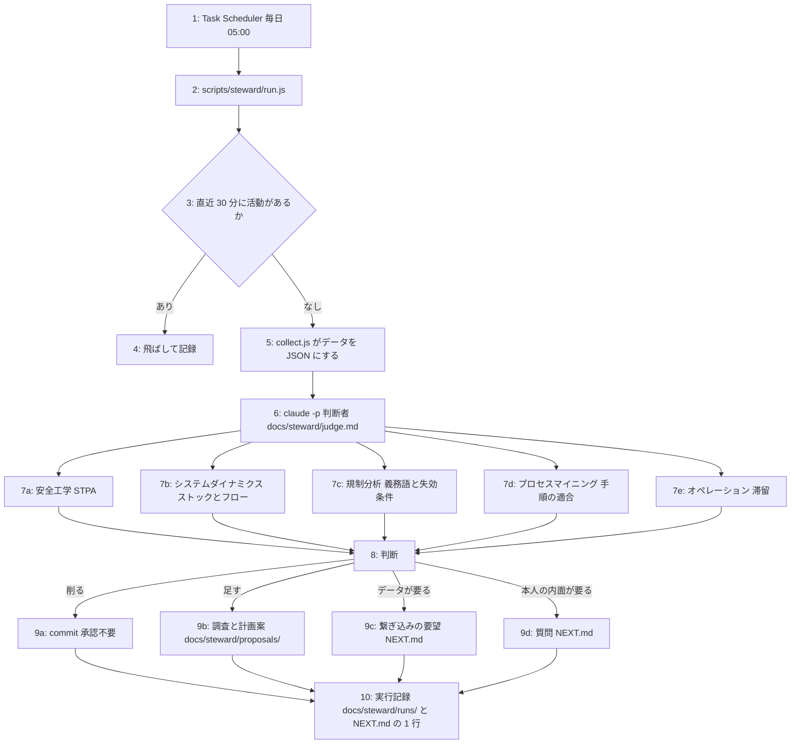

# 回す仕組み 計画 Phase 2: 無人の専門家と判断者 (段階 2)
作成 2026-10-29。承認済み 2026-10-29 (目的・完了条件・入れないものを本人が承認。タスクの詳細は CLAUDE.md「承認の扱い」に従い Claude が決めて実装する)。

根拠となる詰まり: 本人は「仕組みの規律やガードが積もり、エージェントの処理能力を超えて全体の最適化ができなくなる」を with-codex と refine_idea で 2 回経験した。vault の with-codex 構造診断 (2026-08-07) は、減算の観点が minor 固定で往復を駆動できなかったこと、「トリガー未成立」が放置を正規化したこと、沈黙が正常な検知系が忘れられたこと、本人宛の報告が本人を中継役にしたことを特定している。vault の progress-dialog T1 (停滞検知) は実装済みのまま Scheduler 登録が「本人の運用判断」待ちで 4 か月止まっている。本人は「苦しくなってから、実害が出て巻き戻せなくなってから」ではなく、常に自浄作用が働く状態を望む。

## 目的
規律と待ちの在庫を、本人が苦しくなる前に減らす専門家を、本人が呼ばなくても無人で回す。本人が話しかけるときは話したい話題があるので、専門家の処理は本人の起動に乗せない。

## 完了条件
- Task Scheduler に登録され、無人で 1 回走り、数値が docs/NEXT.md「今の状態」に 1 行で書かれ、削除の commit か提案が 1 件出る
- 5 回走って削除 0 件なら、判断者は自分の登録を外して記録する (本人が承認した停止条件)

## 入れないもの
- 質問や提案を本人に通知する機能 (後回し。本人の決め)。質問は NEXT.md「本人に聞きたいこと」に置くだけ
- Codex などの別モデルによる検証 (多様性の問題は認識しているが、後回し)
- 本人宛の報告文。判断者の出力は数値 1 行、削除の commit、提案ファイル、質問の 4 種だけ
- 判断者のサイズや専門家の数の上限 (本人の指摘: 妥当性の無い制限が精査されずに積もるのが with-codex だった)

## 設計
記事 (vault:with-codexの後継-人間を不満の源泉にする自律システム.md「記事の要点」) の Depth に従い、専門家は「その分野の人が実際に使う道具」で、データの用意は別に置く。専門家は単体で回さず、判断者が道具として使う。

### 専門家 (判断者が使う道具)
| 専門家 | 道具 | collect.js が用意するデータ |
|---|---|---|
| 安全工学 (Leveson) | STPA。制御構造図を持ち、各制御動作の「出ない・誤る・遅い・長い」と欠けたフィードバック経路を列挙する | docs/steward/control-structure.md (判断者が保守)、規律の一覧、decisions/*-feedback.md の「仕組み側の学び」 |
| システムダイナミクス (Forrester、Senge) | ストックとフローの時系列、因果ループ、原型 (Shifting the Burden など) | CLAUDE.md と docs/plan/loop-*.md の行数の推移 (git 履歴)、[作品] / [仕組み] の commit 数の推移 |
| 規制分析 | 義務語のカウント、各規則の根拠と失効条件の有無、サンセット | 文書ごとの義務語 (必ず・しない・禁止・求めない 等) の数、global CLAUDE.md は測るだけ |
| プロセスマイニング (van der Aalst) | イベントログからの手順の発見と、文書化された手順との適合検査 | ~/.claude/projects/<slug>/*.jsonl から、セッション数、本人の発言数、NEXT.md を最初に読んだか、終わりに NEXT.md を更新したか |
| オペレーション (Kanban) | 仕掛かりの滞留時間 (aging WIP) | NEXT.md「本人に聞きたいこと」の各項目の初出日 (git 履歴)、system-design.md「未決事項」の件数、proposals/ の承認待ち日数 |

### 判断者の権限
- 削る (承認不要、1 件 1 commit、接頭辞 `[仕組み] 判断者:`): プロジェクトの CLAUDE.md の規律、docs/plan/loop-*.md、docs/system-design.md「未決事項」、NEXT.md「本人に聞きたいこと」の古い項目 (捨てた理由を実行記録に残す)、docs/steward/ 配下、README の開発の節
- 足す (提案のみ): docs/steward/proposals/<日付>-<slug>.md に調査と計画案 (目的・完了条件・入れないもの) を書き、NEXT.md「本人に聞きたいこと」に 1 行で載せる
- 要望する: データの繋ぎ込み (例: セッションログのより深い抽出) は NEXT.md「本人に聞きたいこと」に書く
- 聞く: 本人の内面の情報 (好み、優先、やる気) が要るときだけ質問する。答えが無くても進められる範囲を添える
- 触らない: docs/concept.md、src/、assets/、acceptance.json、vault、global CLAUDE.md (測るだけ。変更は提案)。push はしない (次のセッションが push する。未 push を NEXT.md に書く)

### 実行記録
- docs/steward/runs/<日付>.md: 数値の表、各専門家の所見 (根拠つき)、取った行動、それまでに飛ばした日 (活動中で飛ばした日は `.steward/skips.log` に溜め、次の記録に載せる。作業中の tree に記録を書き込まないため)。失敗しても必ず書く (判断者が書かなければ run.js が失敗の記録を書いて commit する)
- NEXT.md「今の状態」に 1 行: 「判断者: 最終実行 <日付>、削除 N、提案 N、質問 N (docs/steward/runs/<日付>.md)」

## タスク
### T1 (データの用意 collect.js) [仕組み]
- `scripts/steward/collect.js` (node、依存なし、ESM)。出力は JSON を stdout に。上の表の「用意するデータ」を全部出す
- commit の分類は docs/decisions/commit-labels.md の定義に従う。2026-10-29 より前は src/ と assets/ への変更を [作品] と読み替える
- 義務語の一覧は collect.js の先頭に置き、判断者が変えられる
- テスト: `scripts/steward/collect.test.js` (vitest)。commit の分類、義務語の数、質問の初出日の 3 つ

### T2 (判断者の指示 judge.md と制御構造図) [仕組み]
- `docs/steward/judge.md`: 判断者が読む指示。専門家 5 つの使い方、権限、出力の形、停止条件 (5 回で削除 0 件なら `schtasks /Delete` で自分を外して記録)
- `docs/steward/control-structure.md`: STPA の制御構造図の初版 (本人、Claude、規律、hook とテスト、作品と仕組み、NEXT.md、不満ノート)。判断者が毎回更新する

### T3 (無人起動 run.js) [仕組み]
- `scripts/steward/run.js`: 直近 30 分の活動 (repo のファイル更新、セッションログの更新) があれば飛ばす → collect.js → `claude -p` に judge.md とデータを渡す (`--allowedTools` で Read・Edit・Write・Bash の git/npm/schtasks に絞る) → 判断者が commit と記録を作る → 失敗時は run.js が記録を書く
- claude と node は `where` で絶対パスを解決する (Scheduler はシェルの PATH を継承しないことがある)
- ログ: `.steward/` (git 無視) に生の stdout/stderr

### T4 (登録と無人の 1 回) [仕組み]
- `schtasks /Create /SC DAILY /ST 05:00` で登録。Claude が実行する (本人の登録作業を残さない)
- `schtasks /Run` で 1 回無人で走らせ、記録と NEXT.md の 1 行が出たことを確認して commit
- CLAUDE.md「文書」にこの計画と docs/steward/ を足し、README の開発コマンドに手動実行 (`node scripts/steward/run.js`) を足す

## 決めた既定値 (理由つき)
- 起動は「PC を 15 分放置したら」(Task Scheduler の idle トリガー)。当初は毎日 05:00 にしたが、10-29・10-30 とも PC がその時刻に起きておらず、起動時に Scheduler が「ログオン前」で拒否して一度も走らなかった (2026-10-30 に切り替え)。1 日 1 回の制限は run.js 側にあるので、放置中のどこかで 1 日 1 回走る
- 活動の判定は 30 分: vault の progress-dialog T1 と同じ値。根拠は「本人や Claude が作業中に commit を割り込ませない」だけなので、実際に衝突したら変える
- push しない: 2026-10-28 に gh の有効アカウントで 403 が出た。無人で認証の失敗を扱わない
- global CLAUDE.md は測るだけ: 他プロジェクトにも効くので、削除は提案に留める
- 判断者のモデルは claude CLI の既定: vault の progress-dialog は特定のモデル ID を既定値に焼き込んで「黙って失敗」した。指定しない

## 決めていないこと
- 質問や提案を本人に通知する手段 (後回し。本人の決め)
- 削除が本人の不満を生んだときの扱い: 不満ノートに書いてもらい、通常の不満の loop に乗せる案。実際に起きてから決める
