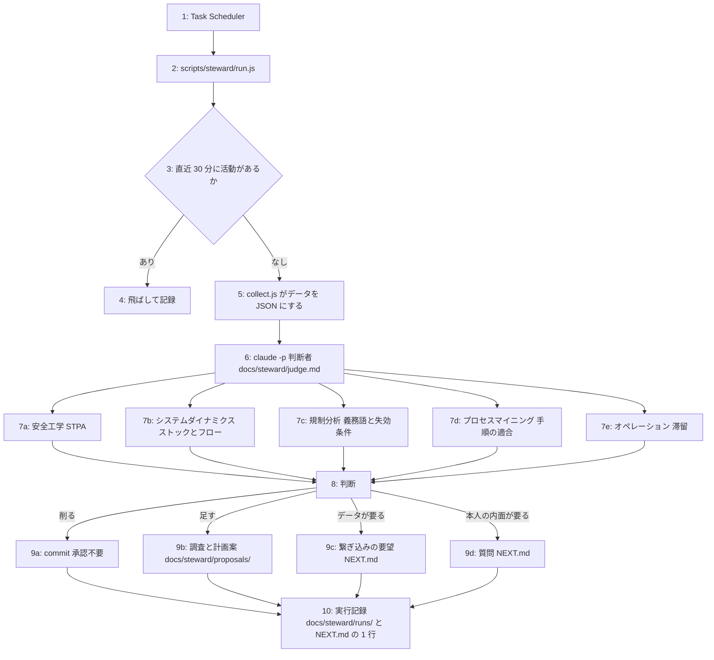

# 回す仕組み 計画 Phase 2: 無人の専門家と判断者 (段階 2)
作成 2026-10-29。承認済み 2026-10-29 (目的・完了条件・入れないものを本人が承認。タスクの詳細は CLAUDE.md「承認の扱い」に従い Claude が決めて実装する)。

根拠となる詰まり: 本人は「仕組みの規律やガードが積もり、エージェントの処理能力を超えて全体の最適化ができなくなる」を with-codex と refine_idea で 2 回経験した。vault の with-codex 構造診断 (2026-08-07) は、減算の観点が minor 固定で往復を駆動できなかったこと、「トリガー未成立」が放置を正規化したこと、沈黙が正常な検知系が忘れられたこと、本人宛の報告が本人を中継役にしたことを特定している。vault の progress-dialog T1 (停滞検知) は実装済みのまま Scheduler 登録が「本人の運用判断」待ちで 4 か月止まっている。本人は「苦しくなってから、実害が出て巻き戻せなくなってから」ではなく、常に自浄作用が働く状態を望む。

## 目的
規律と待ちの在庫を、本人が苦しくなる前に減らす専門家を、本人が呼ばなくても無人で回す。本人が話しかけるときは話したい話題があるので、専門家の処理は本人の起動に乗せない。

## 完了条件
- Task Scheduler に登録され、無人で 1 回走り、数値が docs/NEXT.md「今の状態」に 1 行で書かれ、削除の commit か提案が 1 件出る
- 5 回走って削除 0 件なら、判断者は自分の登録を外して記録する (本人が承認した停止条件)

## 入れないもの
- 質問や提案を本人に通知する機能 (後回し。本人の決め)。質問は NEXT.md「本人に聞きたいこと」に置くだけ
- Codex などの別モデルによる検証 (多様性の問題は認識しているが、後回し)
- 本人宛の報告文。判断者の出力は数値 1 行、削除の commit、提案ファイル、質問の 4 種だけ
- 判断者のサイズや専門家の数の上限 (本人の指摘: 妥当性の無い制限が精査されずに積もるのが with-codex だった)

## 設計
記事 (vault:with-codexの後継-人間を不満の源泉にする自律システム.md「記事の要点」) の Depth に従い、専門家は「その分野の人が実際に使う道具」で、データの用意は別に置く。専門家は単体で回さず、判断者が道具として使う。

### 専門家 (判断者が使う道具)
| 専門家 | 道具 | collect.js が用意するデータ |
|---|---|---|
| 安全工学 (Leveson) | STPA。制御構造図を持ち、各制御動作の「出ない・誤る・遅い・長い」と欠けたフィードバック経路を列挙する | docs/steward/control-structure.md (判断者が保守)、規律の一覧、decisions/*-feedback.md の「仕組み側の学び」 |
| システムダイナミクス (Forrester、Senge) | ストックとフローの時系列、因果ループ、原型 (Shifting the Burden など) | CLAUDE.md と docs/plan/loop-*.md の行数の推移 (git 履歴)、[作品] / [仕組み] の commit 数の推移 |
| 規制分析 | 義務語のカウント、各規則の根拠と失効条件の有無、サンセット | 文書ごとの義務語 (必ず・しない・禁止・求めない 等) の数、global CLAUDE.md は測るだけ |
| プロセスマイニング (van der Aalst) | イベントログからの手順の発見と、文書化された手順との適合検査 | ~/.claude/projects/<slug>/*.jsonl から、セッション数、本人の発言数、NEXT.md を最初に読んだか、終わりに NEXT.md を更新したか |
| オペレーション (Kanban) | 仕掛かりの滞留時間 (aging WIP) | NEXT.md「本人に聞きたいこと」の各項目の初出日 (git 履歴)、system-design.md「未決事項」の件数、proposals/ の承認待ち日数 |
| 道具の不足 (記事の Range。2026-10-30 に追加) | 上の 5 つで答えられない問いを挙げ、どの分野のどの道具が答えるかを書く | 上の全部。足りないのがデータだけなら判断者が collect.js に足す |

### 判断者の権限と実行記録
本文は docs/steward/judge.md「権限」「出力」。ここには決めた理由だけ残す。
- 測定を足すのは承認不要 (2026-10-30 に本人が決めた): 測定は注意を消費しない構造側なので増えても重くならず、不要になれば判断者が消す
- 新しい専門家は本人の yes を要する: 新しい問いの立て方で多様性の源泉なので
- 活動中で飛ばした日は `.steward/skips.log` に溜め、次の記録に載せる: 作業中の tree に記録を書き込まないため。判断者が記録を書かなければ run.js が失敗の記録を書いて commit する

## 決めた既定値 (理由つき)
- 起動は「PC を 15 分放置したら」(Task Scheduler の idle トリガー)。当初は毎日 05:00 にしたが、10-29・10-30 とも PC がその時刻に起きておらず、起動時に Scheduler が「ログオン前」で拒否して一度も走らなかった (2026-10-30 に切り替え)。1 日 1 回の制限は run.js 側にあるので、放置中のどこかで 1 日 1 回走る。schtasks の idle 登録は「放置が終わったら止める」(StopOnIdleEnd) が既定で true なので、実行中 (2〜3 分) に本人が戻ると途中で止まる。その日の記録が無いままになれば次の放置で再実行される (削除は 1 件 1 commit なので途中で止まっても壊れない)
- 活動の判定は 30 分: vault の progress-dialog T1 と同じ値。根拠は「本人や Claude が作業中に commit を割り込ませない」だけなので、実際に衝突したら変える
- push しない: 2026-10-28 に gh の有効アカウントで 403 が出た。無人で認証の失敗を扱わない
- global CLAUDE.md は測るだけ: 他プロジェクトにも効くので、削除は提案に留める
- 判断者のモデルは claude CLI の既定: vault の progress-dialog は特定のモデル ID を既定値に焼き込んで「黙って失敗」した。指定しない

## 決めていないこと
- 質問や提案を本人に通知する手段 (後回し。本人の決め)
- 削除が本人の不満を生んだときの扱い: 不満ノートに書いてもらい、通常の不満の loop に乗せる案。実際に起きてから決める
