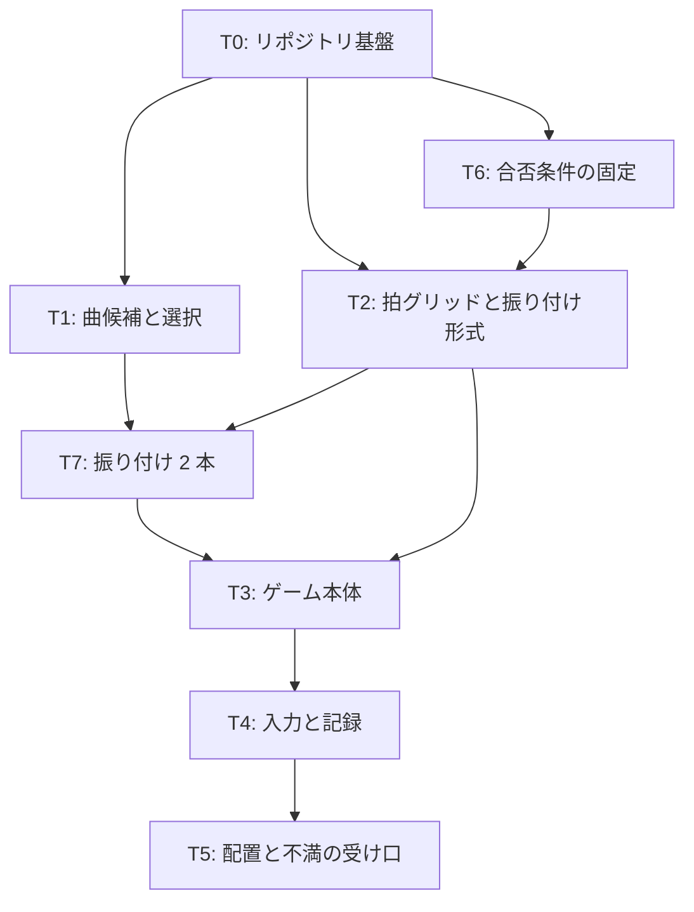

# v0 計画 Phase 1: 目的とタスク一覧
作成 2026-10-21。承認後に Phase 2 (各タスクの詳細) を書く。前提は docs/concept.md (保護対象)、docs/system-design.md「最初の実験の方向」、docs/feasibility.md「実現可能性のフック」。

## 目的
20 秒の戦闘シーン v0 を、PC ブラウザ + DualSense で遊べる状態にして人間の手元に届け、不満のループを 1 周させられる状態にする。

v0 で確かめること (system-design の叩き台に対応):
- 不満が次の版 (v1) の具体的な変更に変わるか
- 人間の関わりが「曲を選ぶ・遊ぶ・不満を書く」だけで済むか

## v0 の完了条件
- URL を開き、DualSense (またはキーボード) で 20 秒の戦闘を最初から最後まで遊べる
- 敵の攻撃が曲のフレーズに振り付けられていて、拍に乗っている。プレイヤーの攻撃タイミングで鳴る音が変わる
- 同じ曲に振り付けが 2 本あり、タイトルで切り替えて遊べる (最初の 2 案比較)
- 20 秒の終わりに、入力と拍のズレ・被弾の記録がテキストで画面に出る
- 不満を書く場所が 1 つ決まっていて、そこに書けば次のセッションが読める
- 合否条件 (数値) がファイルにあり、テストがそれを読んで通っている
- git 履歴に「仕組み」と「作品」の変更が区別できる形で残っている

## 範囲に入れないもの (v0)
- 感性システム、不満の予測照合、外部の判定者の配置
- 定期実行・自律バッチ。v0 は人間がセッションを起こして回す
- スマホのタッチ操作。スマホは不満を返す側だけ
- 曲の個性、音色の質。音は拍とタイミングが分かる最低限 (素のオシレータなので「かっこよさ」は構成とリズムで出す範囲に限られる)
- 世界観・キャラデザ。四角と線で描く
- 振り付けの自動生成・自動評価。振り付けは Claude が書き、良し悪しは人間の不満で判定する

## 決まったこと (2026-10-21)
- GitHub: pokadokan-boop の公開リポジトリ。名前は `music_action_lab` (フォルダ名と同じ)
- 不満の受け口: vault に `音楽アクション/v0 不満.md` を置き、Obsidian モバイルで書く
- 曲: 音楽参考.md の言葉 (かっこよくてゆっくり / 8 連打でなく 4 音 / 構成要素が少ない) は探すときの目安であり、必須条件にしない。BPM で縛らない。「ゆっくり」は密度の話で BPM ではなく、高くてかっこいい方が嬉しい。機械判定も合否条件も置かない

## 技術の決め (Claude の提案)
| 項目 | 決め | 理由 |
|---|---|---|
| 言語・ビルド | TypeScript + Vite | feasibility の定番構成。GitHub Pages に静的配置できる |
| 描画 | Canvas 2D | 四角と線で足りる |
| 音 | Web Audio を直接使う (Tone.js は使わない) | ゲーム時計と音の時計を 1 つにしたい。音色は要らない |
| MIDI | @tonejs/midi で読み書き | JSON 化して拍グリッドとフレーズ区切りを取り、描画と切り離して試験する |
| 時計 | AudioContext.currentTime を正とし、固定ステップで進める advanceTime を持つ | 拍との同期を毎回同じ結果で検査できる |
| 振り付け | 1 フレーズ = 1 攻撃を、拍グリッド上のキーフレーム (予告・移動・当たり) で書くデータ形式 | 「このフレーズでこの攻撃」を人が読める形で置き、機械は可読性と公平さだけ検査する |
| 入力 | Gamepad API (DualSense を標準マッピングで読む) + キーボード | concept.md「範囲」 |
| テスト | Vitest (純粋関数)。ブラウザ自動操作は v0 では入れない | 自動プレイは手触りを測れない (feasibility)。render_game_to_text は window に露出だけしておく |
| 配置 | GitHub Pages (gh CLI でリポジトリ作成、Actions でビルド) | スマホからも URL だけで開ける |
| 合否条件 | リポジトリ内の JSON 1 つ + Edit/Write を止める PreToolUse hook | feasibility「エージェントが変えられない場所」。Bash 経由は止まらないが v0 の抑止としては足りる |

## タスク一覧

### T0 (リポジトリ基盤)
- git init、.gitignore、Vite + TypeScript + Vitest の空プロジェクト、ビルドが通る空ページ
- pokadokan-boop に公開リポジトリ `music_action_lab` を作り、Pages の Actions を置く。空ページが URL で開けるところまで
- 成果物: 動く空ページの URL、最初の commit

### T1 (曲候補と選択)
- 戦闘シーンの長さに合わせた約 20 秒の MIDI を 3 候補、スクリプトで生成する。候補ごとに BPM と作りを違える (例: ジャージークラブ風のキック、トラップ風のハーフタイム、ミニマルテクノ風の反復。音楽参考.md の検索候補から)
- 音楽参考.md の言葉 (かっこよくてゆっくり / 8 連打でなく 4 音 / 構成要素が少ない) は作るときの目安。機械判定はしない。トラック構成はメロディ + ベース + 打音を目安にする
- 候補を聴く小さなページ (スマホでも開ける)。人間が 1 つ選び、理由を一言返す
- 成果物: `assets/midi/candidate-{1,2,3}.mid`、各候補の狙いを 1 行ずつ書いたメモ、選択結果と理由の記録 (docs/decisions/)
- 人間の作業: 聴いて 1 つ選ぶ (数分)

### T2 (拍グリッドと振り付け形式)
- MIDI → 拍グリッド (BPM、拍、小節) と、フレーズの区切り (休符や小節線で切る) を出す純粋関数
- 振り付けの形式を決める: 1 フレーズに 1 攻撃。攻撃は「予告開始の拍」「移動のキーフレーム列 (位置と補間)」「当たりの瞬間 (フレーズ内の音の位置)」「当たり範囲」で書く。移動の補間は根本コンセプトアイデアの予告 (イージングアウト) に合わせる
- 攻撃の原型を 3 つ用意する: 突進、円形の範囲攻撃 (補助線つき予告)、弾。振り付けはこれらにパラメータを与えて並べる
- 固定ステップで進むゲーム時計 (advanceTime)
- 振り付けの機械検査 (T6 の値を読む): 予告は当たりより N 拍以上前、当たりはグリッド上の音か拍に乗る、連続する当たりの間にプレイヤー速度で避けられる位置がある
- 成果物: `src/core/` のモジュールとテスト、振り付け形式の説明 (docs/)

### T7 (振り付け 2 本)
- T1 で選ばれた曲のフレーズごとに「このフレーズでこの攻撃」を Claude が 2 通り書く。2 本は方針を変える (例: A は音の高低に合わせて敵が上下する、B は拍の表裏で突進と範囲を使い分ける)
- 両方が T2 の機械検査を通ることを確認する
- 成果物: `assets/choreo/a.json`、`assets/choreo/b.json`、各本の狙いを 2〜3 行で書いたメモ (人間が不満を書くときの照合用)

### T3 (ゲーム本体)
- Canvas 描画: 横視点、常に浮いているプレイヤーと敵、攻撃予告の補助線、主張しない HP 表示
- 敵は振り付けデータを再生する。タイトルで A / B を選ぶ
- プレイヤーの攻撃: 射程内なら当たるように位置を少し補正する。攻撃した拍の位置 (表・裏・外れ) で鳴る音が変わる
- 曲の再生を Web Audio で行い、ゲーム時計と同じ時計に乗せる
- 20 秒で終わり、結果画面に移る
- 成果物: 遊べる 1 画面

### T4 (入力と記録)
- Gamepad API で DualSense を読む (左スティック移動、ボタン 1 つで攻撃)。キーボード代替
- 入力ごとに「最寄りの拍からのズレ (ms)」を記録。被弾・命中も、どのフレーズのどの攻撃かと一緒に記録
- 結果画面に記録の要約をテキストで出し、コピーできるようにする。render_game_to_text を window に露出する
- 成果物: 入力層、記録層、結果画面

### T5 (配置と不満の受け口)
- Pages に本体を配置し、URL を確定する
- vault に `音楽アクション/v0 不満.md` を作る。書き方の最小ルール: 1 回の不満につき、どの振り付け (A/B)・何が・いつ (フレーズか場面)・どう嫌か、の 4 行以内。好きだった点も書いてよい (任意)
- 次のセッションが読む手順を README に書く: concept.md → 不満ノート → 記録、の順で読んで v1 を作る
- 成果物: URL、不満ノート、README

### T6 (合否条件の固定)
- `acceptance.json` に数値条件を置く: 予告の先行拍数の下限、当たりとグリッドのズレ 0 ms (ゲーム時計上)、避けられる位置の存在、同じ入力列で記録のハッシュが一致、20 秒で終了。曲の音楽的な条件は置かない
- `.claude/settings.json` に、このファイルへの Edit/Write を exit 2 で止める PreToolUse hook を置く
- 成果物: acceptance.json、hook、hook が止まることの確認記録

## 人間の作業 (v0 全体)
1. この Phase 1 と Phase 2 の承認
2. T1 で曲を 1 つ選び、理由を一言
3. v0 を遊び、不満を書く

## 進め方の注意
- 各タスクは commit を分け、メッセージ先頭に `[仕組み]` か `[作品]` を付ける (system-design「作品が出ないのに仕組みの変更だけ増えたら refine_idea 型の兆候」を git で見るため)。振り付けと曲は `[作品]`
- 1 セッションで全タスクを終える想定。終わらなければ T3 の前で切り、Phase 2 文書を頼りに再開する
