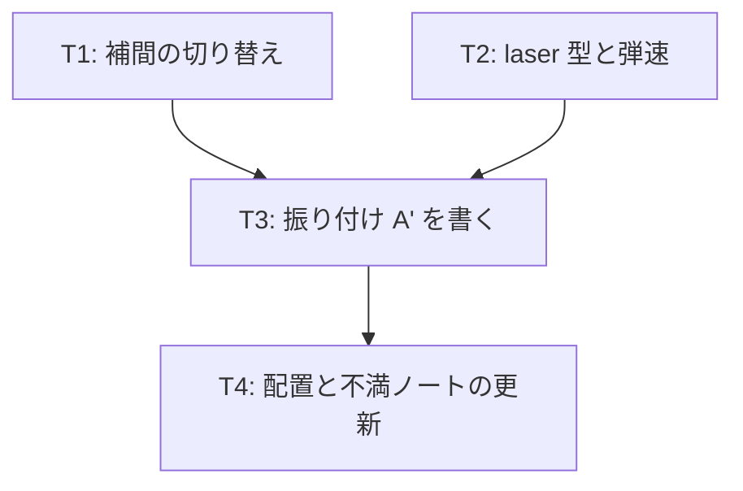

# v1 計画 Phase 1: 目的とタスク一覧
作成 2026-10-22。根拠は docs/decisions/v0-feedback.md (v0 の不満の分解)。前提は docs/concept.md (保護対象)。

## 目的
「曲に乗っている感じ」を出す。v0 の不満 1 (拍ごとの動きの量) と 2 (弾の判定) に対応し、v0 の A と並べて比較できるようにする。

## v1 の完了条件
- タイトルで「A (v0)」と「A' (v1)」を選べ、同じ曲・同じフレーズ割り当てで、補間とレーザーだけが違う
- A' では、移動が拍の頭に向けて加速し、3 拍の移動なら最後の 1 拍で 70% 動く
- A' では、放射系の攻撃がレーザー (予告の線が 0.25 拍だけ判定になる) になっている
- 機械検査 (予告の先行、当たりがグリッド上、避けられる位置) を A' も通る
- テストが通り、公開 URL で遊べる

## 入れないもの (v1)
- 自機狙い、攻撃の衝突・相殺、方向つき攻撃 (v0-feedback「後回し」)
- 地面と空中
- 表の判定窓の調整
- B の作り直し

## タスク

### T1 (補間の切り替え) [仕組み]
- 振り付け形式に `motion: "easeOut" | "snap"` を足す (振り付け全体の既定と、攻撃ごとの上書き)。`snap` は区間ごとに 3 次のイージングイン (`t^3`)。既定は `easeOut` (v0 のデータを変えないため)
- `pathPosAt` と描画の予告 (同心円の動く輪) が motion に従う。予告の輪も拍の頭に向けて加速する
- テスト: snap の 3 拍移動で、最後の 1 拍の移動量が 70% 以上
- docs/choreo-format.md を更新

### T2 (laser 型と弾速) [仕組み] + [作品]
- `type: "laser"`: hitBeat の敵位置から `target` 方向へ画面端まで伸びる線分が、`activeBeats` (既定 0.25) の間だけ判定になる。太さは `hitbox.r`。予告は射線 (v0 の shot と同じ描画)
- 当たり判定の形を円だけから「円 | 線分」に広げる。避けられる位置の検査と sim の被弾判定が線分を扱う
- 描画: 判定中は線を太く明るく描く
- `config.shotSpeed` を 0.8 → 2.4 に上げる ([作品] として別 commit)。shot 型は残す
- テスト: laser の hitboxAt、線分と点の距離、validate が通ること

### T3 (振り付け A' を書く) [作品]
- `assets/choreo/a2.json`: A と同じフレーズ割り当て・同じ軌道の形で、`motion: "snap"`、shot を laser に置き換える。A との違いはこの 2 点だけにする (比較の軸を 1 つに絞るため)
- 書くのは Claude 本体 (サブエージェントに分けない。A の形を保つ作業であり多様性は要らない)
- assets/choreo/README.md に A' の節を足す
- 検査を通す

### T4 (配置と不満ノートの更新) [仕組み]
- push して公開 URL で A / A' / B が選べることを確認
- vault の不満ノートに「v1 (2026-10-22 以降)」の節を足し、比較の軸 (A と A' の違いは補間とレーザーだけ) を 1 行書く
- docs/plan/v1-phase1.md の完了条件を照合して記録

## 人間の作業
1. この Phase 1 の承認 (Phase 2 は規模が小さいので、この文書の T1〜T4 の記述を兼ねる。承認後そのまま実装に入る)
2. A と A' を遊び比べて、不満ノートに書く

## 2 案比較の読み方
- A' が A より「曲に乗っている」なら、不満 1・2 の読みが当たっている。snap を既定にして B も直す
- 変わらなければ、原因は補間ではなく別のところ (敵の動きの量そのもの、拍の明滅、音) にある。次は動きの量を拍ごとに変える案を試す
