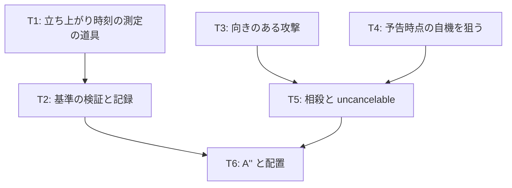

# v2 計画 Phase 1: 当たりの時刻の基準と「捌く」
作成 2026-10-27。前提は docs/concept.md (保護対象)、docs/decisions/v0-feedback.md と v1-feedback.md (不満の分解)、docs/choreo-format.md (振り付け形式)。v1 の到達点は docs/plan/v1-phase1.md「完了記録」と、その後の 3 回の修正 (叩きつけを音に合わせる → 立ち上がり遅れ → 80 ms)。

## 新しいセッションの始め方
1. docs/concept.md → この文書 → docs/choreo-format.md → docs/decisions/v1-feedback.md の順に読む
2. 現状の確認: `npm test` (43 件)、`npx tsx scripts/sync-report.ts assets/choreo/a2.json`
3. 本人から Phase 1 の承認を取ってから Phase 2 (各タスクの詳細) を書く。承認前に実装コードを書かない

## 2026-10-27 までに決まったこと
- A' (a2) の叩きつけは、動き出しを最後の音のなり始め (10.5 拍目)、当たりをその 80 ms 後 (impactDelayBeats 0.1875) にして「ぴったり合っている」と判定された
- 突進とレーザーは当たりの遅れ 0 ms で「合っている」。触らない
- 振り付け B は比較の役目を終え、外した (git 履歴 `53eb625`)
- 本人の感覚を遅れの定規にしない。感覚はぶれるので、測れる基準を作り、感覚は基準の検証に使う (本人の要望)
- v2 では「向きを付ける」と「自機狙い」の両方を入れる。相殺できないのは型 (範囲攻撃) ではなく属性 (`uncancelable`) で表す (本人の要望)

## 目的
1. 当たりの時刻を決める、感覚によらない基準を作り、既にある 2 つの判定で検証する
2. 「予測して捌く」を作る。向きのある攻撃、予告時点の自機を狙う敵、拍に乗せた攻撃での相殺

## 基準の仮説 (T1 で検証する)
当たりが合って感じる時刻は「音のなり始め」ではなく、その拍で鳴る音を全部混ぜた波形のエネルギーが立ち上がりきる時刻。
- 叩きつけの拍 (10.5) にはメロディ 68 と一緒にキック (150 → 40 Hz を 150 ms で沈む) とハットが鳴る。キックの立ち上がりは遅い
- 突進 (18) とレーザー (6) の拍にはメロディ 65 とスネア (ノイズ、立ち上がりは数 ms) が鳴る
- 仮説どおりなら、叩きつけ 80 ms・突進とレーザー 0 ms の 2 判定が、音の性質から説明できる
- 外れたら仮説を捨て、別の基準を探す。本人の判定を基準の材料に戻さない

## 完了条件
- 各アンカー拍の「エネルギーの立ち上がり時刻」が ms で出る道具があり、a2 の 3 種類の攻撃について値が記録されている
- 上の 2 判定と測定値の整合が docs/decisions/ に記録されている (合う・合わないどちらでも)
- 振り付けの攻撃に `aim: "player"` と `uncancelable` を書け、プレイヤーの攻撃に向きがあり、相殺が起きる
- A' に属性を付けた版 (A'') で、立ち止まると当たり、予告を見て動くか拍に乗せて向きを合わせた攻撃を出すと捌ける
- 機械検査 (予告の先行、当たりがグリッド上、避けられる位置) が自機狙いを含めて通る
- テストが通り、公開 URL で遊べる

## 入れないもの (v2)
- 地面と空中
- 表の判定窓の調整
- 曲の変更、B の作り直し
- 音と絵の同期の実測 (docs/research/av-sync-verification.md の AudioWorklet 案)。「数値上は合っているのに合って聞こえない」不満が出たら着手

## タスク

### T1 (立ち上がり時刻の測定の道具) [仕組み]
- 曲を実際の合成器 (src/audio/engine.ts) と同じ処理でオフライン描画し、各アンカー拍の直後の短時間エネルギーが、その後 150 ms 内のピークの 90% に達する時刻を ms で出す
- 描画の方法は 2 択。(a) ブラウザの OfflineAudioContext で engine.ts をそのまま使う計測ページ `measure.html` を置き、Claude が Chrome で開いて値を読む。(b) engine.ts の合成を Node に移植して `scripts/` で出す。(a) は合成器と同一で確実、(b) は自動テストに乗る。Phase 2 で決める (推奨は (a) を先に作り、値が安定したら (b) でテスト化)
- 出力: 攻撃ごとに「アンカー拍、鳴っている音の種類、立ち上がり時刻 (ms)、現在の impactDelay (ms)、差」

### T2 (基準の検証と記録) [仕組み]
- 叩きつけ (キック + メロディ) の立ち上がりが 60〜100 ms、突進とレーザー (スネア + メロディ) が 0〜20 ms なら仮説は立つ。その場合「当たり = アンカー + 立ち上がり時刻」を基準にし、検査に「impactDelay が測定値 ±20 ms」を足す (acceptance.json への追加は本人が編集)
- 外れた場合は、測定値と判定の表を docs/decisions/ に残し、仮説を捨てる
- 記録先: docs/decisions/v2-timing-standard.md

### T3 (向きのある攻撃) [仕組み] + [作品]
- プレイヤーの攻撃に向きを持たせる。スティックの方向 (8 方向に丸める)。入力が無ければ敵の方向
- 当たりは前方の扇 (角度は config、初期値 90 度) × 射程。射程内補正は扇の中だけ
- 描画: 攻撃の瞬間に扇を出す
- 記録: 攻撃の向きと、敵がその扇に入っていたかを log に残す

### T4 (予告時点の自機を狙う) [仕組み]
- 攻撃に `aim: "fixed" | "player"` を足す (既定 fixed)。player なら、予告開始 (telegraphBeat) の瞬間のプレイヤー位置を狙う。追尾はしない
- 狙い方は型ごと: dash は path の終点をその位置に平行移動、burst は発生点をその位置に、laser / shot は target をその位置に
- 機械検査の「避けられる位置」を自機狙いに広げる: 予告開始時にプレイヤーが格子点 p にいたとして、予告の間 (lead 拍 × 速度 × 余裕) に当たらない点へ移れること。全ての p で成り立つこと
- 予告の描画は狙った位置に出る (今の描画をそのまま使える)

### T5 (相殺と uncancelable) [仕組み] + [作品]
- 攻撃に `uncancelable: boolean` を足す (既定 false)
- 相殺の条件: 敵の当たりが有効な窓の間に、プレイヤーの攻撃の扇が敵の当たりの形 (dash は本体、laser は線分の自機に近い部分) と重なり、向きが来る方向を向いている (dash は敵の進行方向の逆、laser は射線の向きの逆、角度の許容は config)。成立したら敵の当たりを消し、相殺の音と絵を出す
- 相殺の受付窓は当たりの有効窓そのもの。拍に乗せて出す必要がある (「音楽のガイドで捌く」)。窓を少し前に広げるかは T2 の基準で決める
- 記録: 相殺の成立・失敗 (向き違い、タイミング違い) を log と結果画面に出す

### T6 (A'' と配置) [作品] + [仕組み]
- a3.json: A' と同じ振り付けに属性を付ける。dash と laser は `aim: "player"`、burst は `aim: "player"` + `uncancelable: true`
- タイトルで A / A' / A'' を選べる。README と vault の不満ノートに v2 の節を足す
- 比較の軸: A' (捌く対象なし) と A'' (向き + 自機狙い + 相殺)

## 人間の作業
1. Phase 1 と Phase 2 の承認
2. T2 の結果を見て、基準を採用するか判断。採用なら acceptance.json を本人が編集
3. A'' を遊んで、捌けたか・捌きたくなるかを不満ノートに書く

## 未決 (Phase 2 で決める)
- 扇の角度、相殺の向きの許容角、相殺時の敵の挙動 (弾かれて下がるか、その場で消えるか)
- 自機狙いの dash の終点を「自機の位置」にするか「自機を少し通り過ぎる位置」にするか
- 相殺の音を曲の和音から取るか (concept「行動が音楽になる」との接続)
