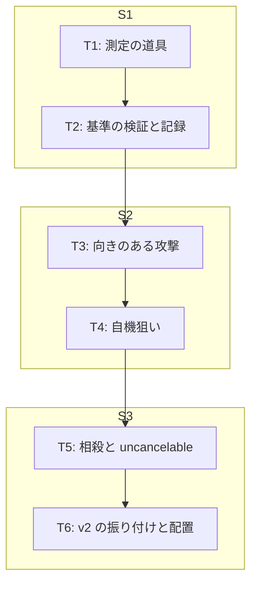

# v2 計画 Phase 2: 各タスクの詳細
作成 2026-10-27。Phase 1 は docs/plan/v2-phase1.md。前提は docs/choreo-format.md (振り付け形式と検査) と、現在のコード: src/core/choreo.ts (型・幾何・検査)、src/core/sim.ts (状態遷移)、src/audio/engine.ts (合成器)、src/render/canvas.ts (描画)、src/input/ (入力)。

## セッションの切り方
3 セッションに分ける。各セッションは 1 つの区切りで終わり、docs/NEXT.md を書いて止まる (CLAUDE.md「セッションの終わり方」)。

| セッション | タスク | 終わりの区切り |
|---|---|---|
| S1 | T1 (測定の道具) → T2 (基準の検証と記録) | docs/decisions/v2-timing-standard.md に測定値と判定の整合が書かれ、本人に基準の採否を聞く状態 |
| S2 | T3 (向きのある攻撃) → T4 (自機狙い) | 向きと自機狙いがテストを通り、公開 URL で遊べる (この時点の振り付けは a2 のまま) |
| S3 | T5 (相殺) → T6 (v2 の振り付けと配置) | v2.json で遊べ、不満ノートに v2 の節がある |

## 既定値の決め (Phase 1 の未決。承認後は Claude の判断で動かし、変えたら docs/decisions/ に記録)
| 項目 | 既定値 | 理由 |
|---|---|---|
| 扇の角度 `attackFanDeg` | 90 度 (前方 ±45 度) | 当たりやすさより「向きを合わせる」行為が成立する最小の広さ。狭すぎると向きの入力がストレスになる |
| 相殺の向きの許容角 `cancelFacingDeg` | 60 度 (来る方向の逆 ±30 度) | スティックは生の角度で、相殺の窓は 0.25〜0.5 拍と短い。最初は緩めにして「簡単すぎる」不満で締める |
| 自機狙いの dash の終点 | 自機の位置そのもの (通り過ぎない) | 通り過ぎる量は振り付けデータ側でキーフレームを足せば書ける。仕組みに値を持たせない |
| 相殺時の敵の挙動 | 本体の動き (path) は変えず、当たりだけ消える。弾かれる動きは入れない | path は音に合わせて書いたデータ。実行時に動きを変えると v1 で合わせた同期が崩れる |
| 相殺の音 | そのフレーズの、相殺した拍に最も近いメロディ音の 1 オクターブ上を 0.1 秒 (矩形波) | concept「行動が音楽になる」との最小の接続。和音は曲側の仕組みが無いので v2 では取らない |
| 相殺の受付窓 | 当たりの有効窓そのもの。前に広げない | T2 で基準が立てば impactDelay が窓を知覚上の立ち上がりに合わせる。広げるかは不満で決める |
| 攻撃の向きの入力 | `move` ベクトルの向きそのもの (デッドゾーン後)。無入力なら敵の方向 | 新しい入力を足さない。キーボードは組み合わせの性質上 8 方向 |

## T1 (立ち上がり時刻の測定の道具) [仕組み]
### 事前条件
- src/audio/engine.ts の `AudioEngine` が `AudioContext` を受け取る。OfflineAudioContext を渡せるよう、コンストラクタの型を `BaseAudioContext` に広げる (`resume` / `outputLatency` は AudioContext のときだけ動く)

### 実装
- 描画の方法は Phase 1 の (a): ブラウザの OfflineAudioContext で engine.ts をそのまま使う。合成器と同一であることを優先する。Node への移植 ((b)) はしない。テスト化が要るなら、合成器を手で移植するのではなく Node 用の Web Audio 実装 (node-web-audio-api) で engine.ts を動かす案を T2 の後に検討する (依存を足すので、値が安定してから)
- `src/audio/onset.ts` (純粋関数。DOM・Audio に触らない):
  - `energyEnvelope(samples: Float32Array, sampleRate, windowSec = 0.010, hopSec = 0.001)`: 10 ms の RMS を 1 ms 刻みで出す
  - `riseTime(env, hopSec, anchorSec, opts)`: アンカー時刻 t0 について、基準 = [t0 − 30 ms, t0 − 5 ms] の平均、ピーク = [t0, t0 + 150 ms] の最大。立ち上がり時刻 = 基準 + 0.9 × (ピーク − 基準) に初めて達する時刻 − t0 (ms)。50% に達する時刻も出す
  - 低域版: 同じ計算を 200 Hz のローパス (2 次バイカッド、Node 側で係数を計算) を掛けた波形に対して行う
- `measure.html` + `src/measure.ts` (vite の入口に追加。candidates.html と同じ形):
  - 曲 (candidate-2) を読み、OfflineAudioContext (48 kHz、21 秒) に `AudioEngine` を作って `start(song, 0)` → `startRendering()`
  - 振り付け (v2.json。S1 時点では a2.json) の各攻撃について、アンカー拍 `hitBeat` の時刻を t0 にして広帯域と低域の立ち上がり時刻を出す
  - 表: 攻撃 / type / アンカー拍 / 鳴っている音 (MIDI から: メロディ音高、kick / snare / hat の有無) / 広帯域 90% (ms) / 低域 90% (ms) / 現在の impactDelay (ms) / 差 (広帯域、低域)
  - `window.__measure` に JSON を置き、Claude が Chrome で読む。値は docs/decisions/v2-timing-standard.md に手で写す
- 測定の設定値 (窓 10 ms、刻み 1 ms、ピーク探索 150 ms、低域 200 Hz、90%) は表の上に出し、記録にも書く

### 先に書いておく読み (測る前の宣言。後から合わせない)
- engine.ts のキックは `gain 0.6` から始まって指数減衰する (立ち上がりのランプが無い)。メロディの矩形波は 5 ms のランプ。したがって広帯域の 90% 立ち上がりは 3 攻撃とも 0〜15 ms 程度になる可能性が高く、そうなら Phase 1 の仮説 (広帯域のエネルギー) は外れる
- 低域だけを見る理由: キックは 150 → 40 Hz を 150 ms で沈む。低い音は数周期鳴らないと音として立たず (40〜150 Hz の数周期 = 20〜75 ms)、200 Hz 以下のエネルギーは沈むにつれて増える。「立ち上がりきった感じ」が低域の立ち上がりなら、叩きつけだけが遅く出るはず。これは測る前に立てた第 2 の読みで、測った後に合わせて作る基準ではない

### 成果物
- src/audio/onset.ts とそのテスト (合成信号: 5 ms ランプの正弦波で立ち上がり ≈ 5 ms、ステップ入力で ≈ 窓幅以下、無音で NaN)
- measure.html、src/measure.ts、vite.config.ts の入口追加
- `npm run build` が通る

## T2 (基準の検証と記録) [仕組み]
### 事前条件
T1 の値が Chrome で読めている。

### 判定の規則 (測る前に固定)
| 読み | 立つ条件 | 結果 |
|---|---|---|
| H1 広帯域 | 叩きつけ (10.5 / 26.5 / 42.5 拍) が 60〜100 ms、突進 (18 / 34) とレーザー (6 / 22 / 38) が 0〜20 ms | 「当たり = アンカー + 広帯域の立ち上がり」を基準にする |
| H2 低域 | H1 が外れ、低域の値が同じ範囲に入る | 「当たり = アンカー + 低域の立ち上がり」を暫定の基準にする。1 回の観測で立てた仮説と明記し、次の不満で検証する |
| どちらも外れ | | 仮説を捨てる。基準は「無し」のまま、impactDelay は本人の判定値 (80 ms / 0 ms) を据え置き、v2 の T3 以降に進む |

### 実装 (H1 か H2 が立った場合のみ)
- 測定値を `assets/midi/candidate-2.onsets.json` に置く (拍 → 立ち上がり ms。measure.html の JSON をそのまま。手で写した旨を記録)
- `validateChoreo` に `impact-rise`: `impactDelayBeats` を ms にした値が、hitBeat の立ち上がり ± `acceptance.impactRiseToleranceMs` に入る。onsets.json が無い曲は検査しない
- acceptance.json への `impactRiseToleranceMs: 20` の追加は本人が編集する (hook が Claude の Edit を止める。docs/decisions/acceptance-guard.md)。追加されるまで検査は無効で、テストは通る
- 立たなかった場合は上の実装はしない

### 成果物
- docs/decisions/v2-timing-standard.md: 設定値、3 種類 × 2 読みの測定値の表、本人の 2 判定との整合、採った結論、外れた場合は捨てた理由
- (立った場合) onsets.json、`impact-rise` 検査とテスト
- セッションの終わりに本人へ聞くこと: 基準を採用するか、acceptance.json を編集するか

## T3 (向きのある攻撃) [仕組み] + [作品]
### 事前条件
S2 の冒頭。T2 の結果に依存しない (T2 が外れていても進める)。

### 実装
- `src/config.ts` に `attackFanDeg: 90` を足す ([作品] commit)
- `src/core/sim.ts`:
  - 攻撃の向き `aim`: `input.move` の長さが 0 より大きければその単位ベクトル、無ければプレイヤーから敵への単位ベクトル。度に直した値 `aimDeg` (0 = 右、90 = 下、時計回り) を記録に残す
  - 命中条件: 敵との距離 ≤ `meleeRange + rangeAssist` かつ、aim と (敵 − プレイヤー) の角度差 ≤ `attackFanDeg / 2`。射程内補正 (寄せ) は扇の中にいるときだけ
  - 幾何は `src/core/vec.ts` に `angleBetween(a, b)` と `inFan(origin, aim, halfDeg, range, p)` を足して、sim と T5 の相殺で共用する
- `src/core/log.ts`: `attack` イベントに `aimDeg` と `enemyInFan: boolean` を足す。要約に「扇内 n / 扇外 m」を 1 行足す
- `src/render/canvas.ts`: 攻撃の瞬間 (flash の間) の描画を、meleeRange の円から aim 方向の扇 (半径 meleeRange、角度 attackFanDeg) に替える。色は今の on / off / miss のまま
- 向きの常時表示はしない (Phase 1「入れないもの」)

### 成果物
- テスト: 扇の中の敵に当たり、同距離で扇の外 (角度差 > 45 度) は外れる / 無入力なら敵方向を向いて当たる / 補正は扇の中だけ / 記録に aimDeg と enemyInFan が入る / 同じ入力で同じハッシュ (決定性)
- docs/choreo-format.md は変えない (振り付け側の形式は T4 で変わる)

## T4 (予告時点の自機を狙う) [仕組み]
### 事前条件
T3 が済み、S2 の中。

### 実装
- 型: `Attack.aim?: 'fixed' | 'player'` (既定 fixed)
- 狙いの解決 `resolveAttack(attack, target: Vec, beatSec, cfg): Attack` (src/core/choreo.ts。純粋関数):
  - 平行移動量 delta = target − 基準点。型ごとの基準点: dash = `hitBeat` より後の最初のキーフレームの位置 (突進の終点)。burst = `impactBeat` 時点の位置 (発生点)。laser / shot = 平行移動せず `target` を狙い位置に置き換える
  - dash と burst は `telegraphBeat` より後の全キーフレームに delta を足す (予告開始時点の位置は変えないので、攻撃の間の補間は影響を受けない)。移動後の各点は [enemyRadius, 1 − enemyRadius] に収める (画面外に出さない)
  - 戻りのキーフレームも平行移動されるので、戻り先は元と変わる。次の攻撃の始点へは攻撃間の補間で移る (割り切り。戻り先だけを固定する書き方は v2 では用意しない)
- sim: `SimState.resolved: Map<number, Attack>`。各 step で、`beat >= telegraphBeat` になった未解決の攻撃について、その瞬間のプレイヤー位置で `resolveAttack` して入れる。以後の `hitboxAt` / `enemyPosAt` / 描画は `effectiveChoreo(state)` (resolved で置き換えた攻撃一覧) を使う。未解決の攻撃は元のまま (まだ始まっていないので幾何に影響しない)
- 描画: 予告 (同心円・射線・進路) は解決済みの攻撃から描くので、狙った位置に出る。コードの変更は choreo の受け渡しだけ
- 検査 `dodgeable` の拡張 (src/core/choreo.ts):
  - `aim: "player"` の攻撃は、12×12 の格子点 p ごとに `resolveAttack(attack, p)` し、p から `playerSpeed × (impactBeat − telegraphBeat) × beatSec × (1 − dodgeTimeMarginRatio)` 以内に、その攻撃の active 区間で一度も当たらない格子点があること。全ての p で成り立つこと
  - 次の攻撃への連鎖 (prevSafe) は、全 p の安全な点の和集合を使う (緩い側の割り切り。v0 の「同時回避は見ない」と同じ扱いで記録する)
  - 計算量: 144 × 144 × (0.5 拍 ≈ 26 サンプル) ≈ 54 万回の hitboxAt × 攻撃数。テストが 2 秒を超えたら p の格子を 6×6 に落とす
- docs/choreo-format.md に `aim` の項と、検査の拡張を書く

### 成果物
- テスト: burst の発生点が予告開始時のプレイヤー位置になる / dash の突進の終点がプレイヤー位置になり、予告開始時点の位置は変わらない / laser の target が置き換わる / 画面外にはみ出す狙いが収まる / fixed は変わらない / 自機狙いの検査が通る例と通らない例 (予告が短すぎて逃げ場に届かない) / 決定性
- a2.json はこの時点では変えない (属性を付けるのは T6)

## T5 (相殺と uncancelable) [仕組み] + [作品]
### 事前条件
S3 の冒頭。T3 の扇 (`inFan`) と T4 の解決済み攻撃がある。

### 実装
- 型: `Attack.uncancelable?: boolean` (既定 false)。`src/config.ts` に `cancelFacingDeg: 60` ([作品] commit)
- 相殺の判定 (sim の `playerAttack` の中。命中判定と独立に、両方起きてよい):
  - 対象: その瞬間に `hitboxAt` が形を返し、`uncancelable` でなく、まだ相殺されていない敵の攻撃
  - 条件 1 (重なり): 扇 (半径 `meleeRange + rangeAssist`、角度 `attackFanDeg`) と当たりの形が重なる。円 (dash の本体、burst) は中心までの距離 ≤ 半径 + r かつ角度差 ≤ 扇の半角 + atan(r / 距離)。線分 (laser) は線分上のプレイヤーに最も近い点が扇の中
  - 条件 2 (向き): aim が「来る方向の逆」から ± `cancelFacingDeg / 2` 以内。来る方向は型ごとに: dash = その拍の敵の進行方向 (`pathPosAt(beat) − pathPosAt(beat − 1/120 秒)`。速度が 0 ならプレイヤーから当たりの中心への向きで代える)、laser = 射線の向き (`shotDir`)、burst = 中心からプレイヤーへの向き
  - 成立: `state.cancelled.add(idx)`。以後その攻撃の `hitboxAt` は被弾判定と描画で無視する (本体の動きは path どおり続く)。`lastCancel = true` を立て、main.ts が相殺の音 (既定値の決め) と絵 (扇を白く、敵の当たりの位置に短い閃光) を出す
  - 不成立の記録: 敵の攻撃が「近い」(予告開始 〜 当たりの窓の終わり + 0.25 拍) ときの押下は `cancel-miss` を記録し、理由を 1 つ付ける。優先順: `timing` (窓の外) → `reach` (扇と重ならない) → `angle` (向きが合わない)
- `src/core/log.ts`: `cancel` と `cancel-miss` イベント (attackIndex、phrase、reason)。要約に「相殺 n 回、失敗 m 回 (タイミング a / 届かず b / 向き c)」を足す。buildSummary の phrase 表に「相殺」列を足す
- `src/audio/engine.ts`: `scheduleSfx('cancel', atSec, midi)` を足す (矩形波、midi + 12、0.1 秒)
- docs/choreo-format.md に `uncancelable` の項と相殺の条件を書く

### 成果物
- テスト: 右から来る dash に右向きの攻撃で相殺が成立し、以後その攻撃で被弾しない / 左向きだと `angle` / 窓の前だと `timing` / 届かない距離だと `reach` / uncancelable は相殺されず、記録は `cancel-miss` にならない (対象外) / 決定性のハッシュに相殺が含まれる

## T6 (v2 の振り付けと配置) [作品] + [仕組み]
### 事前条件
T5 が済み、S3 の中。

### 実装
- `assets/choreo/v2.json`: a2.json を複製し `id: "v2"`、intent を「A' に自機狙いと相殺を付けた」趣旨に。dash と laser に `aim: "player"`、burst に `aim: "player"` と `uncancelable: true`。他は変えない ([作品] commit)
- a.json と a2.json を削除する (git 履歴に残る。B と同じ扱い)
- `src/core/choreo-assets.test.ts`: ファイル一覧の期待を `['v2.json']` に
- `src/ui/title.ts`: 振り付けが 1 本なら選択カードを出さず、intent を文として出す。h1 を `music_action_lab v2`、操作説明から選択の記述を消す。index.html の title も v2
- README: 「遊ぶ」節を v2 に (選択なし、攻撃の向き = スティックの向き、相殺の説明 1 行)、開発コマンドの例を v2.json に。assets/choreo/README.md を v2 の 1 本の説明に書き直し (A → A' → v2 の経緯は 2〜3 行と git の参照だけ)
- scripts/sync-report.ts の使い方コメントを v2.json に。validate-choreo の例も
- vault の不満ノート (vault:音楽アクション/v0 不満.md) に「## v2」の節: 変わった点 3 つ (向き・自機狙い・相殺)、書いてほしいこと (捌けたか / 捌きたくなるか / 相殺の手応え / 向きの入力がストレスか)、結果の要約を貼る場所
- push して公開 URL で確認: タイトルに選択が無い、立ち止まると当たる、相殺が起きる (Chrome で Claude が確認。音は本人)
- docs/plan/v2-phase1.md に完了記録の表を足す (v1 と同じ形)

### 成果物
- v2.json が機械検査を通る (自機狙いを含む)
- テスト全件通過、公開 URL で遊べる
- NEXT.md の「本人に聞きたいこと」に、遊んで不満ノートに書いてほしい旨

## 人間の作業
1. この Phase 2 と Phase 1 の一括承認
2. S1 の終わりに、基準の採否と acceptance.json の編集
3. S3 の終わりに、v2 を遊んで不満ノートに書く
