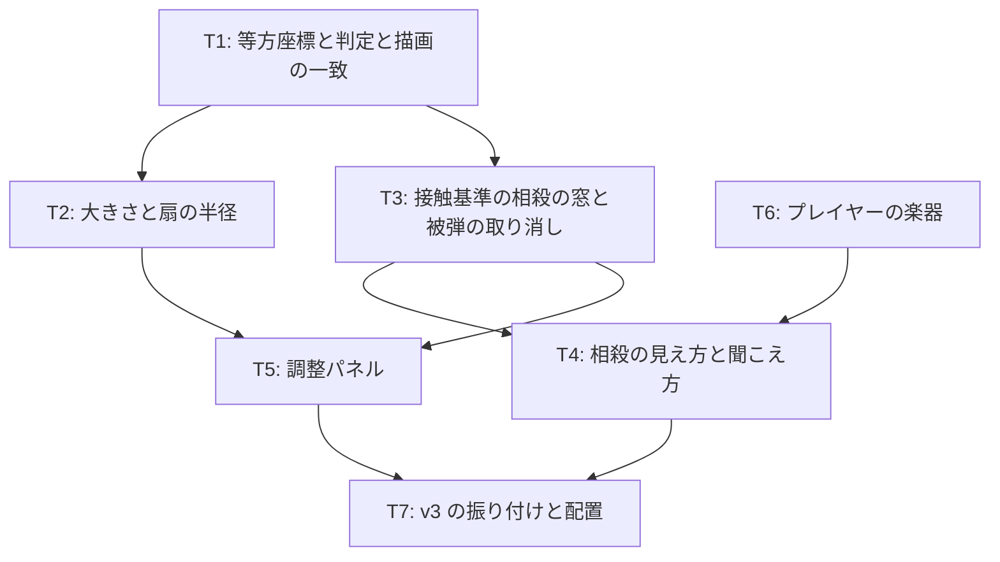

# v3 計画 Phase 1: 相殺を成立させる
作成 2026-10-28。承認済み 2026-10-29 (本人の返事で 5 点を修正。「本人の返事」節。目的・完了条件・入れないものへの異議は無かったので承認とみなした)。前提は docs/concept.md (保護対象。「曲と音の役割」を含む)、docs/decisions/v2-feedback.md (不満の分解と確かめた事実)、docs/choreo-format.md、現在のコード (src/core/sim.ts、vec.ts、choreo.ts、render/canvas.ts、audio/engine.ts)。

## 新しいセッションの始め方
docs/NEXT.md の「次の 1 手」に従う。Phase 2 (各タスクの詳細と既定値) は Claude が docs/plan/v3-phase2.md に書き、承認を待たずに実装に入る。タスクの接頭辞は docs/decisions/commit-labels.md の定義で、v3 のタスクは全て `[作品]`。

## 目的
v2 の問い (捌けるか・捌きたくなるか) に答えが出なかったのは、相殺が運でしか成立しないからだった (docs/decisions/v2-feedback.md F5: 被弾より先に相殺できる幅が dash 27 ms、laser 8 ms)。v3 は要素を足さず、相殺が「成立する」「成立したと分かる」「見えている形で判定される」ようにする。
1. 相殺の窓を自機との接触の瞬間の前後にし、遅い側は被弾を取り消す
2. 判定の幾何を画面と一致させる (等方座標。横長の扇と 16 度の向きのずれを消す)
3. 自機と敵を小さくし、扇の判定と描画を同じ大きさにする
4. 相殺できる攻撃が見分けられ、成立が絵と音で分かる。プレイヤーの音は曲と別の楽器 (concept.md「曲と音の役割」)
5. 値 (窓・大きさ・扇・許容角) は本人がタイトル画面の調整パネルで探す。選んだ値は次の版の既定値に反映し、パネルは残す

## 本人の返事 (2026-10-29)
| # | 2026-10-28 の案 | 返事 | 反映 |
|---|---|---|---|
| 1 | 理想の 1 フレーズの動作イメージを v3 の T0 に | v3 に含めない方がよい。1 フレーズでは短すぎるかも。下書きは Claude が出してよい | v3 から外し、別の作業にした (docs/NEXT.md)。範囲は 20 秒のシーン全体 (phrase 0〜8)。docs/play-image.md |
| 2 | 調整パネルは値が決まったら config に焼いて畳む | 焼き込まず、既定値に反映するだけにしてほしい | パネルは残す。選んだ値を次の版の既定値 (src/config.ts) にする。concept.md「入れないもの」に注記 |
| 3 | concept.md に 1 行足す | 情報は足してよいが 1 行では劣化しすぎ | 不満ノートの言葉を落とさず、concept.md に「曲と音の役割」の節として書いた (2026-10-29) |
| 4 | 「自機の 1.2 倍」のサイズは直径と読む | 問題なし | そのまま |
| 5 | タスクに [仕組み] / [作品] | [仕組み] は開発の流れそのもので、作品固有のものではない。意味が違う | 定義を直した (docs/decisions/commit-labels.md)。v3 のタスクは全て [作品] |

## 完了条件
- 幾何: 世界座標が等方 (幅 1 × 高さ 9/16) で、判定と描画が同じ値を使う。テスト: 画面上の斜め 45 度の入力で、斜め 45 度にいる敵への角度差が 0 / 自機から等距離の上下左右の点が判定でも等距離 / 扇・当たり・本体が画面上で円と扇に見える (Chrome で確認)
- 大きさ: 自機の半径 0.024、敵 0.03 (0.6 倍)。扇の半径は命中と相殺で共通の 1 値で、描画も同じ半径。見えない射程 (`rangeAssist`) が無い
- 相殺の窓: 自機との接触の瞬間を基準に、早い側と遅い側が別の値 (既定 前 100 ms・後 50 ms)。遅い側の押下は被弾を取り消す (HP が戻り、記録と要約に「取り消し」が残る)。dash の接触の基準は突進の終点の拍で、予告の輪もそこに収束する。sim のテスト: v3 の振り付けで初期位置に立ったまま、接触 −100 ms 〜 +50 ms のどの step に向きを合わせた押下を置いても dash と laser が相殺され、HP が減らない。窓の外 (−150 ms、+100 ms) では成立しない
- 見え方・聞こえ方: 相殺できる攻撃と不可の攻撃 (burst) の予告が色で区別できる。相殺の成立で、当たりの位置に閃光が出て、当たりの形が砕けた見た目で短く残る。音はプレイヤーの楽器で鳴る
- プレイヤーの楽器: 表・裏・外・相殺の 4 音が曲の 3 声 (矩形波・三角波・ノイズ) と別の系統の音色。音高の規則 (相殺 = 最も近いメロディ音 +12) は残す。本人が聴いて区別できるかは不満ノートで聞く
- 調整パネル: タイトル画面に折りたたみの「調整」があり、相殺の窓 (早い側・遅い側、ms)、自機と敵の大きさ (倍率)、扇の半径 (自機の直径に対する倍率)、向きの許容角 (度) を動かせる。値はブラウザに保存され、結果の要約の先頭行に出る。既定値に戻すボタンがある。パネルは v3 以降も残す
- 振り付け: `assets/choreo/v3.json` (v2 と同じ振り付け。dash の接触の基準など形式の変更があれば反映)。機械検査 (自機狙いを含む) が等方座標で通る。v2.json は外す (git 履歴に残る)
- 文書: docs/choreo-format.md に座標系と相殺の窓の新しい規則。README と不満ノートの v3 節 (書いてほしいこと: 相殺が成立する手応え / 選んだ調整値 (要約の先頭行) / 楽器の区別 / 捌きたくなるか)
- テストが通り、公開 URL で遊べる

## 入れないもの (v3)
- 相殺のメリット (敵の硬直、反撃の窓、回復)。相殺が成立してから、捌きたくなるかの不満で決める
- 曲の変更、曲側の楽器の追加、敵ごとの曲。曲は仮置き (concept.md「曲」) のまま
- キャラの絵、世界観、エフェクトの作り込み (concept.md「入れないもの」)。相殺の閃光と砕ける見た目は四角と線の範囲で
- 新しい攻撃の型、振り付けの変更 (v3 は v2 と同じ振り付け)
- 地面と空中
- 表の判定窓 (`onBeatWindowBeats`) の変更。相殺の窓と別物
- 難易度選択の UI (段階・モード)。調整パネルは連続値を探す道具で、難易度選択ではない (concept.md「入れないもの」の注記)
- 相殺の受付の音 (予告開始時の合図音)。「来ている」の合図は予告の色と拍で足りるかを先に見る
- 理想の動作イメージの文書 (docs/play-image.md)。v3 と独立に進める (docs/NEXT.md)

## タスク (詳細は Phase 2。Claude が書いてそのまま実装。全て [作品])

### T1 (等方座標と判定と描画の一致)
- 世界座標を幅 1 × 高さ 9/16 の等方にする。JSON の書き方 (0..1) を変えるか読み込み時に変換するかは Phase 2 で決める (推奨: 読み込み時に y を 9/16 倍し、書き方は変えない)
- 距離・角度・速度・画面端の処理・dodgeable の格子を等方座標で行う。描画は等方座標 × 画面幅で写す (縦も幅基準)
- 規律: 描画は判定の値をそのまま使う。判定に無い大きさを描かず、判定にある大きさを描き落とさない

### T2 (大きさと扇の半径)
- 自機 0.024、敵 0.03。扇の半径は 1 値 (`attackRadius`。既定 = 自機の直径 × 1.2 ≈ 0.06) で命中と相殺に共通、描画も同じ。`rangeAssist` は外し、寄せは扇の中で接触位置までにする (concept 初期案の補正は残る)
- burst の r (0.22)、dash の r (0.06)、laser の r (0.03) は等方化と自機の縮小に合わせて見直す (避けられる位置の検査が通る範囲で)。値は Phase 2

### T3 (接触基準の相殺の窓と被弾の取り消し)
- 押下ごとに、各攻撃について「今の自機の位置に当たりが最初に触れる拍」(接触拍) を active 区間の走査で求める。押下が [接触 − 早い側, 接触 + 遅い側] にあり向きが合えば成立。扇と当たりが今重なっている場合 (かすめる相殺) も今までどおり成立
- 遅い側で成立し、その攻撃で既に被弾していれば HP を戻し、記録に `damage-undone` を残す。要約の被弾は「被弾 n 回 (取り消し m 回)」
- dash の接触の基準は突進の終点の拍。予告の輪の収束もそこへ (hitBeat は音のアンカーのまま検査に使う)
- 窓の値は config (ms) と調整パネルから来る

### T4 (相殺の見え方と聞こえ方)
- 予告の色: 相殺できる攻撃と `uncancelable` を分ける (値は Phase 2)
- 成立の絵: 閃光を大きく長く (0.15 → 0.3 秒程度)、当たりの形を白で砕けた見た目 (線分なら途切れ、円なら欠け) で 0.3 秒ほど残す。四角と線の範囲で
- 成立の音は T6 の楽器で

### T5 (調整パネル)
- タイトル画面の折りたたみ。項目と範囲: 相殺の窓 早い側 0〜200 ms、遅い側 0〜200 ms / 自機と敵の大きさ 0.4〜1.0 倍 / 扇の半径 0.8〜2.0 (自機の直径に対する倍率) / 向きの許容角 30〜120 度
- 値は localStorage に保存。結果の要約の先頭行に出す (不満ノートに貼れば値が伝わる)。既定値に戻すボタン
- 本人が選んだ値は次の版の既定値 (src/config.ts) にする。パネルは残す
- sim は値を config のコピーとして受け取る (決定性のテストは既定値で)

### T6 (プレイヤーの楽器)
- 4 音を曲の 3 声と別の系統に。第一候補は減衰の速い撥弦 (短い遅延線のフィードバック)。次候補は FM の鐘。Phase 2 で measure.html と同じ要領でオフライン描画して波形を見比べ、1 つに決める
- 音高の規則は残す。表・裏・外の区別は音高と減衰の長さで
- 拠り所は concept.md「曲と音の役割」(敵の曲と区別できる別の楽器。アコギとエレキのような区別)

### T7 (v3 の振り付けと配置)
- v3.json (v2 と同じ振り付け、形式の変更を反映)。v2.json を外す。検査・テスト・README・assets/choreo/README.md・scripts の例を v3 に
- タイトルの h1 を v3。不満ノート (vault:音楽アクション/v3 不満.md を本人が作る想定。無ければ v2 不満.md の下に節を足す) に書いてほしいことを置く
- push して公開 URL で確認 (Chrome で Claude が確認。音は本人)。docs/plan/v3-phase1.md に完了記録

## 既定値 (Claude の決め。調整パネルで本人が動かし、選んだ値を次の既定値に反映)
| 項目 | 既定値 | 理由 |
|---|---|---|
| 相殺の窓 早い側 | 100 ms | 原本「判定緩め (+前 6 フレーム)」= 100 ms (docs/decisions/v2-feedback.md F10) |
| 相殺の窓 遅い側 | 50 ms | 原本は後 2〜4 フレーム (33〜67 ms)。本人が「遅い側も緩めてほしい」なので中間 |
| 自機・敵の大きさ | 0.6 倍 | 本人の値 |
| 扇の半径 | 自機の直径 × 1.2 | 本人の値 (直径と読んでよいと確認済み)。命中と相殺で共通 |
| 向きの許容角 | 60 度 (据え置き) | 等方化で 16 度の系統誤差が消えるので、まず据え置きで見る |

## 人間の作業
1. v3 を遊び、調整パネルで値を探して、選んだ値 (要約の先頭行) と相殺の手応えを不満ノートに書く
2. docs/play-image.md の下書きを直す (v3 と独立。急がない)

## 未決 (Phase 2 で決めた。docs/plan/v3-phase2.md「既定値の決め」)
- JSON の座標: 世界座標で書く (読み込み時の変換はしない。検査 `in-world` で古い書き方を弾く)
- 等方化後の r: dash 0.03 / laser 0.02 / burst 0.16
- 予告の色: 相殺できる攻撃は黄、uncancelable は赤。成立は 0.3 秒の閃光と白の破線
- 楽器: 撥弦 (前計算)。実装で decay と brightness の意味を変えた (commit 6637719 の本文)
- 接触拍の走査は 1/120 秒。かすめる相殺は残した

## 完了記録 (2026-10-29)
| 完了条件 | 結果 |
|---|---|
| 幾何: 等方座標、判定と描画が同じ値 | src/core/world.ts (幅 1 × 高さ 9/16)。テスト: 斜め 45 度の入力で角度差 0、世界の端、`in-world`。公開 URL のスクリーンショットで予告の輪が円に見える |
| 大きさ: 自機 0.024、敵 0.03、扇の半径 1 値、見えない射程なし | config の `makeConfig` (0.6 倍、自機の直径 × 1.2 = 0.0576)。`rangeAssist` は廃止、寄せは接触距離まで |
| 相殺の窓: 接触基準、前 100 ms・後 50 ms、遅い側は被弾を取り消す、dash の輪は終点に収束。sim のテスト | `contactBeat` / `cancelAnchorBeat`、`tryCancel` の書き直し。フィクスチャで −100〜+40 ms の全押下が成立 (sim.test.ts)。実物の v3.json と曲の拍グリッドで、laser 3 つと dash 2 つが接触 60 ms 前の押下で相殺され被弾しない、dash は 30 ms 後の押下で HP が戻る、向き違いと 150 ms 前は不成立 (sim-v3.test.ts) |
| 見え方・聞こえ方: 予告の色分け、閃光と砕ける絵、プレイヤーの楽器の音 | canvas.ts (黄 / 赤、0.3 秒の閃光、白の破線)。音は撥弦 |
| プレイヤーの楽器: 4 音が曲の 3 声と別の系統 | src/audio/pluck.ts (Karplus-Strong の前計算)。音高の規則は据え置き。本人が聴いて区別できるかは不満ノートで聞く |
| 調整パネル: 5 項目、保存、要約の先頭行、既定値に戻す、残す | src/ui/tuning.ts、title.ts。公開 URL で 5 本の range (0-200/10=100、0-200/10=50、0.4-1/0.05=0.6、0.8-2/0.1=1.2、30-120/5=60) を確認。要約の先頭行に「調整 窓 前100/後50 ms 大きさ 0.6 扇 1.2 許容 60°」が出た |
| 振り付け v3.json、検査が通る、v2.json は外す | v2 を y × 9/16 で写した。validate-choreo: 違反なし。choreo-assets.test は `['v3.json']` |
| 文書: choreo-format、README、不満ノートの v3 節 | docs/choreo-format.md「位置と座標」「相殺」、README「遊ぶ (v3)」、assets/choreo/README.md、vault:音楽アクション/v2 不満.md「v3 について」 |
| テストが通り、公開 URL で遊べる | `npm test` 121 件 + sim-v3 10 件 = 131 件 (14 ファイル)。`npm run build` 通過。Pages の配置成功、タイトルが v3 で 20 秒遊べて結果画面が出る |

注意: Chrome の自動操作タブでは描画が間引かれ (当たりの処理遅れ 平均 320 ms)、自動入力の押下が 0.3〜2 拍遅れて届いたので、公開 URL では時刻の検証はしていない (v2 と同じ)。時刻は sim-v3.test.ts で実物のデータに対して確かめた。手で遊んだときの手応えは本人の不満で確かめる。
