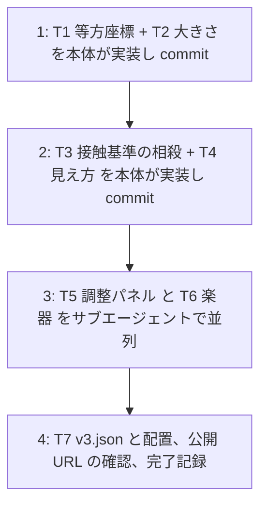

# v3 計画 Phase 2: 各タスクの詳細と既定値
作成 2026-10-29。Phase 1 (docs/plan/v3-phase1.md) は承認済み。この文書は Claude が書き、承認を待たずに実装する (CLAUDE.md「承認の扱い」)。前提のコード: src/core/sim.ts、vec.ts、choreo.ts、grid.ts、log.ts、summary.ts、render/canvas.ts、audio/engine.ts、ui/title.ts、main.ts、scripts/validate-choreo.ts、sync-report.ts。接頭辞は全て `[作品]` (docs/decisions/commit-labels.md)。

## 進め方

T1 が全てに効くので先に 1 人で通す。T5 (title.ts、main.ts、tuning) と T6 (engine.ts) は触るファイルが重ならないので並列。

## 既定値の決め (Phase 1 の未決)
| 項目 | 決め | 理由 |
|---|---|---|
| 座標の書き方 | JSON も config も等方座標で書く。世界 = 幅 1 × 高さ 9/16 (0.5625)。y の中央は 0.28125。読み込み時の変換はしない | 変換を挟むと「どこで変換したか」を全ての入口 (main、measure、scripts、テスト) で揃える必要があり、忘れると静かに壊れる。JSON を世界座標にすれば検査 `in-world` (x ∈ [0,1]、y ∈ [0,0.5625]) で古い書き方を機械的に弾ける。Phase 1 の推奨 (読み込み時変換) から変えた |
| 等方化後の当たりの r | dash 0.03 (= 敵の本体の半径)、laser 0.02 (太さの半分)、burst 0.16 | dash の当たりは本体なので敵の半径に合わせる。laser は自機 (直径 0.048) より細く。burst は旧 0.22 が画面上で横 0.44·w、縦 0.25·w だったので、その中間の円 (直径 0.32·w = 画面の高さの 57%) にする。避けられる位置の検査で確かめる |
| 大きさの持ち方 | `Tuning { sizeScale, fanRatio, cancelEarlyMs, cancelLateMs, cancelFacingDeg }` と `makeConfig(tuning)`。`config` = 既定の tuning で作った Config。自機 = 0.04 × sizeScale、敵 = 0.05 × sizeScale、扇の半径 `attackRadius` = 自機の直径 × fanRatio | 調整パネルの項目と config の値を 1 対 1 にし、本人が選んだ値をそのまま既定値に書ける |
| 寄せ (旧 rangeAssist) | 廃止。命中の条件は「敵の中心が扇 (半径 attackRadius、角度 attackFanDeg) の中」。扇の中なら、自機を敵との接触距離 (自機 + 敵の半径) まで寄せる | 見えない射程を無くす。concept 初期案の「射程内なら当たるように少し補正」は接触までの寄せとして残る |
| 相殺の窓の基準 | 押した瞬間の自機の位置に、その攻撃の当たりが最初に触れる拍 (接触拍 c)。active 区間を 1/120 秒刻みで走査して求める。押下 b が [c − 早い側, c + 遅い側] なら時刻は合っている | 「当たりの瞬間」を自機から見た接触で定義する。dash は本体が届く瞬間、laser と burst は窓の始まり |
| かすめる相殺 | 残す。押した瞬間に当たりの形が扇と重なっていれば、接触しない位置からでも相殺できる (今の規則) | 自機に当たらない dash を横から叩く遊びを消さない |
| 向きの判定の時刻 | 時刻が合った相殺は接触拍 c での来る方向、かすめる相殺は押下時刻での来る方向 | dash の出発前 (b < 窓の始まり) は速度が無く、来る方向が定まらないため |
| 被弾の取り消し | 遅い側で成立し、その攻撃で既に被弾していて、被弾の時刻が b − 遅い側 以降なら HP を 1 戻し `damage-undone` を記録。被弾の記録は消さない | 記録は事実のまま、結果だけ戻す。要約は「被弾 n 回 (取り消し m 回)」 |
| dash の予告の輪 | 突進の終点の拍 (hitBeat より後の最初のキーフレーム) に収束させる。hitBeat は音のアンカーのまま | 輪が示す瞬間 = 相殺の瞬間にする。v2 では出発の拍に収束していて、相殺の 0.46 拍前を示していた (docs/decisions/v2-feedback.md F7) |
| 予告の色 | 相殺できる攻撃 = 今の黄 (telegraph)、`uncancelable` = 赤 (rgba(255, 90, 70)) | 「赤 = 避けるしかない」はアクションゲームの慣用。既存の色を動かすのは 1 つだけ |
| 相殺の成立の絵 | 閃光 0.15 → 0.3 秒、半径を敵の 1.5 倍から縮める。消した当たりの形を白の破線で 0.3 秒残して薄くする (円は破線の輪、線分は破線) | 四角と線の範囲 (concept「入れないもの」) で「砕けた」を出す |
| 楽器 | 撥弦 (Karplus-Strong) を JS で AudioBuffer に前計算する。周期ぶんの決め打ちノイズを種に、y[n] = 0.5 (y[n−P] + y[n−P−1]) × 減衰。音高と長さごとにキャッシュ | DelayNode の帰還は 1 量子 (128 サンプル) の最小遅延があり 375 Hz 以上が出ない。前計算なら OfflineAudioContext でも同じ波形で、measure.html で確かめられる。FM は次候補 |
| 4 音 | 表 = 880 Hz 0.25 秒、裏 = 440 Hz 0.3 秒、外 = 110 Hz 0.35 秒 (減衰を強く)、相殺 = 最も近いメロディ音 +12 を 0.5 秒 (明るく長く) | 音高の規則は v2 のまま。音色だけ曲の 3 声 (矩形・三角・ノイズ) と別の系統に |
| 調整パネルの保存 | localStorage キー `mal.tuning`。無ければ既定値。結果の要約の先頭行に「調整 窓 前100/後50 ms 大きさ 0.6 扇 1.2 許容 60°」を足す | 不満ノートに貼れば値が伝わる |

## T1 (等方座標と判定と描画の一致)
- `src/core/world.ts`: `WORLD = { w: 1, h: 9 / 16 }` と `inWorld(p)`。位置の単位は「画面の幅」
- `src/core/choreo.ts`: `exitDistance` の y の端を `WORLD.h` に。`resolveAttack` の y の clamp を `[enemyRadius, WORLD.h − enemyRadius]` に。`gridPoints` を 16 × 9 (同じ密度) に。検査 `in-world`: path の全点と target が世界の中 (違反は `Violation` に rule `in-world`)
- `src/core/sim.ts`: `movePlayer` の y の clamp を `WORLD.h − playerRadius` に
- `src/config.ts`: `enemyRestPos`、`playerStartPos` の y を 0.28125 に
- `src/render/canvas.ts`: `px(v) = (ox + v.x·w, oy + v.y·w)`。扇は `ctx.scale` を使わずピクセル空間で角度そのまま描く (等方なのでずれない)。扇の半径は `attackRadius` (判定と同じ)
- テスト: 斜め 45 度の入力で斜め 45 度の敵への角度差が 0 (`angleBetweenDeg(aim, toEnemy)` が 0) / 上下左右の等距離の点が `dist` で等距離 (等方なので自明だが、回帰の見張りとして) / `in-world` の違反例 (y 0.9) / 既存テストの y が 0.5625 を超えるものを直す
- `docs/choreo-format.md`: 座標の節を書き直す (世界 = 幅 1 × 高さ 0.5625、y の中央 0.28125、`in-world` 検査)

## T2 (大きさと扇の半径)
- `src/config.ts`: `Tuning`、`defaultTuning`、`makeConfig(tuning)`、`config = makeConfig()`。`Config` は interface。`playerRadius`、`enemyRadius`、`attackRadius`、`cancelEarlyMs`、`cancelLateMs`、`cancelFacingDeg` は tuning から。`meleeRange`、`rangeAssist` は消す
- `src/core/sim.ts` `playerAttack`: 命中 = `inFan(player, aim, fanDeg/2, attackRadius, enemy)`。扇の中なら接触距離まで寄せる。相殺の扇も `attackRadius`
- テスト: 旧 `meleeRange` / `rangeAssist` を使うテストを `attackRadius` に。寄せは接触距離まで

## T3 (接触基準の相殺の窓と被弾の取り消し)
- `src/core/choreo.ts`: `contactBeat(attack, playerPos, playerRadius, beatSec, cfg, motion): number | null` (active 区間を 1/120 秒刻みで走査し、`hitDistance ≤ r + playerRadius` になる最初の拍)。`cancelAnchorBeat(attack)` (dash = 突進の終点の拍、他 = impactBeat。予告の輪の収束に使う)
- `src/core/sim.ts` `tryCancel`:
  1. 対象: uncancelable でなく未相殺の攻撃
  2. `c = contactBeat(...)`。`timingOk = c !== null && b ∈ [c − early, c + late]` (ms → 拍は `/ (beatSec × 1000)`)
  3. `nowOk = hitboxAt(b) が形を返し、扇と重なる` (かすめる相殺)
  4. どちらも偽: 近い押下 (telegraphBeat ≤ b ≤ 窓の終わり + 0.25) なら `cancel-miss` を記録。理由は `c !== null` なら `timing`、そうでなければ `reach`
  5. 向き: `incomingDir` を `timingOk ? c : b` の時刻で取り、`aim` と来る方向の逆の角度差 ≤ cancelFacingDeg / 2。外れたら `angle`
  6. 成立: `cancelled.add`、`lastCancel = { attackIndex, pos, hitbox }` (pos は接触点か今の当たりの最寄り点。hitbox は砕ける絵のため、c の時点か今の形)。`damagedBy` にあり、その被弾の時刻が b − late 以降なら `player.hp += 1` (上限 playerHp)、`damage-undone` を記録
- `src/core/log.ts`: `EventKind` に `damage-undone`。要約: 「被弾 n 回 (取り消し m 回)」、被弾の一覧で取り消したものに「(取り消し)」。`summary.ts` の phrase 表: 被弾列は「被弾」「取り消し」「-」
- `src/render/canvas.ts` `drawTelegraph`: 輪の収束を `cancelAnchorBeat` に。予告の終わりも同じ
- テスト (v3 の値で): dash に立ったまま、c − 100 ms 〜 c + 50 ms の各 step (10 ms 刻み) に右向きの押下を置くと全て相殺され HP が減らない。c + 50 ms より後は被弾のまま、c − 150 ms は `timing` / laser も同じ / 被弾の後の遅い側の押下で HP が戻り `damage-undone` が記録される / かすめる相殺 (接触しない位置、当たりが扇に重なる) が残っている / 決定性

## T4 (相殺の見え方と聞こえ方)
- `src/render/canvas.ts`: 予告の色を `uncancelable` で分ける。閃光 0.3 秒、半径 敵 × 1.5 → 0.5。`FlashState.cancel` に `hitbox` を持ち、白の破線で形を残す (α は残り時間に比例)
- `src/main.ts`: `flash.cancel` に hitbox を渡す。`CANCEL_FLASH_SEC` 0.3
- 音は T6

## T5 (調整パネル) [サブエージェント]
- `src/config.ts` の `Tuning` を使う。`src/ui/tuning.ts`: `loadTuning()` / `saveTuning()` (localStorage `mal.tuning`、壊れていれば既定値)、`describeTuning(t)` (要約の 1 行)
- `src/ui/title.ts`: `
` 「調整」。5 本の range + 数値表示: 相殺の窓 早い側 0〜200 ms (刻み 10) / 遅い側 0〜200 ms / 大きさ 0.4〜1.0 (刻み 0.05) / 扇 0.8〜2.0 (刻み 0.1) / 許容角 30〜120 度 (刻み 5)。「既定値に戻す」。変更は即保存。`TitleOptions` に `tuning` と `onTuningChange`
- `src/main.ts`: 開始時に `makeConfig(loadTuning())` を `deps.cfg` に。要約の `extra` の先頭に `describeTuning`。`index.html` に `.tuning` の最小の CSS
- テスト: `tuning.ts` の読み書き (localStorage のモック)、`describeTuning` の文字列、`makeConfig` の値 (0.6 / 1.2 で 0.024 / 0.03 / 0.0576)

## T6 (プレイヤーの楽器) [サブエージェント]
- `src/audio/pluck.ts`: `renderPluck(sampleRate, hz, durSec, opts): Float32Array` (純粋関数。決め打ち LCG のノイズ。減衰係数と最後の正規化は opts)。テスト: 長さ、最大振幅 ≤ 1、同じ引数で同じ配列、周期 P に対応するピークが自己相関で出る
- `src/audio/engine.ts`: `scheduleSfx` の 4 音を `pluck()` (AudioBuffer をキャッシュ、BufferSource で鳴らす) に替える。曲の 3 声は変えない。`measure.html` が OfflineAudioContext で同じ合成器を使えること (engine のコンストラクタは変えない)
- 4 音の値は「既定値の決め」の表

## T7 (v3 の振り付けと配置)
- `assets/choreo/v3.json`: v2.json から y を 9/16 倍 (path、target)、r を dash 0.03 / laser 0.02 / burst 0.16、`id: "v3"`、intent を更新。v2.json を削除。`validate-choreo` で違反なし
- テスト `choreo-assets.test.ts`: `['v3.json']`
- `src/ui/title.ts` h1 を v3、`index.html` の title を v3
- README「遊ぶ (v3)」、assets/choreo/README.md、scripts のコメントの例、docs/choreo-format.md の相殺の節
- vault の不満ノート: `v2 不満.md` の末尾に「## v3 について」(本人が v3 不満.md を作るならそちらでよい旨と、書いてほしいこと 4 つ)
- push → 公開 URL を Chrome で確認 (タイトルに調整パネル、立ったまま dash を相殺して HP が減らない、扇が円に見える)。docs/plan/v3-phase1.md に完了記録。docs/NEXT.md

## テストの見積もり
既存 89 件 + T1 4 件 + T2 2 件 + T3 6 件 + T5 3 件 + T6 3 件 ≈ 107 件。`npm test` と `npm run build` が通ること。
