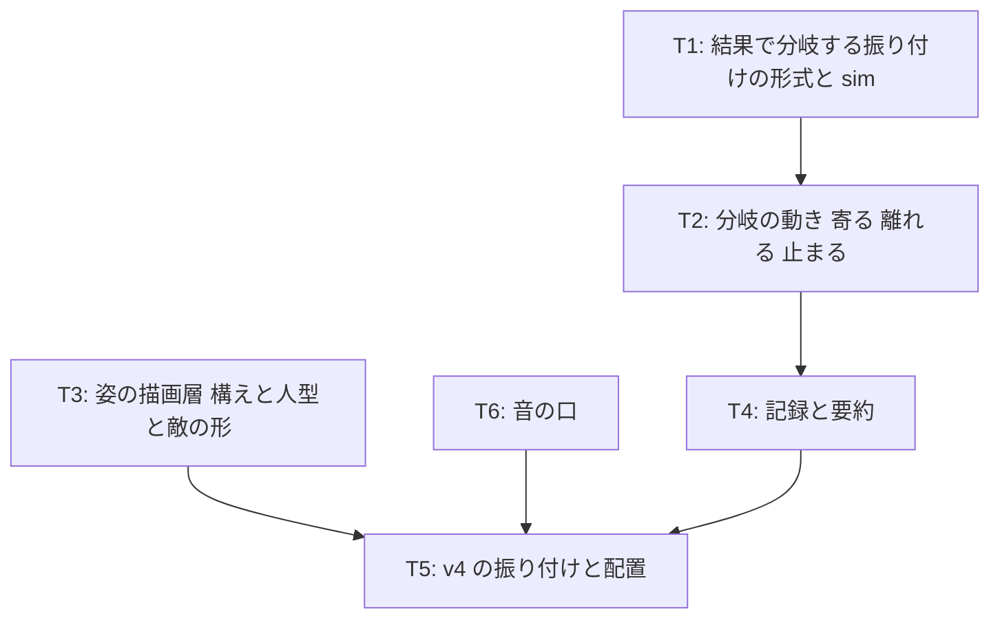

# v4 計画 Phase 1: 流れを作るための部品
作成 2026-10-30。承認済み 2026-10-30 (「承認に含めるもの」3 点も可。本人の補足: concept.md の「入れないもの」は書いた時点の判断で、いつまでも入れないものではない)。同日に本人の指摘で狙いを絞った: 「捌いた後に敵が近くにいればリターン」という案は浅く、一連の流れを作るのは次の計画に回し、v4 は機能 (部品) を作るだけにする。応えの音の規則も次かその次に回す。前提は docs/concept.md (保護対象)、docs/decisions/v3-feedback.md (不満の分解)、docs/play-image.md (理想の動作イメージの叩き台)、docs/choreo-format.md、現在のコード (src/core/sim.ts、choreo.ts、render/canvas.ts、audio/engine.ts、audio/pluck.ts)。

## 新しいセッションの始め方
docs/NEXT.md の「次の 1 手」に従う。Phase 2 (各タスクの詳細と既定値) は承認後に Claude が docs/plan/v4-phase2.md に書き、承認を待たずに実装に入る。接頭辞は全て `[作品]`。

## 目的
v3 で相殺は成立した。本人の不満は「捌いた後に何も続かない」「音楽に合わせて攻撃する意味が無い」「追いかけて殴るのが面白くない」に移った (docs/decisions/v3-feedback.md)。一連の流れ (捌いた後に何が続き、何がリターンで、音がどう曲に乗るか) をどう組むかはコンセプトの判断で、v5 で本人と言葉で決める。v4 は、どの流れを選んでも要る部品を作る。
1. 結果で分岐する振り付け: 攻撃ごとに「捌けた (相殺した、または当たらなかった) / 被弾した」で、敵の次の動きをデータで分けられる。動きの種類は「寄る」「離れる」「止まる」「通常どおり戻る」。意味づけ (何がリターンか) はしない
2. 姿の部品: 自機と敵を「構え」の列で描く描画層。自機は線と面で描く人型、敵は性格のある 1 つの形。構えは状態 (立つ・攻撃・相殺・被弾・止まっている など) から決まり、構えの絵は差し替えられる形にする
3. 音の口: プレイヤーの音を鳴らすときに音高・長さ・明るさを渡せる口を作る。規則は v3 のまま (表 880 Hz など)。応えの音の規則は v5 以降で 2〜3 案を聴き比べて本人が選ぶ
4. 記録: 攻撃ごとの結果 (捌けた / 被弾) と分岐の実行を記録と要約に残す
5. エンジンはブラウザのまま (下の「エンジンの判断」)

## 承認に含めるもの (concept.md と進め方に触れる 3 点)
1. 姿を入れる。concept.md「最初の実験に入れないもの」の「世界観・キャラデザ」のうち、キャラの姿だけを「線と面で描く最低限の姿」として入れる。世界観 (背景・設定・ステージの雰囲気) と画像ファイルは入れないまま。承認されたら concept.md の「入れないもの」に注記を書く
2. 流れの設計は v5 で本人が決める。Claude は docs/play-image.md を叩き台に、流れの案を 2〜3 つ「言葉で」出し (実装しない)、本人が選ぶか直す。応えの音も同じ扱い (案を聴き比べる形にしてから決める。音楽の良し悪しは Claude が判定しない)
3. エンジンの判断 (下)。Unity に移すなら v4 の前に決める必要があるので、ここで一度決める

## エンジンの判断 (Claude の読み。本人が決める)
- 今の不満 (姿、捌いた後の続き、音が曲に乗る) はどれも Canvas 2D と Web Audio で届く範囲。人型の構えは線と面で描けるし、音高は pluck.ts に値を渡すだけ
- Unity (や Godot) に移すと、「Claude がコードを書き、テストを回し、push すると公開 URL が更新され、Chrome で確かめ、本人がスマホの vault に不満を書く」という今の回し方が止まる。Unity はエディタでのビルドが要り、Claude が無人で確かめる手段が細い。回し方を作り直す間 (数週間) 作品が止まる。これは docs/system-design.md「自律システムを作ること自体が大プロジェクトになる危険」そのもの
- 移す条件を先に決めておく: (a) 3D か物理が要る、(b) 家庭用機や Steam への配置が要る、(c) DualSense のハプティクスやアダプティブトリガーが要る (concept.md「範囲」で既に予告されている)、(d) 絵の資産 (スプライト・アニメーション) を本人か外部が作る段になった。どれかが来たら移す。そのときは Godot も候補 (2D に強く、コマンドラインで無人ビルドできる)
- 推奨: v4 はブラウザのまま。「人型にしたら Unity」ではなく「絵の資産を作る段になったら移す」

## 完了条件
- 分岐: 振り付けの攻撃ごとに、結果 (捌けた / 被弾) 別の次の動きをデータで書ける (項目名は Phase 2)。動きの種類は 寄る (自機の正面の間合いへ)・離れる (休憩位置へ)・止まる (その場で n 拍)・通常。省略時は通常。検査: 分岐先の動きが次の攻撃の予告開始と重ならない。sim のテスト: v4 の振り付けで dash を相殺すると敵が自機の近くで 2 拍止まり、被弾すると今までどおり戻る
- 姿: 自機は人型 (頭・胴・腕・脚を線と面で)。立つ (拍で揺れる)・攻撃 (振る)・相殺 (受ける)・被弾 (のけぞる)・止まっている敵に向く (構える)、の 5 つが見分けられる。敵は 1 つの形で、laser・burst・dash の構えと「止まっている」姿が見分けられる。四角の描画は消える。構えは `pose` の名前で選ばれ、絵の関数を差し替えれば別の姿にできる。Chrome のスクリーンショットで 5 + 4 の構えを確認
- 音の口: プレイヤーの音は `{ 音高, 長さ, 明るさ, 音量 }` で鳴らせる。既定の 4 音は v3 と同じ値 (テスト: 既定が v3 の spec と一致)。規則は変えない
- 記録: 攻撃ごとの結果 (捌けた / 被弾) と、実行した分岐を log に残し、要約に「捌けた n / 被弾 m」と phrase 表の「結果」列を出す
- 振り付け `assets/choreo/v4.json`: v3 と同じ動きに、分岐を 1 箇所だけ試しに付ける (dash を相殺したら 2 拍止まる)。他は通常。v3.json は外す。機械検査が通る
- 文書: docs/choreo-format.md (分岐の項)、README「遊ぶ (v4)」、assets/choreo/README.md、不満ノートの v4 節 (書いてほしいこと: 姿は見分けられるか / dash の後に敵が止まる手応え / 流れの設計に向けて思うこと)。concept.md の注記 (承認に含めるもの 1)
- テストが通り、公開 URL で遊べる。調整パネルは残す (項目は増やさない)

## 入れないもの (v4)
- 一連の流れの設計 (何がリターンか、追いかけを無くすか、窓の意味づけ)。v5 で本人が決める
- 応えの音の規則 (音高を曲に乗せる規則)。口だけ作り、規則は v3 のまま
- 移動を拍に乗せる
- 世界観、背景、画像ファイル (スプライト)
- 曲の変更、和音進行、作曲
- ダメージ量・強化状態・回復
- 敵の新しい攻撃の型、振り付けの動きの変更 (分岐の試し 1 箇所を除く)
- Unity などへの移行
- 20 秒の終わり方、HP の意味
- 地面と空中

## タスク (詳細は Phase 2。全て [作品])

### T1 (結果で分岐する振り付けの形式と sim)
- 攻撃に結果別の次の動きを書く項目を足す。sim は攻撃の当たりの窓が終わった時点で結果 (捌けた / 被弾) を確定し、分岐を選ぶ
- 検査: 分岐の動きが次の攻撃の予告開始までに終わる

### T2 (分岐の動き)
- 寄る: 0.5 拍で自機の正面 (向いている側) の間合いへ snap。離れる: 休憩位置へ。止まる: その場で n 拍。通常: 今の補間
- 分岐の動きの間も拍の揺れ (idle) は乗せる (テンポ把握)

### T3 (姿の描画層)
- `pose` を状態から決める純粋関数 (自機: idle / attack / cancel / hit / ready。敵: idle / laser / burst / dash / stopped) と、pose ごとの絵の関数。自機は線と面の人型、敵は Phase 2 で形を決める。四角を消す
- 構えの切り替えは瞬間でよい (補間は入れない。不満が出たら)

### T4 (記録と要約)
- log: 攻撃ごとの `outcome` (handled / hit) と分岐の実行。要約の行と phrase 表の列

### T5 (v4 の振り付けと配置)
- v4.json (dash に「捌けたら 2 拍止まる」)、検査、テスト、README、不満ノート、concept.md の注記、公開 URL、完了記録

### T6 (音の口)
- `scheduleSfx(kind, atSec, spec?)` で音高・長さ・明るさ・音量を上書きできる。既定は v3 の値。テストで既定の一致を見る

## 既定値 (Claude の決め)
| 項目 | 既定値 | 理由 |
|---|---|---|
| 「止まる」の拍数 | 2 拍 | 試しに 1 箇所。流れの設計 (v5) で変える前提 |
| 「寄る」の間合い | 接触距離の 1.5 倍 | 扇 (1.6 倍 ≈ 0.077) の中に入り、重ならない |
| 構えの切り替え | 瞬間 | 補間は不満が出てから |

## 次の計画 (v5) の予告
流れの設計。Claude は docs/play-image.md を叩き台に、捌いた後の流れの案を 2〜3 つ言葉で出す (例: 捌く → 敵が止まる → 拍に乗せた連打 → 敵が離れて次の呼び / 捌く → 敵が寄る → 一撃で押し返す / 捌くほど曲に自分の音が増える)。本人が選ぶか直してから、v5 の Phase 1 を書く。応えの音は、選ばれた流れに合わせて 2〜3 案を聴き比べる形で用意する。

## 人間の作業
1. この Phase 1 の承認 (「承認に含めるもの」3 点の可否を添えて)
2. 音の出力遅延 280 ms について: 有線の音声機器で遊べるなら、要約の値が変わるか見てほしい (docs/decisions/v3-feedback.md F6)
3. v4 を遊んで不満ノートに書く。v5 に向けて、流れについて思うことがあれば一言

## 未決 (Phase 2 で決めた。docs/plan/v4-phase2.md「既定値の決め」)
- 敵の形: 目のある雫形。構えは体の伸び縮みと目の形で描き分け
- 「捌けた」: 相殺済み、または窓の終わり + 遅い側の相殺の窓 までに被弾していない (burst を避けたときも捌けた)
- 分岐の項目名: `after: { handled, hit }`、`Branch = { move, beats }`

## 完了記録 (2026-10-30)
| 完了条件 | 結果 |
|---|---|
| 分岐: データで書け、検査があり、sim で dash の相殺 → 止まる / 被弾 → 通常 | `Attack.after`、`applyBranch`、検査 `after-order` / `after-overlap`。フィクスチャと実物の v4.json の両方でテスト (相殺した dash は 19〜20 拍止まり、被弾した dash は止まらない)。「止まる」は Phase 1 の 2 拍でなく 1 拍 (次の予告が 20 拍のため) |
| 姿: 自機の人型 5 構え、敵の形と 4 構え、四角は消える、構えは名前で選ばれる | src/core/pose.ts (選択、テスト 4 件) と src/render/figures.ts (絵)。構えの一覧 (drawPoseSheet) と実際の画面を Chrome で確認: 人型 5 構えと敵 7 構えが見分けられる。四角は消えた |
| 音の口: 音高・長さ・明るさ・音量を渡せ、既定は v3 と同じ | `resolvePluckSpec` と `scheduleSfx` の override。テスト: 上書き無しは v3 の spec と一致 |
| 記録: 攻撃ごとの結果と分岐。要約の行と phrase 表の列 | `outcome` イベント。「捌けた n / 被弾 m (結果の出た攻撃、分岐した)」と「結果」列 (例「捌けた (止まる)」) |
| v4.json (v3 と同じ動きに分岐 1 箇所)、検査、v3.json を外す | dash (phrase 3、6) に after.handled = stop 1 拍。validate-choreo: 違反なし。choreo-assets.test は `['v4.json']` |
| 文書: choreo-format、README、assets/choreo/README、不満ノート、concept.md の注記 | 全て更新。vault:音楽アクション/v4 不満.md を作った。concept.md「入れないもの」に「書いた時点の判断」と姿の注記 |
| テストが通り、公開 URL で遊べる。調整パネルは残す | `npm test` 148 件 (15 ファイル)、`npm run build` 通過。公開 URL はタイトル v4 で確認 (下) |

注意: 自動操作タブでは描画が間引かれるので、構えの切り替わりの滑らかさや時刻は見ていない。手触りは本人の不満で。
