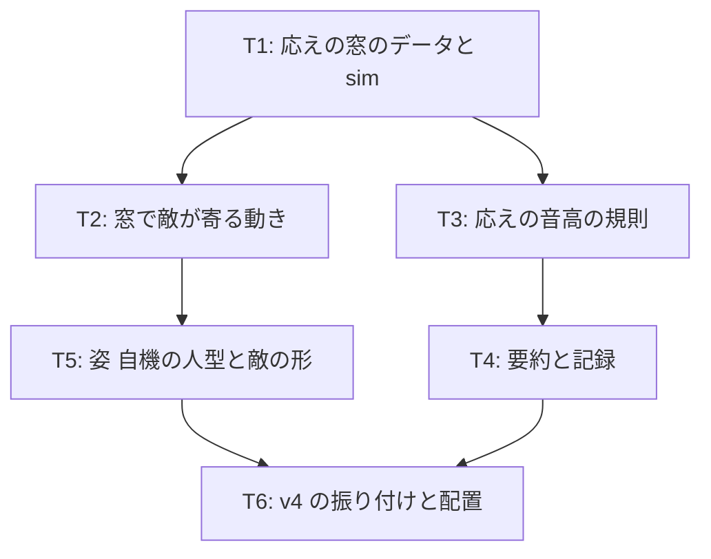

# v4 計画 Phase 1: 呼びと応え (捌いた後に続くもの)
作成 2026-10-30。承認待ち (本人に求めるのは「目的」「完了条件」「入れないもの」と、下の「承認に含めるもの」4 点)。前提は docs/concept.md (保護対象)、docs/decisions/v3-feedback.md (不満の分解)、docs/play-image.md (理想の動作イメージの叩き台)、docs/choreo-format.md、現在のコード (src/core/sim.ts、choreo.ts、render/canvas.ts、audio/engine.ts、audio/pluck.ts)。

## 新しいセッションの始め方
docs/NEXT.md の「次の 1 手」に従う。Phase 2 (各タスクの詳細と既定値) は承認後に Claude が docs/plan/v4-phase2.md に書き、承認を待たずに実装に入る。接頭辞は全て `[作品]`。

## 目的
v3 で相殺は成立した。本人の不満は「相殺が何も生きていない」「音楽に合わせて攻撃する意味が無い」「追いかけて殴るのが面白くない」「捌いても何も続かない」に移った (docs/decisions/v3-feedback.md)。v4 は、捌いた後に続くものを作る。
1. 応えの窓: 敵のフレーズ (呼び) を捌いたら、その直後に敵が自機の間合いまで寄ってきて、短い窓の間とどまる。窓の間は追いかけなくても攻撃が届く。被弾したら窓は開かない
2. 応えの音: 窓の間の攻撃は、曲の調 (F マイナー) の 5 音から拍の位置と押した順で選んだ音高で鳴り、押すほど上がる短いフレーズになる。拍から外れた押下は鈍い音。これで「適切に動けているならプレイヤーの音が敵の曲に相乗りする」を 1 曲ぶん試す。作曲はしない
3. 姿: 自機を線で描く人型にし、立つ・攻撃・相殺・被弾・応えの構えを分ける。敵を性格のある 1 つの形にし、攻撃の型ごとに構えを分ける。画像ファイルは使わない
4. エンジンはブラウザのまま (下の「エンジンの判断」)

## 承認に含めるもの (concept.md と範囲に触れる 4 点)
1. 姿を入れる。concept.md「最初の実験に入れないもの」の「世界観・キャラデザ」のうち、キャラの姿だけを「線と面で描く最低限の姿」として入れる。世界観 (背景・設定・ステージの雰囲気) は入れないまま。承認されたら concept.md の「入れないもの」に注記を書く
2. 追いかけを無くす方向。応えの窓で敵が寄ってくるので、自分から歩いて殴りに行く場面は無くなる (歩いて行っても構わないが、設計の主役ではない)。v0 の不満「追いかけて攻撃するのは捌く感じが無い」と同じ向き
3. 応えの音の方式。音高は曲の調の 5 音 (F A♭ B♭ C E♭) から選ぶ。拍の表 = 根音か 5 度、裏 = 3 度か 7 度、窓の中で押すごとに 1 段上がる。曲側の和音進行は candidate-2 に無い (ベースは F と A♭ の 2 音) ので、小節ごとに根音を F か A♭ に切り替える。これは「音楽の知識が無い」本人の代わりに Claude が置く最小の規則で、聴いて違和感があれば不満で直す
4. エンジンの判断 (下)。Unity に移すなら v4 の前に決める必要があるので、ここで一度決める

## エンジンの判断 (Claude の読み。本人が決める)
- 今の不満 (姿、応えの窓、音高) はどれも Canvas 2D と Web Audio で届く範囲。人型の構えは線と面で描けるし、音高の選択は pluck.ts に音高を渡すだけ
- Unity (や Godot) に移すと、「Claude がコードを書き、テストを回し、push すると公開 URL が更新され、Chrome で確かめ、本人がスマホの vault に不満を書く」という今の回し方が止まる。Unity はエディタでのビルドが要り、Claude が無人で確かめる手段が細い。回し方を作り直す間 (数週間) 作品が止まる。これは docs/system-design.md「自律システムを作ること自体が大プロジェクトになる危険」そのもの
- 移す条件を先に決めておく: (a) 3D か物理が要る、(b) 家庭用機や Steam への配置が要る、(c) DualSense のハプティクスやアダプティブトリガーが要る (concept.md「範囲」で既に予告されている)、(d) 絵の資産 (スプライト・アニメーション) を本人か外部が作る段になった。どれかが来たら移す。そのときは Godot も候補 (2D に強く、コマンドラインで無人ビルドできる)
- 推奨: v4 はブラウザのまま。姿は線と面で描く。「人型にしたら Unity」ではなく「絵の資産を作る段になったら移す」

## 完了条件
- 応えの窓: 振り付けの攻撃ごとに窓 (開始拍・長さ) がデータで書け、既定は「当たりの終わりから次の予告の開始まで (上限 4 拍)」。捌けた攻撃 (相殺した、または当たらなかった) の窓では、敵が自機の正面の間合い (接触距離) まで寄って窓の終わりまでとどまり、窓の間の攻撃は寄らずに届く。被弾した攻撃の窓は開かず、敵は今までどおり戻る。sim のテスト: v4 の振り付けで、dash を相殺した後の窓で 3 回押すと 3 回命中し、被弾した後は同じ押下で命中しない
- 応えの音: 窓の間の攻撃 (命中・空振りとも) は音階の音で鳴り、窓の中で押すごとに 1 段上がる。拍から外れた押下 (表でも裏でもない) は鈍い音。窓の外の攻撃は今までの 3 音のまま。テスト: 音高の選択が純粋関数で、表 → 根音か 5 度、裏 → 3 度か 7 度、順に上がる、外は鈍い音、小節ごとの根音の切り替え
- 姿: 自機は人型 (頭・胴・腕・脚を線と面で)。立つ (拍で揺れる)・攻撃 (振る)・相殺 (受ける)・被弾 (のけぞる)・応え (踏み込む) の 5 つの構えが見分けられる。敵は 1 つの性格のある形で、laser・burst・dash の構えと、窓で寄ってきたときの「開いた」姿が見分けられる。四角の描画は消える。Chrome のスクリーンショットで 5 + 4 の構えを確認
- 捌けなくても遊べる: 窓が一度も開かなくても 20 秒は終わり、結果画面が出る。全部捌くと敵の HP を削り切れる (窓の数 × 窓の拍数で届く設計。enemyHp を見直してよい)
- 結果の要約に「窓 n 回 (開いた m 回)、窓の中の攻撃 k 回 (音階に乗った j 回)」が出る
- 振り付け `assets/choreo/v4.json` (v3 と同じ振り付けに窓の属性を付ける)。機械検査が通る (窓が次の予告と重ならない検査を足す)。v3.json は外す
- 文書: docs/choreo-format.md (窓の項、応えの音の規則)、README「遊ぶ (v4)」、assets/choreo/README.md、不満ノートの v4 節 (書いてほしいこと: 応えの窓は続きになったか / 自分の音は曲に乗ったか / 姿は見分けられるか / 追いかけが無くなって物足りないか)。concept.md の注記 (承認に含めるもの 1)
- テストが通り、公開 URL で遊べる。調整パネルは残す (項目は増やさない)

## 入れないもの (v4)
- 移動を拍に乗せる (ステップ、踏み込みの入力)。移動は自由のまま
- 世界観、背景、ステージの雰囲気、画像ファイル (スプライト)
- 曲の変更、和音進行の追加、作曲。音高の規則は今の曲の調から置くだけ
- ダメージ量・強化状態・回復などのリターン (本人の要望はアクション性)
- 敵の新しい攻撃の型、振り付けの動きの変更 (v4 は v3 と同じ動きに窓を付ける)
- Unity などへの移行
- 20 秒の終わり方、HP の意味の変更 (enemyHp の値の調整だけ可)
- 地面と空中

## タスク (詳細は Phase 2。全て [作品])

### T1 (応えの窓のデータと sim)
- `Attack.opening?: { startBeat, beats }` (省略時は当たりの終わりから次の予告まで、上限 4 拍)。sim は攻撃ごとに「捌けたか」(相殺した、または窓の始まりまでに被弾していない) を判定し、捌けていれば窓を開く。窓の間は敵への命中条件を「距離を見ない (扇の向きだけ)」にするのではなく、T2 で敵が間合いに来ることで届かせる (判定は変えない)
- 検査: 窓が次の攻撃の予告開始と重ならない

### T2 (窓で敵が寄る動き)
- 窓が開いたら、敵は 0.5 拍で自機の正面 (向いている側。無ければ敵のいる側) の接触距離まで snap で寄り、窓の終わりまでとどまる (自機が動けば追従はしない。寄った位置に居る)。窓が閉じたら次の攻撃の始点へ補間で移る
- 「開いた」状態を描画に渡す

### T3 (応えの音高の規則)
- 純粋関数 `answerPitch(beat, pressIndexInOpening, cls)`: 調の 5 音 (F マイナーペンタトニック)、小節の根音 (F / A♭)、表 → 根音・5 度、裏 → 3 度・7 度、押すごとに 1 段上がる、外は鈍い音。pluck.ts に音高と明るさを渡す
- 窓の外の攻撃音は v3 のまま

### T4 (要約と記録)
- log に `opening-open` / `opening-close`、attack に `inOpening` と `pitch`。要約に窓の行

### T5 (姿: 自機の人型と敵の形)
- 自機: 線と面の人型。構え 5 つ。拍で小さく揺れる (原本「テンポ把握」の自キャラ側。docs/play-image.md 6 節 4 の答えが無ければ上下で)
- 敵: 1 つの形 (Phase 2 で決める。例: 吊り鐘のような形で、拍で膨らむ)。laser は細く伸びる、burst は持ち上がる、dash は前傾、開いたときは口を開ける、など型ごとの構え
- 四角は消す。HP バーはそのまま

### T6 (v4 の振り付けと配置)
- v4.json、検査、テスト、README、不満ノート、concept.md の注記、公開 URL の確認、完了記録

## 既定値 (Claude の決め)
| 項目 | 既定値 | 理由 |
|---|---|---|
| 窓の長さの上限 | 4 拍 | 休みの小節 1 つぶん。次の予告と重ねない |
| 敵が寄る時間 | 0.5 拍 (snap) | 攻撃の動きと同じ速さの感覚 |
| 間合い | 接触距離 (自機 + 敵の半径) の 1.5 倍 | 扇 (1.6 倍 ≈ 0.077) の中に入り、重ならない |
| 音階 | F A♭ B♭ C E♭ (F マイナーペンタトニック) | candidate-2 は F マイナー。5 音なら外れにくい |
| 窓の中の押下の音域 | 1 オクターブ (5 音 + 次の根音)。上がり切ったら留まる | 短いフレーズに収める |

## 人間の作業
1. この Phase 1 の承認 (「承認に含めるもの」4 点の可否を添えて)
2. 音の出力遅延 280 ms について: 有線の音声機器で遊べるなら、要約の値が変わるか見てほしい (docs/decisions/v3-feedback.md F6)
3. v4 を遊んで不満ノートに書く

## 未決 (Phase 2 で Claude が決めて記録)
- 敵の形と構えの具体
- 窓の中で自機が動いたときの扱い (敵は追従しない、で始める)
- 「捌けた」の定義の細部 (burst を避けたときも窓を開くか。開く、で始める)
- enemyHp の値 (窓の数 × 窓の中で押せる回数から逆算)
