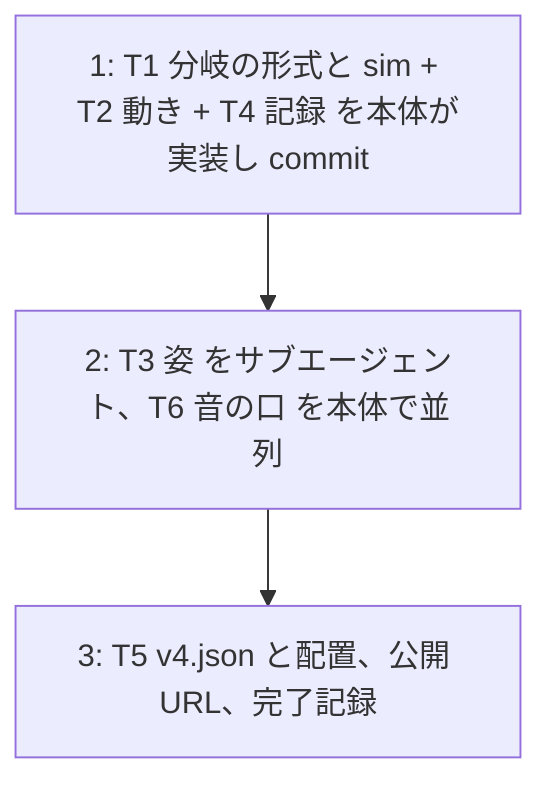

# v4 計画 Phase 2: 各タスクの詳細と既定値
作成 2026-10-30。Phase 1 (docs/plan/v4-phase1.md) は承認済み。この文書は Claude が書き、承認を待たずに実装する。前提のコード: src/core/sim.ts、choreo.ts、log.ts、summary.ts、render/canvas.ts、audio/engine.ts、audio/pluck.ts、ui/title.ts。接頭辞は全て `[作品]`。

## 進め方

T3 (描画) は core の「構え」の選択関数を先に本体が作って commit し、その名前に対して絵を描く形で切り出す。

## 既定値の決め
| 項目 | 決め | 理由 |
|---|---|---|
| 分岐の項目名 | `after: { handled?: Branch, hit?: Branch }`、`Branch = { move: 'normal' | 'stop' | 'approach' | 'retreat', beats?: number }` | 「捌けた」= handled、「被弾」= hit。省略は normal |
| 結果の確定 | 当たりの窓の終わり (activeWindow.endBeat)。相殺済み、または被弾していなければ handled | burst (相殺不可) は避ければ handled |
| 分岐の開始 | 攻撃の path の最後のキーフレームの拍 (振り付けの動きが終わった所)。窓の終わりより前なら検査 `after-order` で弾く | dash は通り過ぎた所 (19 拍) で止まる。自機の上に重ならない |
| 分岐の動き | stop: 最後の点に beats (既定 1) とどまる。approach: 0.5 拍で自機の正面 (自機が向いている側。無ければ敵のいる側) の間合い (接触距離 × 1.5) へ snap し、beats の終わりまでとどまる。retreat: 0.5 拍で休憩位置へ、同様。normal: 変えない | 動きは path のキーフレームを足す形で表し、sim の他の部分 (enemyPosAt、hitboxAt、描画) は変えない |
| 分岐の後 | 次の攻撃の始点へ今までの補間で移る。分岐の終わり (開始 + beats) は次の攻撃の予告開始以前 (検査 `after-overlap`) | 動きが重ならない |
| 分岐の間の拍の揺れ | 乗せる (idle) | テンポ把握 |
| v4.json の試し | dash (phrase 3、6) に `after.handled = { move: 'stop', beats: 1 }`。2 拍にしないのは、dash の path が 19 で終わり次の予告が 20 なので 1 拍しか無いため (Phase 1 の「2 拍」から変更) | 1 箇所だけの試し。意味づけは v5 |
| 構えの選択 (core) | 敵: `enemyPose(choreo, state, beat)` → `idle / laser / burst / dash / stopped / approach / retreat`。攻撃の予告開始〜窓の終わりはその型、分岐の間は分岐の種類、他は idle。自機: `playerPose(state, flash)` → `hit / cancel / attack / ready / idle` の優先順 (ready = 敵が stopped か approach の間) | 描画は名前だけを見る。純粋関数でテストする |
| 姿の絵 (T3) | 自機: 頭 (円)・胴・両腕・両脚を線と面で。向きは敵の側。構えごとに腕と脚と傾きを変える。敵: 雫形の体に 2 つの目 (線)。idle は拍で膨らむ、laser は横に細長く目を細める、burst は持ち上がって膨らみ目を見開く、dash は進行方向へ前傾して伸びる、stopped はしぼんで目が「×」、approach / retreat は idle と同じ体で目だけ動きの向きを見る | 性格は目で出す。四角は消す。HP バー・予告・扇は今のまま |
| 音の口 | `scheduleSfx(kind, atSec, midi?, override?: Partial<PluckSpec>)`。override は pluckSpec の上に重ねる。キャッシュのキーに hz・dur・decay・brightness を含める | 規則は v3 のまま。v5 以降が音高を渡せる |
| 記録 | log に `outcome` (attackIndex、phrase、outcome: handled / hit、branch: move)。要約に「捌けた n / 被弾 m」の行、phrase 表に「結果」列 (捌けた / 被弾 / -) | 被弾列 (取り消しを含む) はそのまま残す |

## T1 (結果で分岐する振り付けの形式と sim) + T2 (分岐の動き) + T4 (記録)
- `choreo.ts`: `Branch`、`Attack.after`。`applyBranch(attack, branch, playerPos, facing, cfg, motion): Attack` (純粋関数。path の最後の点の後にキーフレームを足す)。`branchStartBeat(attack)` = path の最後の拍。検査 `after-order` (分岐の開始 ≥ 窓の終わり) と `after-overlap` (分岐の終わり ≤ 次の攻撃の予告開始)。`enemyPosAt` は分岐で足した区間に idle を乗せる (attack に `branchFromBeat` を持たせる)
- `sim.ts`: `outcome: Map<number, 'handled' | 'hit'>`。step ごとに、窓が終わった未確定の攻撃の結果を確定し log に `outcome` を残す。`beat ≥ branchStartBeat` になったら、結果に対応する branch (無ければ normal) を `applyBranch` で resolved に入れる (自機の位置と向き (lastAim か敵の側) はその瞬間のもの)
- `enemyPose` / `playerPose` を `src/core/pose.ts` に (純粋関数)
- `log.ts` / `summary.ts`: outcome の行と列
- テスト: applyBranch の 4 種の path / 検査 2 つ / sim: dash を相殺すると 19〜20 拍の間 敵が path の最後の点にとどまり、被弾すると 19 拍以降は次の始点へ補間で動く / burst を避けると handled / 要約の行 / pose の選択

## T3 (姿) [サブエージェント]
- `src/render/figures.ts`: `drawPlayer(ctx, p, r, pose, facing, beatPulse)`、`drawEnemy(ctx, p, r, pose, dir, beatPulse)`。線と面だけ。色は今の player / enemy の色
- `canvas.ts`: 四角の描画を figures に置き換える。pose は core の関数から取る。他 (予告、扇、閃光、HP) は変えない
- 確認は Chrome のスクリーンショット (本体が行う)

## T6 (音の口)
- `pluck.ts` に `PluckSpec` の上書き、`engine.ts` の `scheduleSfx` に override。テスト: override 無しは v3 の spec と一致、override 有りはその値

## T5 (v4 の振り付けと配置)
- v4.json、v3.json を外す、choreo-assets.test、README、assets/choreo/README.md、docs/choreo-format.md (分岐の項、構えの項)、不満ノートの v4 節、タイトル h1 と index.html の title を v4、公開 URL の確認、docs/plan/v4-phase1.md の完了記録、NEXT.md
