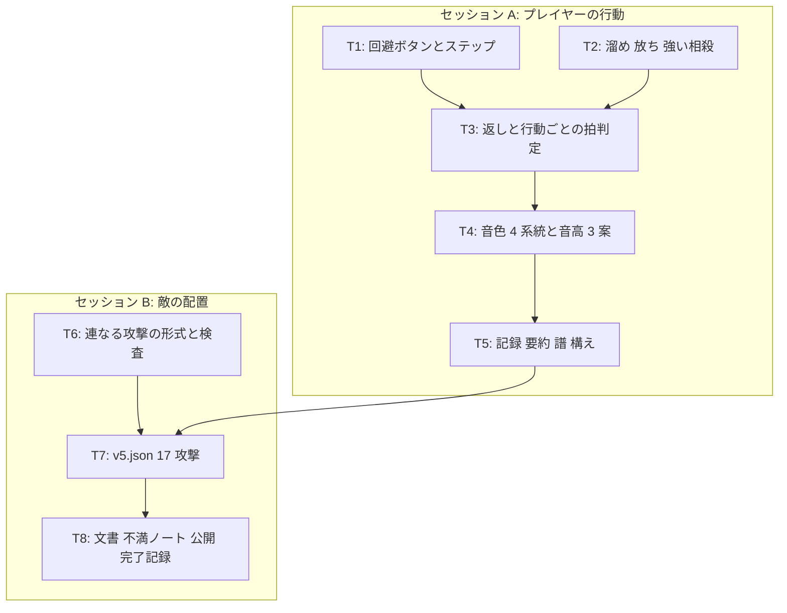

# v5 計画 Phase 1: 行動に拍の長さを持たせる (相乗りのメロディ)
作成 2026-11-02。承認待ち。同日に本人の返事で 3 点を直した: 攻撃ボタンを R1 に (○ で回避しながら溜めを持てるように)、返しはスティックが入力されていれば踏み込みあり、被弾で溜めは解除。前提は docs/concept.md (保護対象)、docs/decisions/v4-feedback.md (不満の分解)、docs/plan/v5-flow-options.md (案 A〜D と本人の返事 2 回)、docs/play-image.md、docs/choreo-format.md、現在のコード (src/core/sim.ts、choreo.ts、grid.ts、audio/engine.ts、audio/pluck.ts、input/、render/figures.ts、ui/title.ts)。

## 新しいセッションの始め方
docs/NEXT.md の「次の 1 手」に従う。Phase 2 は承認後に Claude が 2 つに分けて書き (下の「タスク」)、承認を待たずに実装に入る。接頭辞は全て `[作品]`。

## 目的
v4 で姿と部品はそろった。本人の不満は「相殺の音と攻撃の音が浮いている。プレイヤーの行動側にリズム的な要素が少ない」と「敵が 1 小節に 1 回しか攻撃してこない。構成も何も無い」に移った (docs/decisions/v4-feedback.md)。流れの案 A〜C (捌いた後に敵がどう変わるか) は本人が「大味」と判定し、案 D (プレイヤーの行動に拍の長さと音の形を持たせる) を軸にすると決めた (docs/plan/v5-flow-options.md「本人の返事」)。
v5 の流れ: 敵は全てのメロディの音で攻撃し、手強いまま止まらない。プレイヤーは長さと音の違う行動 (ステップ・通常攻撃・溜め攻撃・相殺後の返し) を、敵のフレーズの合間にどう差し込むかを選ぶ。その行動の音の列が、敵の曲に相乗りするプレイヤー側のメロディになる。
1. ステップ: 回避ボタン (新設) で 0.5 拍の短いダッシュ。無敵は無い (相殺が押した瞬間に出る意味を消さないため。本人)。短い打音が鳴り、2 連で「タタンッ」になる。拍の判定は 8 分と 16 分
2. 溜め攻撃: 攻撃ボタンを押した瞬間に今の通常攻撃が出て、押し続けると溜めに入る。溜め中は持続音が上がっていき、普通に動けてステップもできる (曲を把握していないことに重いペナルティを課さない。本人)。被弾すると溜めは解除される (本人)。離した瞬間に放つ (長い音)
3. 強い相殺: 溜めの放ちが相殺の窓と向きを満たしたとき、相殺と同時に敵にダメージが入る。敵を止める (乗っ取る) ことはしない (本人: 今は要らない。コピーとセットでないと要らない)
4. 相殺後の派生「返し」: 相殺が成立してから 1 拍以内の攻撃ボタンは 0.5 拍の速い攻撃になり、通常とは別の音が鳴る。スティックが入力されていればその向きへ踏み込み、無入力なら踏み込まない (本人)。派生はこの 1 つだけ (大技・小連撃・溜め反撃は次以降)
5. 敵の攻撃を曲のメロディの全ての音に置く (1 フレーズ 2 攻撃。同じモチーフには同じ 2 攻撃)。v4 の試し (dash を捌けたら止まる) は外す
6. 音: 行動ごとに固定のリズム図形と音色 (ステップ = 短い打音、通常 = 今の撥弦、溜め = 持続音 + 放ちの長い音、返し = 短く高い音)。音高の規則は 3 案をタイトルで切り替えて聴き比べる。Claude は音楽の良し悪しを判定しない
7. 記録: 行動ごとの回数と拍の乗り、強い相殺の回数、プレイヤーの音の列 (小節ごとの譜) を要約に出す

## 承認に含めるもの (concept.md、acceptance.json、入力に触れる 5 点)
1. ボタンの割り当てを変える: 攻撃は R1 (今は ×)、回避は ○ (新設)。親指で ○ を押しながら人差し指で R1 を押し続けられるので、回避しながら溜めを持てる (本人の指定)。× はタイトルと結果画面の決定だけに残す。キーボードは攻撃 J / Space、回避 K。concept.md「範囲」の入力の記述に触れる
2. acceptance.json の予告の先行 `telegraphLeadBeatsMin` (2 拍) を、「連なる攻撃」(同じフレーズの 2 つ目の攻撃) については 1 拍以上に緩める。1 つ目の予告が 2 連であることを示す (線の本数など) ことを条件にする。1 つ目の攻撃は 2 拍のまま。CLAUDE.md の「acceptance.json の変更は判断が要る点」に当たる
3. ダメージ量を v5 で決める (v4 まで「入れないもの」)。既定: 通常 1、返し 1、溜めの放ち 3、強い相殺 = 溜めの放ちのダメージがそのまま入る。敵 HP 12 のまま。倒し切ったときの終わり方は決めない (今の結果画面)
4. v4 の dash の `after.handled = stop` を v5 の振り付けから外す。部品 (after) は残す
5. phrase 0 の 1 音目 (拍 0 の A♭4) には攻撃を置かない (予告の先行が取れない)。18 音のうち 17 音に攻撃。曲の前に 2 拍のカウントを足して 18 音全部に置くかは本人に聞く (下)

## 完了条件
- ステップ: 回避ボタンで 0.5 拍の間、スティックの向き (無入力なら敵と逆) へ素の移動より速く動く。無敵なし。溜め中も出せる。音が鳴り、拍の判定は 8 分と 16 分の格子で「乗った / 外」。sim のテスト: 位置、長さ、ステップで溜めが切れないこと、判定
- 溜め攻撃: 押した瞬間に通常攻撃 (今の相殺の判定も今のまま)。押し続けて閾値 (既定 0.5 拍) を超えると溜め状態。溜め中は移動・ステップ可。被弾すると溜めは解除され、持続音が止まる (離しても放たない)。離した瞬間に放つ (扇は通常と同じ、ダメージ 3)。溜め中は持続音、放ちで長い音。拍の判定は 4 分 (表) と 8 分 (裏)。テスト: 閾値未満の離しは何も起きない、溜め中の被弾で解除される、放ちの時刻とダメージ
- 強い相殺: 放ちが相殺の時刻と向きを満たせば、相殺 + ダメージ 3。敵の動きは変えない。テスト: v5 の振り付けの dash を放ちで相殺すると HP が 3 減り、通常の相殺では減らない。要約に「強い相殺 n 回」
- 返し: 相殺の成立から 1 拍以内の攻撃ボタンは 0.5 拍の攻撃、別の音、ダメージ 1、相殺の判定も持つ (連続相殺のつなぎ)。スティックが入力されていればその向きへ踏み込む (距離は Phase 2 の既定値)、無入力なら踏み込まない。テスト: 窓の内外で通常と返しが切り替わる、スティックの有無で踏み込みが変わる
- 敵の振り付け `assets/choreo/v5.json`: X・Y・Z の各 2 音に攻撃 (phrase 0 は 2 音目だけ)、計 17 攻撃。同じモチーフには同じ 2 攻撃。相殺できる攻撃とできない攻撃の混ぜ方は Phase 2 で決め、assets/choreo/README.md に理由を書く。形式に「連なる攻撃」の印を足し、検査 `telegraph-lead` は 2 つ目を 1 拍以上に、`dodgeable` は今の規則で通る。v4.json は外す
- 音: 4 系統の音色 (ステップ・通常・溜めと放ち・返し) が聴き分けられる。音高の規則 3 案 (案 1: 曲のコードの音 F / A♭ / C から行動ごとに / 案 2: その拍で鳴る敵のモチーフの音か直前の音 / 案 3: 固定、v3 の値) をタイトルで切り替えられ、選んだ案を要約の先頭行に出す。既定は案 1。テスト: 各案が返す音高の表
- 記録と要約: 行動ごとの回数と乗った率 (ステップ n 回 乗った m / 通常 / 溜めの放ち / 返し)、強い相殺の回数、小節ごとの「プレイヤーの譜」(1 行 1 小節、16 分の格子に行動の記号を置いた文字列) を要約に出す。phrase 表に「2 音目」の列
- 姿: ステップ・溜め・放ち・返しの構えを足す (線と面のまま)。敵の構えは攻撃の型ごとに今のまま。Chrome のスクリーンショットで確認
- 文書: docs/choreo-format.md (連なる攻撃)、README「遊ぶ (v5)」(ボタンと行動の一覧)、assets/choreo/README.md、不満ノート vault:音楽アクション/v5 不満.md (書いてほしいこと: 自分の音の列が曲に乗って聞こえるか (有線で) / 2 攻撃のフレーズは読めるか、多すぎないか / 溜めを動きながら持つ手触り / 強い相殺のダメージは手応えになるか / 音高の 3 案のどれがよいか)、concept.md「範囲」の入力の注記
- テストが通り、公開 URL で遊べる。調整パネルは残す (項目は増やさない。音高の案の切り替えは別の選択)

## 入れないもの (v5)
- 乗っ取り (強い相殺で敵を止める)、コピー、吸収と放出
- 返し以外の派生 (小連撃、溜め反撃、ゲージの大技)、ゲージ、スタイル
- ステップの無敵、溜めの段階 2 以上
- タイトルで音の遅延を体感で測る仕組み (本人の希望。v5 には含めなくてよい、と本人。次以降)
- 案 A の弾き返し (返った攻撃が敵に当たる)、案 B の敵 (寄って開く)
- 判定の細かさを装備や強化で変える
- 曲の変更、作曲、和音進行の変更。音高の規則は 3 案の切り替えまで
- 20 秒の終わり方、HP の意味、回復
- 右向き固定の修正、攻撃モーションの種類の追加、世界観、画像ファイル
- 地面と空中、Unity などへの移行

## タスク (2 セッションに分ける。詳細は Phase 2)
セッション A (プレイヤー側) を docs/plan/v5-phase2-player.md、セッション B (敵側と配置) を docs/plan/v5-phase2-enemy.md に書く。A が先。B は A の記録の形 (phrase 表の列) に依存する。

### T1 (回避ボタンとステップ)
- input に `dodgePressed` (○ = buttons[13] / K)。攻撃を R1 (buttons[5]) / J / Space に移し、× は決定のみに。sim にステップの状態 (開始拍、向き、0.5 拍)。速度は Phase 2 の既定値。溜め中も可。音は T4、判定は T3

### T2 (溜め・放ち・強い相殺)
- 攻撃ボタンの押し続けを input から渡す (`attackHeld`)。押した瞬間は今の通常攻撃。閾値を超えたら溜め状態、離した瞬間に放つ。放ちは命中と相殺の判定を通常と同じ幾何で行い、相殺が成立すれば `cancel` に `strong: true` とダメージ

### T3 (返しと行動ごとの拍判定)
- 相殺の成立から 1 拍以内の攻撃ボタンは返し (スティック入力があればその向きへ踏み込む)。拍の判定を行動ごとの格子 (ステップ 16 分、通常と返し 8 分、放ち 8 分) で行い、「乗った / 外」と表裏を記録に残す。今の表 / 裏 / 外は通常攻撃の判定としてそのまま

### T4 (音色 4 系統と音高 3 案)
- pluck.ts に打音・持続音・長い音を足す (別の楽器の系統は保つ。concept「曲と音の役割」)。音高の規則を純粋関数 `pitchFor(action, beat, rule)` にして 3 案。タイトルで選ぶ

### T5 (記録・要約・譜・構え)
- log に行動の種類と判定、要約に行動別の行と「プレイヤーの譜」、phrase 表の列。pose に step / charge / release / riposte

### T6 (連なる攻撃の形式と検査)
- 攻撃に `chained: true` (同じフレーズの 2 つ目)。検査 `telegraph-lead` は chained なら 1 拍以上。1 つ目の予告に 2 連の印 (描画)。acceptance.json に `chainedTelegraphLeadBeatsMin: 1`

### T7 (v5.json)
- X・Y・Z の 2 音ずつに攻撃。相殺可 / 不可の混ぜ方と型 (laser / burst / dash / shot) は Phase 2 で決め、理由を assets/choreo/README.md に。`after` は使わない。検査が通る

### T8 (文書・不満ノート・公開・完了記録)

## 既定値 (Claude の決め。Phase 2 で確定し、理由を書く)
| 項目 | 既定値 | 理由 |
|---|---|---|
| ステップの長さ / 距離 | 0.5 拍 / 自機の直径 × 3 (≈ 0.14) | 2 連で burst の半径 0.16 の外へ出られる |
| 溜めの閾値 | 0.5 拍 | 通常攻撃の押し離しと区別する最短 |
| 溜めの最大 | 無し (持続音は 2 拍で上がり切って保つ) | 動きながら持つ前提なので上限で縛らない |
| ダメージ | 通常 1 / 返し 1 / 放ち 3 / 強い相殺 3 | 敵 HP 12。放ち 4 回で倒れる |
| 返しの窓 | 相殺から 1 拍 | 本人の「1 拍か 2 拍分」の短い側 |
| 返しの踏み込み | スティック入力あり: その向きへ自機の直径 × 2 (≈ 0.1) を 0.25 拍で / 無入力: 踏み込まない | 本人の指定。距離はステップより短く、間合いの調整用 |
| 被弾と溜め | 被弾で解除 (持続音を止める) | 本人の指定 |
| 判定の格子 | ステップ 16 分 ±40 ms、通常・返し・放ち 8 分 ±54 ms | 8 分は今の値 (`onBeatWindowBeats` 0.125)。16 分は 107 ms の間隔なので窓を狭める |
| 音高の既定 | 案 1 (コードの音) | 3 案のどれでもよい。聴き比べで決める |
| 連なる攻撃の 2 つ目の先行 | 1 拍以上 | Y は 1.5 拍、X は 2 拍、Z は 2.5 拍の間隔。1 拍なら全部に置ける |

## 懸念 (Phase 2 と不満で見る)
- 予告が常に 1 つは出ている状態になる (1 フレーズ 2 攻撃 + 先行 2 拍)。視覚の情報が増える (docs/plan/v5-flow-options.md 前提 6)。読めるかは本人の不満で
- 溜めの放ちと通常の押下の区別が、押し離しの速さに依存する。閾値 0.5 拍 (214 ms) で短すぎれば上げる
- 音の出力遅延 280 ms (Bluetooth のイヤホン) の環境では自分の音が 0.65 拍遅れて聞こえるはずだが、本人は「正直何も感じていない」(2026-11-02)。読み: 絵と判定は聞こえる音に合わせて遅らせているので曲と敵は合い、自分の音の遅れだけが残る。「攻撃音が浮いている」の一部がこの遅れである可能性は残る。v5 で相乗りの手応えが出なければ有線で聴き比べる。タイトルで遅延を体感で測る仕組みは次以降
- `dodgeable` は素の移動速度だけで見るので、ステップがあっても検査は厳しい側。2 攻撃の間隔 1.5 拍で通らない配置が出たら、配置を変える (検査を緩めない)

## 人間の作業
1. この Phase 1 の承認 (「承認に含めるもの」5 点の可否を添えて)
2. 下の「本人に聞きたいこと」(答えが無くても既定で進める)
3. v5 を遊んで不満ノートに書く (有線で聴けるなら有線で)

## 本人に聞きたいこと (答えが無くても進められる既定つき)
1. 曲の前に 2 拍のカウント (ハットだけ) を足して、拍 0 の A♭4 にも攻撃を置くか。既定: 置かない (17 攻撃)

答え済み (2026-11-02): 返しの踏み込みはスティック入力があれば付ける / 攻撃は R1、回避は ○ / 被弾で溜めは解除 / 音の遅延は何も感じていない (イヤホンも Bluetooth)
