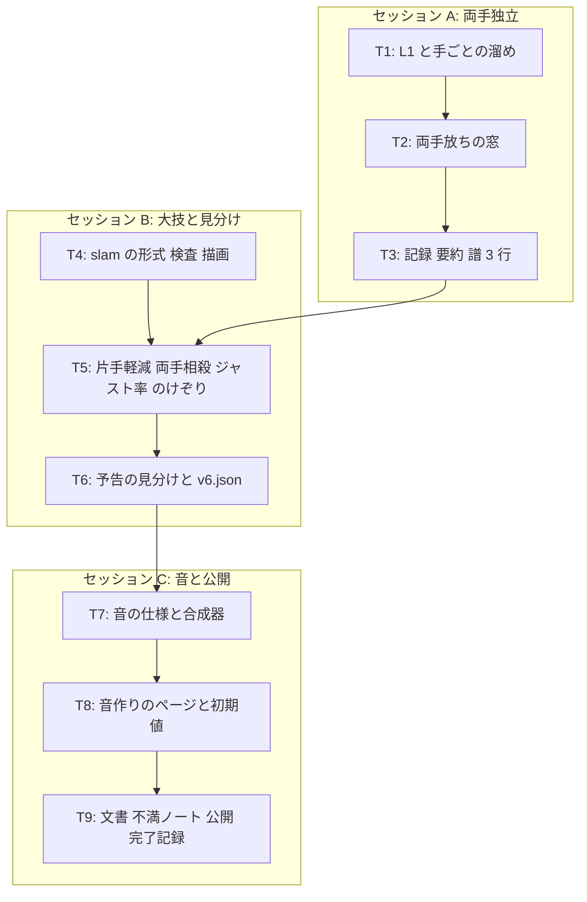

# v6 計画 Phase 1: 両手独立と大技 (片手で溜め、片手で捌く)
作成 2026-11-05。承認待ち。同日に本人の返事で 3 点を直した: 手によって音は区別しない (最終的に相乗りできる音が鳴るべき) / 極太レーザーは十字でなく範囲攻撃を囲む (十字だと元の範囲攻撃が活きなくなる) / 返しの窓の表示は入れない (相殺の閃き 0.3 秒が窓 1 拍の大半と重なり、合図として足りる) / 両手放ちの反動は双方同量でなく、敵の反動耐性 R とジャスト率 j で配分する (敵 j / (R + j)、自機 R / (R + j))。前提は docs/concept.md (保護対象)、docs/decisions/v5-feedback.md (不満の分解)、docs/plan/v5-phase1.md (v5 の形)、docs/choreo-format.md、現在のコード (src/core/sim.ts、audio/engine.ts、audio/pluck.ts、audio/pitch.ts、input/、render/canvas.ts、core/log.ts)。

## 新しいセッションの始め方
docs/NEXT.md の「次の 1 手」に従う。Phase 2 は承認後に Claude が 3 つに分けて書き (下の「タスク」)、承認を待たずに実装に入る。接頭辞は全て `[作品]`。公開は 3 セッション目の最後に 1 回 (本人: 1 日に何回もバージョンアップできない)。途中の push で公開 URL は作りかけになるが、不満ノート v6 は最後に作る。

## 目的
v5 で「メロディに合わせて体を動かすことに報酬がある」手応えは出た (docs/decisions/v5-feedback.md「判定」)。残った不満は 3 つに集まる: 溜めると唯一の攻撃が塞がれて溜めたくなくなる / 範囲攻撃の前のレーザーが無関係で、攻撃の見分けがつかない / 溜めと放ちの音が間抜けで、本人が音を作る口が無い。
v6 の流れ: 右手 (R1) と左手 (L1) が独立に攻撃と溜めを持ち、片手で溜めながらもう片手で軽い攻撃を捌き続け、価値のある攻撃に強い相殺を合わせる。大技 (叩きつけ + 4 本のレーザー) だけは両手の放ちを同時に合わせないと相殺できず、ジャスト具合で敵へのダメージと被ダメの軽減に振れる。音は仕様をデータにして本人が作る。
1. 両手独立: R1 と L1 のそれぞれが「押した瞬間に通常攻撃 (相殺から 1 拍以内なら返し)、押し続けて溜め、離して放つ」を持つ。扇・向き・ダメージは共通。音は手で区別しない (本人: 最終的に相乗りできる音が鳴るべき)。輪は手ごとに出る。両手の放ちが短い窓の中に重なれば「両手放ち」
2. 大技: Z モチーフ (phrase 2, 5, 8) の laser + burst を、1 音目 (拍 8) で飛び上がりと 4 つの発射装置の射出、2 音目 (拍 10.5) で叩きつけと 4 本の極太レーザー、に作り直す。レーザーは叩きつけの円を囲む正方形の 4 辺 (発射装置は 4 隅) で、逃げ場を「円の外かつ枠の内側」の帯に狭める (撃たれる前に枠の外へ出てもよい)。十字だと元の範囲攻撃が活きなくなる (本人)。相殺は両手放ちだけ。片手の放ちが窓と向きを満たせば被ダメ 2 割減と吹っ飛び減。両手放ちが成立すれば相殺、ジャスト率 j で敵にダメージ、反動の総量 0.2 を敵の反動耐性 R とで配分してのけぞる (敵 j / (R + j)、自機 R / (R + j)。ジャストなほど敵が多く受ける)
3. 攻撃の見分け: 型ごとに予告の形を変える。dash は当たりのある区間だけ道を描き、構えへの移動は残像。shot は点線の射線と発射点の小さな輪、laser は当たりの太さの帯
4. 音: 行動ごとの音を層 (波形・FM・ノイズ・撥弦) の仕様データにし、つまみで値を変えて聴き、JSON に書き出せる音作りのページを置く。本人が溜め・放ち・両手放ちの音を作る。Claude は本人の言葉 (鋸歯 + 歪み、FM の低い重ね、中音域のレーザー風、核 800 Hz、ドンとスカンが同時) から初期値を入れる
5. 記録: 行動別の命中、手ごとの回数、大技の結果 (片手軽減 / 両手相殺 / ジャスト率)、譜を右手・左手・足の 3 行に

返しが 2 回とも 0 回だったことへの手当て (窓の表示) は入れない。相殺の閃き (0.3 秒) が窓 1 拍の大半と重なり合図として足りる (本人)。返しが使われるかは v6 の不満で見る

## 承認に含めるもの (concept.md、ダメージ、入力に触れる 5 点)
1. 入力: 左手攻撃を L1 (buttons[4]) に足す。キーボードは F。R1 / J / Space、○ / K、× は今のまま。concept.md「範囲」の入力の注記に足す
2. 大技の相殺を「両手放ちだけ」にし、通常攻撃と片手の放ちでは相殺できない (片手は軽減だけ)。相殺不可 (赤) の攻撃は無くなり、大技は「両手」の印 (別の色) になる
3. ダメージと HP: 大技の被ダメは 2 (他は 1)。片手の軽減で 1.6 (HP は小数を許す)。両手放ちの敵へのダメージは 3 × 2 × j (j はジャスト率 0〜1。最大 6、敵 HP 12 のまま)。通常の強い相殺は 3 のまま (ジャストの配分は大技だけ。本人の悩みどころは狭い側を既定にする)
4. 吹っ飛びとのけぞり: 大技に当たると自機は中心から外へ 0.2 吹っ飛ぶ (0.5 拍、入力を受けない)。片手の軽減で 0.16。両手放ちでは反動の総量 0.2 を、敵が 0.2 × j / (R + j)、自機が 0.2 × R / (R + j) で分けてのけぞる (R は敵の反動耐性 0〜1、既定 0.5。R + j = 0 なら敵 0、自機 0.2。敵は振り付けの位置に減衰する差分を乗せる)。数値の表示はしない
5. 振り付けの検査: Z の 1 音目は当たりを持たず、大技の予告の始まり (飛び上がり) として音に乗る。「全メロディ音に攻撃」の検査は「全メロディ音に攻撃か大技の予告の始まり」に読み替える。`dodgeable` は「円の外かつ枠の内側」の帯に素の移動で入れることを見る (検査は緩めない。通らなければ枠の大きさを変える)。acceptance.json の値は変えない

## 完了条件
- 両手独立: R1 と L1 が別々に通常攻撃・返し・溜め・放ちを出せる。片手が溜め中でももう片手で通常攻撃と相殺ができる。音は手で区別せず、両手とも溜めても持続音は 1 つ (片手が放っても他方が溜め中なら鳴り続ける)。輪は右手が右半分・左手が左半分で、両手で 1 周。被弾で両手の溜めが解除。テスト: 片手溜め中の他方の通常攻撃と相殺、両手の放ちの窓 (0.25 拍) の内外、被弾での両手解除
- 大技: Z モチーフを新しい型 `slam` (叩きつけ + 4 本のレーザー) に。1 音目に予告開始 (敵が飛び上がり、発射装置 4 つが円を囲む正方形の 4 隅へ飛ぶ)、2 音目に叩きつけの円と 4 本のレーザー (隣り合う発射装置を結ぶ 4 辺)。通常攻撃と片手の放ちでは相殺できず、片手の放ちが窓と向きを満たせば被ダメ 0.8 倍と吹っ飛び 0.8 倍。両手放ちが窓と向きを満たせば相殺、敵に 6 × j、反動 0.2 を敵 j / (R + j)・自機 R / (R + j) で配分。テスト: 片手で軽減、両手で相殺とダメージ、j の計算 (窓の中心で 1、端で 0)、反動の配分 (R = 0.5 で j = 1 なら敵 2 : 自機 1、j = 0 なら全部自機、R + j = 0 でも壊れない)、円の外かつ枠の内側に立てば当たらない、撃つ前に枠の外へ出れば当たらない
- 攻撃の見分け: dash / shot / laser / slam の予告が型ごとに違う形。dash の道は当たりのある区間だけ、構えへの移動は残像。Chrome のスクリーンショットで 4 型を並べて確認。見分けられるかは本人の不満で
- 音の仕組み: 行動 (step / normal / riposte / charge / release / double / cancel) ごとの音を `assets/sound/v6.json` に層の仕様 (波形・音高の差・包絡・ローパス・歪み・FM 比と深さ・ノイズ・撥弦) で持ち、ゲームと OfflineAudioContext (measure.html) で同じ波形になる。音高は今の 3 案がそのまま基音を与える
- 音作りのページ `sound.html`: 行動を選び、層ごとのつまみを動かして鳴らし、JSON を書き出し・読み込みできる。溜めは進み具合 (0〜1) のつまみで途中の音も聴ける。曲の 1 小節を鳴らしながら重ねて聴ける。初期値は Claude の案 (本人の言葉から) で、本人が作った JSON を v6.json に入れて公開する
- 記録と要約: 「命中 n (通常 a / 返し b / 放ち c / 両手放ち d)」、行動の行に手の内訳 (右 / 左)、「大技 n 回 (片手軽減 a / 両手相殺 b、ジャスト率 平均 x)」、譜は 1 小節 3 行 (右手 / 左手 / 足)。吹っ飛びとのけぞりは log に残す
- 文書: docs/choreo-format.md (slam、両手の印)、assets/choreo/README.md (v6 の表と理由)、README「遊ぶ (v6)」(両手の操作、Bluetooth の注意: 自分の音だけ遅れる、有線かイヤホンのゲームモード、要約の「音の出力遅延の補正」の読み方)、docs/sound-format.md (音の仕様と音作りのページの使い方)、concept.md「範囲」の入力の注記、不満ノート vault:音楽アクション/v6 不満.md (書いてほしいこと: 片手で溜めながら捌く手触り / 大技の両手放ちは合わせられるか、ジャストの振れは手応えになるか / 攻撃の見分け / 自分で作った音と初期値の差 / 相殺後の返し (1 拍以内の攻撃。スティックを倒していればその向きへ 0.1 踏み込む) を試した手触りと踏み込みの距離 (v5 では 2 回とも 0 回で、本人も「やっていなかった」))
- テストが通り、公開 URL で遊べる。調整パネルの項目は増やさない

## 入れないもの (v6)
- コントローラの振動 (本人: 主張が強い演出。そのうち強度を設定できる形で)
- タイトルで音の遅延を体感で測る仕組み (継続)
- 回避が活きる配置、通常移動を遅くする (本人: 一旦受容して後回し)
- ジャストの配分を大技以外の相殺に広げる
- ボス戦前にフレーズを掴む仕組み、曲の変更、作曲、音高の 4 案目
- スタイル、ゲージ、コピー + 乗っ取り、吸収と放出、返し以外の派生
- 右向き固定の修正、攻撃モーションの種類、世界観、画像ファイル
- 20 秒の終わり方、HP 0 の扱い、回復
- 地面と空中、Unity などへの移行

## タスク (3 セッション。詳細は Phase 2)
セッション A (両手) を docs/plan/v6-phase2-hands.md、セッション B (大技と見分け) を docs/plan/v6-phase2-enemy.md、セッション C (音と公開) を docs/plan/v6-phase2-sound.md に書く。B は A の両手放ちに依存し、C は A と B の行動の種類 (double) に依存する。

### T1 (L1 と手ごとの溜め)
- input に `attackPressed` を手ごとに (`right` / `left`)。sim の `charge` と `attackLatch` を手ごとに。engine の持続音を 2 つ持てるように。輪を半分ずつ

### T2 (両手放ちの窓)
- 片方の放ちから 0.25 拍以内にもう片方の放ちが来れば `double` (log に 2 つの放ちの差)。相殺の判定は後の放ちの時刻で行い、j もそこから

### T3 (記録・要約・譜 3 行)
- attack に `hand`、hit を行動別に集計、譜を右手 / 左手 / 足に

### T4 (slam の形式・検査・描画)
- 攻撃の型 `slam`: `telegraphBeat` に発射装置が飛び始め、`hitBeat` に円 + 4 本の線分 (太さ `laserR`、中心から半幅 `frameHalf` の正方形の 4 隅にある発射装置を隣どうし結ぶ)。`validate-choreo` の `dodgeable` を slam に対応。描画は発射装置の点と、届いた先の淡い線

### T5 (片手軽減・両手相殺・ジャスト率・のけぞり)
- slam は通常と片手の放ちで相殺不可。片手の放ちが窓と向きを満たせば `mitigate` (被ダメ ×0.8、吹っ飛び ×0.8)。両手放ちで `cancel` に `double: true` と j。自機の吹っ飛び (0.5 拍、入力無視) と敵ののけぞり (差分、1 拍で減衰)。反動の配分は敵の `knockbackResist` (振り付けの敵の値、既定 0.5) と j で

### T6 (予告の見分けと v6.json)
- dash の道を active 区間だけに、構えへの移動は残像。shot は点線 + 発射点の輪、laser は帯。Z モチーフを slam に差し替えた `assets/choreo/v6.json`。v5.json は外す

### T7 (音の仕様と合成器)
- `assets/sound/v6.json` と `src/audio/synth.ts`: 層 (osc / fm / noise / pluck) × 包絡 × ローパス × 歪み。charge は進み具合で層の音量が変わる。engine が pluck の代わりにこれを鳴らす。OfflineAudioContext で同じ波形 (テスト)

### T8 (音作りのページと初期値)
- `sound.html`: 行動の選択、層のつまみ、鳴らす、1 小節と重ねる、JSON の書き出し・読み込み。初期値は本人の言葉から Claude が作る

### T9 (文書・不満ノート・公開・完了記録)

## 既定値 (Claude の決め。Phase 2 で確定し、理由を書く)
| 項目 | 既定値 | 理由 |
|---|---|---|
| 左手のボタン | L1 (buttons[4]) / F | 右手 R1 と対。人差し指 2 本で独立に押し続けられる |
| 両手放ちの窓 | 0.25 拍 (107 ms) | 両手の同時押しの散らばり (数十 ms) を許し、16 分より広げない |
| 手と音 | 区別しない。両手とも溜めても持続音は 1 つ | 本人: 最終的に相乗りできる音が鳴るべき。同じ音を 2 つ重ねると位相でうねるだけなので 1 つにする。両手の状態は輪で見せる |
| ジャスト率 j | 1 − \|押下 − 接触拍\| / 窓の片側 (早い側 100 ms、遅い側 50 ms) | 窓の中心で 1、端で 0。既存の窓をそのまま使う |
| 大技の被ダメ / 軽減 | 2 / ×0.8 | 本人の「2 割減」。1 だと小数が細かすぎる |
| 両手放ちの敵へのダメージ | 6 × j | 放ち 3 × 2 本。ジャストなら放ち 2 回ぶん |
| 吹っ飛び (大技に当たる) | 0.2 (0.5 拍)、片手の軽減で 0.16 | ステップ 1 回ぶん |
| 両手放ちの反動 | 総量 0.2 を敵 j / (R + j)、自機 R / (R + j) で配分。R (敵の反動耐性) は 0.5 | 本人の式 (2026-11-05)。ジャストなほど敵が多く受け、総量は変わらない。R 0.5 はジャストで敵 2 : 自機 1。敵ごとの値にできる |
| 枠の半幅 / レーザーの太さ | 0.3 / 0.04 | 円 (r 0.16) の外から枠の内縁 (0.26) まで 0.1 の帯。ステップ 1 回 (0.18) で円の中心から帯に入れる。本人: 囲む形 (十字だと範囲攻撃が活きない) |
| 大技の当たりの長さ | 0.5 拍 (円もレーザーも) | 今の burst と同じ |
| 音の層の上限 | 1 音 4 層 | つまみが増えすぎない |

## 懸念 (Phase 2 と不満で見る)
- 両手の同時押しが相殺の窓 (前 100 / 後 50 ms) と両手の窓 (107 ms) の両方を満たす難しさ。合わせられなければ両手の窓を広げるか、相殺の判定を「先の放ち」で行う
- 片手で溜めながらもう片手で捌くとき、通常攻撃の押下も溜めの開始になる (0.5 拍以内に離せば何も起きない)。捌く側の手が意図せず溜めに入ることがあれば、閾値を上げる
- 大技の帯 (円の外かつ枠の内側) が 0.1 で狭い。`dodgeable` が通らなければ枠の半幅で調整し、検査は緩めない。帯の中に立っても円の縁と枠の内縁の見分けが要るので、描画で帯を薄く示す
- 音作りのページで作った音が曲 (矩形・三角・ノイズ) と近づきすぎる可能性。concept「曲と音の役割」(別の楽器、区別できる形) は本人が聴いて守る。Claude は判定しない
- 3 セッションで公開は最後。途中の push で公開 URL が作りかけになる。NEXT.md に「v6 作りかけ」と書く

## 人間の作業
1. この Phase 1 の承認 (「承認に含めるもの」5 点の可否を添えて)
2. 帰宅後にイヤホンのゲームモードを確かめ、要約の「音の出力遅延の補正」の値を見る (ゲーム側の変更は無い)
3. v6 が公開されたら、sound.html で音を作り、JSON を貼るか vault に置く。遊んで不満ノートに書く

## 本人に聞きたいこと (答えが無くても進められる既定つき)
1. 左手のキーボードのキー。既定: F

答え済み (2026-11-05): 極太レーザーは範囲攻撃を囲む形 (十字は元の範囲攻撃が活きなくなる) / 返しの窓の表示は要らない (相殺の閃きで足りる)
