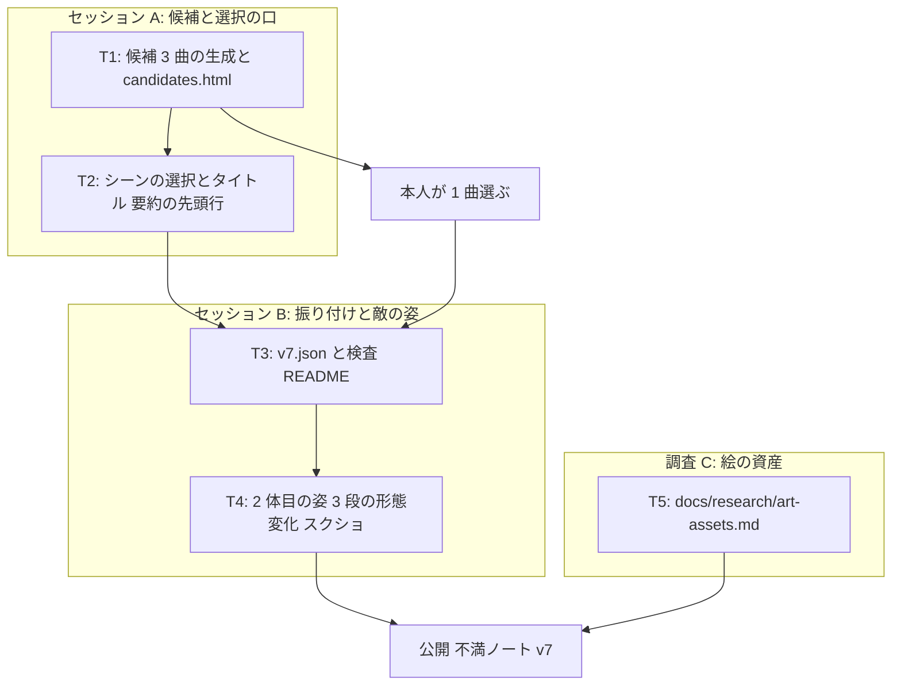

# v7 計画 Phase 1: 2 曲目 (= 2 体目の敵。曲と絵が地続き)
作成 2026-11-06。承認待ち (「承認に含めるもの」6 点の可否を添えて)。同日に本人の返事で 3 点を足した: 長さは 40 秒にしてもいい (20〜120 秒の範囲) / 曲調は複数のフレーズが重なり、その 1 つが抜けのいい高音 / 敵の像に制限なし、人型は引き継ぎやすいので可。「値 1 本で形態変化」の実物は形態変化スライダー (https://claude.ai/artifact/KRZ6BDxTAKZG2gN3Wsxwye) で見せた。前提は docs/concept.md (保護対象。「曲と絵の役割」を 2026-11-06 に足した)、docs/decisions/v6-feedback.md (不満の分解と「次の方向」)、docs/decisions/song-choice.md (1 曲目の選び方と候補の性格)、docs/choreo-format.md、scripts/gen-candidates.ts (曲は小節ごとのパターンからコードで生成する)、現在のコード (src/core/sim.ts、render/figures.ts、render/canvas.ts、ui/title.ts、song.ts、candidates.ts)。

## 新しいセッションの始め方
docs/NEXT.md の「次の 1 手」に従う。Phase 2 は承認後に Claude が書き (下の「タスク」)、承認を待たずに実装に入る。接頭辞は全て `[作品]` (調査文書は `[仕組み]`)。公開は本人が曲を選んだ後のセッションの最後に 1 回。

## 目的
本人は 1 曲目に飽きていて、この曲でできるのはアレンジ・繰り返しのチュートリアル・演出くらい (docs/decisions/v6-feedback.md「本人の返事」)。両手独立を入れた動機は「テンポの細かい曲で後で必要になる」(docs/decisions/v5-feedback.md 不満 1) だったので、その曲で試す。同時に、2026-11-06 に本人が決めた「音楽と視覚的情報が物語的に地続き」(docs/concept.md「曲と絵の役割」) を、2 体目の敵で初めて形にする。
v7 の流れ: Claude が「進むにつれ激しくなる」2 曲目の候補を 3 つ作り、それぞれに「どんな敵か」の像 (姿と、激しくなるにつれどう変わるか) を添える。本人が 1 つ選ぶと、曲と敵の姿が一緒に決まる。選ばれた曲に、今の行動 (両手・溜め・放ち・返し・ステップ・大技の両手相殺) をそのまま持ち込んだ振り付けを書き、敵の姿を曲の 3 段に合わせて変える。タイトルで 2 つのシーン (1 曲目 = v6.1 のまま / 2 曲目) を選べる。資産としての絵の作り方は、実装せずに調査文書にまとめる。
1. 2 曲目の候補: 3 曲。どれも 40 秒前後 = 8 小節 × 3 段で、段が進むほど激しくなる (音の密度・ドラムの手数・メロディの高さや動き)。テンポは 1 曲目 (140 BPM ハーフタイム) より細かく感じる作り。曲調は本人の好み (2026-11-06): 複数のフレーズ (メロディ) が重なり、その 1 つは後ろで鳴る抜けのいい高音の線 (フルートのような。楽器は何でもよい)。攻撃に結びつくのは主旋律 (トラック名 `melody`) だけで、高音の線は背景の声部 (本人が v5 で「背景の音もアクションに反映すると苦しくなる」)。各候補に「敵の像」を一言添える (例: 出力を上げていく機械 / 少しずつ獣になる者 / 増殖する幾何学。人型を軸にしたものを 1 つ以上、人型でないものを 1 つ以上)。candidates.html で 1 曲目と並べて聴ける
2. 2 体目の敵: 1 体目 (雫形) と違う形を、線と面でコードで描く。曲の段 (3 段) に合わせて姿が変わる。変わり方は、段の切り替わりで一気に変わる部分 (形態変化。本人の「雰囲気が大きく変わるタイミング」) と、段の中で少しずつ進む部分 (本人の「出力が上がっているのがわかる」「少しずつ獣っぽく」) の両方を持つ。構え (立つ・攻撃・相殺・被弾・型ごとの構え) は 1 体目と同じ枠組みで、姿だけ違う
3. 振り付け: 選ばれた曲に v7.json。検査の規則 (全メロディ音に攻撃か大技の予告の始まり、予告の先行、当たりがグリッド上、避けられる位置、after-order) は変えない。攻撃の型は今の 4 つ (dash / shot / laser / slam) をそのまま使い、曲の段が進むほど攻撃が増える・速くなる形で曲と揃える。大技 (slam) は段の切り替わりか最後の段に
4. シーンの選択: タイトルで「1 曲目 (v6.1)」「2 曲目」を選ぶ。選んだシーンは要約の先頭行に出る (今の「振り付け v6 / 曲 candidate-2」がそのまま使える)。調整パネル・音高の案・自作の音は両方のシーンで共通
5. 調査: 描けない本人と Claude で「資産としての絵」(静止画、構えのコマ、形態の段) を作る方法を比べ、docs/research/art-assets.md に書く。実装はしない。結論は本人が読んで次の版で決める

## 承認に含めるもの (concept.md、範囲、絵、長さに触れる 6 点)
0. 長さ: 2 曲目のシーンは 40 秒前後 (本人: 「次は 40 秒にしてもいいかも。20〜120 秒の範囲がいいかな」)。シーンごとに長さを持ち、1 曲目は 20 秒のまま。acceptance.json の `sceneSeconds` (20) は 1 曲目の値として残し、シーンの長さは曲の MIDI の長さから取る (acceptance.json の値は変えない)。敵の HP もシーンごとに持ち、2 曲目は攻撃の数に比例して増やす (既定 24。倒し切れる前提は変えない)。結果の要約と譜は 24 小節ぶんになる
1. concept.md「範囲」を「20 秒のシーンを 2 つ (シーンごとに敵 1 体 + 曲 1 つ)」に広げる。1 曲目は v6.1 のまま変えない (注記は 2026-11-06 に書いた。承認されなければ戻す)
2. concept.md に「曲と絵の役割」(保護対象) を足した。本人の言葉をそのまま移してある。読み方の段落は Claude の読みなので、違えば直す
3. 2 曲目の性格: 「進むにつれ激しくなる」3 段 (8 小節ずつ)、1 曲目よりテンポが細かく感じる作り。複数のフレーズが重なり、1 つは抜けのいい高音の線 (本人の好み)。攻撃は主旋律だけに結びつけ、高音の線は背景。候補 3 つは全部この性格で、違いは曲調 (リズムの型・調・音域) と敵の像。既存の候補 1 と 3 は使わない (性格が平坦。本人が聴きたければ candidates.html に残っている)。concept.md「入れないもの」の「複数ジャンルのフレーズ重ね」には当たらない (1 つの曲の中の声部の重なり)
4. 2 体目の敵の姿と形態変化は、コードで描く絵 (線と面) で作る。画像ファイルは入れない。姿の方向 (機械が出力を上げる / 獣になっていく / 幾何学が増殖する など) は、曲の候補に添えた像から、曲を選ぶことで一緒に決まる。像に制限はなく、人型は「他者を引き継ぎやすい」ので可 (本人)
5. プレイヤーの行動と数値 (扇、窓、ダメージ、両手の窓、大技の数値) は v6.1 のまま。2 曲目で足りなければ、その版の不満で直す。acceptance.json の値は変えない

## 完了条件
- 候補: `scripts/gen-candidates.ts` に 3 曲を足し、`assets/midi/` に書き出す。各 40 秒前後、8 小節 × 3 段で、段ごとに (a) ドラムの手数、(b) 主旋律の音数か音域、(c) ベースの動き、(d) 重なるフレーズの数 のうち 2 つ以上が増える。トラックは `melody` (主旋律。攻撃の元) のほかに高音の線 (`lead-high`。段 1 から薄く鳴り、段が進むと主旋律と掛け合う) を持つ。再生は素のオシレータのままだが、高音の線は正弦波に近い柔らかい波形で鳴らし「抜けのいい高音」に寄せる。candidates.html に 3 曲と敵の像の一言、段の切り替わりの拍を表示。1 曲目の拍グリッドの取り方 (`print-grid`、`melody` トラックのフレーズを休符で切る) が 3 曲とも通る
- 本人が 1 曲選ぶ (人間の作業。番号と理由を一言)。選ぶまでは候補の完成で区切る
- 振り付け v7.json: 選ばれた曲の全メロディ音に攻撃か大技の予告の始まり。`validate-choreo` 違反なし。assets/choreo/README.md に v7 の表と理由 (段ごとに何を増やしたか)。1 曲目の v6.json は変えない
- 2 体目の敵の姿: figures.ts に新しい形 (1 体目と見分けがつく)。曲の段 (0〜2) と段の中の進み (0〜1) を受け取り、段の切り替わりで形が変わり、段の中で少しずつ進む。作る順は本人の指摘 (2026-11-07) どおり、**最終形態 (段 3 の姿) を先に満足いくまで作り、本人に見せて OK を取ってから** 段 1 と途中の姿を値を戻して作る。構えは 1 体目と同じ枠組み (enemyPose の型: 立つ・攻撃の型ごと・止まる・近づく・退く) を使い、攻撃の型ごとの構えを形態に合わせて持つ (人型用と最終形態用の 2 組を進みで混ぜる。形態変化スライダーで試した形)。腕と脚は太さを持つ帯で描く。Chrome のスクリーンショットで 3 段 × 構えを並べて確認。段の切り替わりは曲の小節の頭に揃う (絵の切り替わりが拍に乗る)。テスト: 段と進みの計算 (拍 → 段、進み)、描画は目視
- シーンの選択: タイトルで 2 つから選び、選択を保存 (localStorage。既定は 2 曲目)。シーンは曲・振り付け・敵の姿・長さ・敵の HP を持つ。要約の先頭行にシーン (振り付けの id と曲の id) が出る。1 曲目を選べば v6.1 と同じ記録になる (決定性のテストで確かめる)。40 秒のシーンでも要約と譜 (24 小節) がコピーできる
- 音高の案 3 つが 2 曲目でも成り立つ (案 1 コードの音 / 案 2 メロディをなぞる は曲の MIDI から取る。取れなければ Phase 2 で直す)
- 調査文書 docs/research/art-assets.md: 比べる方法は (a) AI 画像生成 + 一貫性の手立て (参照シート、img2img、同一キャラの維持)、(b) AI 3D モデル生成 → 決まった角度でレンダして 2D のコマにする、(c) パラメトリックなベクタ (今のコード描画の延長。形態変化は値の連続で作れる)、(d) ピクセルアートの生成・編集ツール、(e) 素材集・外注。それぞれについて、構え 5 種 × 形態 3 段のコマを揃えられるか、本人の作業 (選ぶ・貼る) は何か、Claude が無人で確かめられるか、エンジン移行との関係を書く。結論は出さず、本人が選べる形にする
- 文書: README「遊ぶ (v7)」(シーンの選択、2 曲目の敵)、docs/choreo-format.md (変更があれば)、concept.md (承認の結果)、不満ノート vault:音楽アクション/v7 不満.md (書いてほしいこと: 2 曲目で両手と大技がどう感じるか / 曲と敵の姿が地続きに見えるか、形態変化は分かるか / 段が進んで激しくなるのが手に伝わるか / 1 曲目との違い / 調査文書を読んでの絵の方向)
- テストが通り、公開 URL で 2 つのシーンが遊べる

## 入れないもの (v7)
- 画像ファイルの資産 (スプライト、コマ) をゲームに入れること。エンジンの移行 (調査文書で関係だけ書く)
- プレイヤーの新しい行動、数値の変更 (扇、窓、ダメージ、両手の窓、大技)
- 1 曲目のアレンジ、チュートリアル、演出の追加。ヒットストップ (大技相殺の見せ場) は 2 曲目の姿を見てから次の版で
- 新しい攻撃の型 (敵の 4 型のまま)。曲をまたぐ構成、2 つのシーンの続き物
- 世界観 (背景、設定)。2 体目の敵の「像」は姿に留め、物語は書かない
- 回避が活きる配置の設計 (振り付けで意識はするが、完了条件にしない。v5 からの後回しのまま)
- 本人が作る音 (来たら入れる。sound.html は変えない)。音高の 4 案目

## タスク (3 セッション。詳細は Phase 2)
セッション A (候補と選択の口) を docs/plan/v7-phase2-song.md、セッション B (振り付けと敵の姿) を docs/plan/v7-phase2-enemy.md に書く。調査 C は A の待ち時間 (本人が曲を選ぶ間) に行う。

### T1 (候補 3 曲の生成と candidates.html)
- gen-candidates.ts に 3 曲 (id は candidate-4 〜 6)。4 小節 × 3 段。各曲に `intent` と敵の像、段の切り替わりの小節。candidates.html に表示。`print-grid` でフレーズが取れることを確かめる

### T2 (シーンの選択とタイトル・要約の先頭行)
- シーン = { 曲の id、振り付けの id、敵の姿の id }。タイトルで選び localStorage に保存。main.ts の song / choreo の読み込みをシーンから引く。要約の先頭行はそのまま (振り付け id と曲 id が出る)

### T3 (v7.json と検査・README)
- 選ばれた曲の全メロディ音に攻撃。段が進むほど攻撃が増える・速くなる。slam は段の切り替わりか最後の段。`validate-choreo` 違反なし。assets/choreo/README.md

### T4 (2 体目の姿・3 段の形態変化・スクショ)
- figures.ts に新しい敵。拍 → 段 (0〜2) と進み (0〜1) の計算は core に (テスト)。描画は段と進みで形を変える。Chrome で 3 段 × 構えを並べて確認

### T5 (docs/research/art-assets.md)
- 上の完了条件の 5 つの方法を比べる。Web 検索は search サブエージェントに任せる。結論は出さず本人が選べる形に

## 既定値 (Claude の決め。Phase 2 で確定し、理由を書く)
| 項目 | 既定値 | 理由 |
|---|---|---|
| 段の数と長さ | 3 段 × 8 小節 (40 秒前後) | 本人の「次は 40 秒にしてもいいかも」。1 曲目の「4 小節 1 周のモチーフ」を段の中で 2 周させ、段ごとに激しくする。150〜170 BPM で 36〜38 秒 |
| 候補の BPM | 150〜170 の範囲で 3 曲とも違う | 1 曲目 (140 ハーフタイム) より細かく感じる。BPM で縛らない (concept) ので目安 |
| 高音の線の扱い | 攻撃に結びつけない背景の声部。段 3 で主旋律と掛け合う | 本人の好み (抜けのいい高音) を曲に入れつつ、攻撃の元は `melody` 1 本に保つ (grid.ts は `melody` トラックだけを読む) |
| 2 曲目の敵 HP | 24 | 1 曲目 12 の倍 (攻撃の数が倍)。シーンごとの値。倒し切れる前提と HP 0 の扱いは v6 の「入れないもの」のまま |
| 段の切り替わりの合図 | 小節の頭。敵の姿が一気に変わり、曲のドラムも同じ拍で変わる | 「雰囲気が大きく変わるタイミングには視覚的にもそれがわかる」。拍に乗せるのはテンポ把握 (保護対象) のため |
| 段の中の進み | 小節の進みで 0 → 1 (線形)。姿の一部 (大きさ・線の数・色の濃さなど 1〜2 項目) が連続で変わる | 「出力が上がっているのがわかる」「少しずつ獣っぽく」。項目を絞るのは見づらさを避けるため (本人も「見づらいとは思うけど」) |
| 既定のシーン | 2 曲目 | 本人は 1 曲目に飽きている。不満ノート v7 は 2 曲目について聞く |
| 敵の像の候補 | 曲ごとに 1 つ。曲調から Claude が決める | 曲と絵を地続きにするため、曲を選ぶと像も決まる形にする。像だけ別に選ばせると往復が増える |
| 攻撃の数 | 段ごとに 1 曲目の phrase あたりの数を目安に、段 1 < 段 2 < 段 3 | 「進むにつれ激しくなる」を振り付けでも守る。検査 (避けられる位置) が通る範囲で |

## 懸念 (Phase 2 と不満で見る)
- 音高の案 1 (コードの音) と案 2 (メロディをなぞる) が曲の MIDI からどう取られているかを Phase 2 の最初に読む。曲固有の表 (コード進行) を持っているなら、2 曲目のぶんを足す
- 拍グリッド (src/core/grid.ts のフレーズの切り方: 休符で切る) が、密度の高い段で 1 フレーズが長くなりすぎる可能性。フレーズが長いと「同じフレーズには同じ攻撃」の予測が作りにくい。候補の作りで、段 3 でも 1〜2 小節ごとに休符を置く
- 2 体目の敵の姿が「1 体目と違う」かつ「構えの枠組みは同じ」を満たすのに、figures.ts の敵の描画が雫形に密結合していれば、姿を差し替えられる形に分ける (enemyPose は core にあるので描画だけ)
- 形態変化が「見づらい」(本人の予想)。スクリーンショットで 3 段を並べて差が分かるかを Claude が見るが、遊んでいる最中に分かるかは本人の不満で
- 3 曲を作って 1 つしか使わないのは、1 曲目のときと同じ (選ぶのは本人の役)。残り 2 曲は candidates.html に残す。
- 調査文書は Web 検索を含むので、search サブエージェントに任せ、本文は 300 行以内に

## 人間の作業
1. この Phase 1 の承認 (「承認に含めるもの」6 点の可否を添えて)
2. 候補 3 曲ができたら candidates.html で聴き、1 つ選んで番号と理由を一言 (敵の像が気に入らなければそれも)
3. 2 体目の最終形態 (段 3 の姿) のスクリーンショットを見て、雑なところを言う (本人: 「100% 形態をまず満足いくように作ってから 0% 形態を作った方がいい」)。OK が出るまで段 1 と途中は作らない
4. 公開されたら 2 曲目を遊び、v7 不満.md に書く。docs/research/art-assets.md を読んで絵の方向の好みを書く

## 本人に聞きたいこと (答えが無くても進められる既定つき)
答え済み (2026-11-06): 曲調は「複数のフレーズが重なり、1 つが抜けのいい高音」(リズムの型は Claude が 3 曲で変える: 速い細かいドラム / 4 つ打ちが重くなる / 3 連で跳ねる) / 敵の像に制限なし、人型は可 / 長さは 40 秒前後 (20〜120 秒の範囲)。
1. 承認の返事と一緒に: 高音の線を段 1 から薄く鳴らすか、段 2 から入れるか。既定: 段 1 から薄く (段が進むと前に出る)
