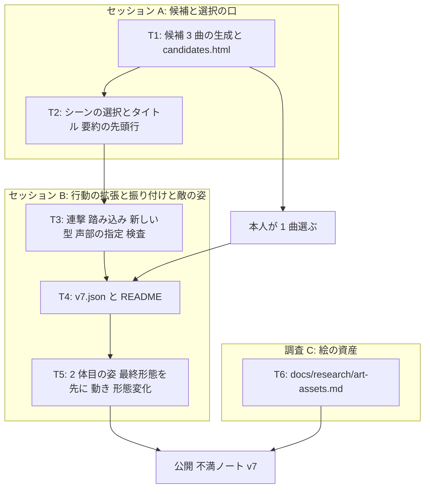

# v7 計画 Phase 1: 2 曲目 (= 2 体目の敵。曲と絵が地続き)
作成 2026-11-06。**承認済み 2026-11-07** (「承認に含めるもの」6 点、「人型は他者を引き継ぎやすい」の読みも本人が「合っています。それで進めてほしい」)。形態変化スライダーの最終版は prototypes/morph-slider.html に残した (鍵フレーム 2 組、動き、向きの補正、形態の値の出し方。T5 の出発点)。2026-11-06 の返事で 3 点 (40 秒 / フレーズの重なりと高音の線 / 像は人型可)、2026-11-07 の返事で 6 点を直した: 今の行動を持ち込むだけでなく拡張する (敵の行動の追加、連撃、踏み込み) / 行動の追加は本人の承認を待たず Claude が部分的に作る / 候補の曲に大技のイメージも添え、大技から通常攻撃を考える / 像は獣と機械の 2 つに縛らない / 「段々激しく」は縛りにしない (序盤より激しい場面があればよく、静を挟んでも、最高出力をいなされて自壊していく形でもよい) / 高音の線は最初から (背景のフレーズが残る一貫性)。「値 1 本で形態変化」と動きの作り方は形態変化スライダー (https://claude.ai/artifact/KRZ6BDxTAKZG2gN3Wsxwye) で確かめた。前提は docs/concept.md (保護対象。「曲と絵の役割」を 2026-11-06 に足した)、docs/decisions/v6-feedback.md (不満の分解、「次の方向」、本人の返事)、docs/decisions/song-choice.md (1 曲目の選び方。「同じフレーズには同じ攻撃」とアレンジでバリエーション)、docs/choreo-format.md、scripts/gen-candidates.ts (曲は小節ごとのパターンからコードで生成する)、現在のコード (src/core/sim.ts、core/choreo.ts、render/figures.ts、render/canvas.ts、ui/title.ts、song.ts、candidates.ts)。

## 新しいセッションの始め方
docs/NEXT.md の「次の 1 手」に従う。Phase 2 は承認後に Claude が書き (下の「タスク」)、承認を待たずに実装に入る。接頭辞は全て `[作品]` (調査文書は `[仕組み]`)。公開は本人が曲を選んだ後のセッションの最後に 1 回。

## 目的
本人は 1 曲目に飽きていて、この曲でできるのはアレンジ・繰り返しのチュートリアル・演出くらい (docs/decisions/v6-feedback.md「本人の返事」)。両手独立を入れた動機は「テンポの細かい曲で後で必要になる」(docs/decisions/v5-feedback.md 不満 1) だったので、その曲で試す。同時に、2026-11-06 に本人が決めた「音楽と視覚的情報が物語的に地続き」(docs/concept.md「曲と絵の役割」) を、2 体目の敵で初めて形にする。
v7 の流れ: Claude が 2 曲目の候補を 3 つ作り、それぞれに「どんな敵か」をひとまとまりで添える (姿の像、その敵を象徴する大技、曲の起伏の形と姿の変わり方)。本人が 1 つ選ぶと、曲・敵の姿・大技が一緒に決まる。選ばれた曲に、今の行動 (両手・溜め・放ち・返し・ステップ・大技の両手相殺) を持ち込み、その敵に要る拡張を Claude が足した振り付けを書き、敵の姿を曲の起伏に合わせて変える。タイトルで 2 つのシーン (1 曲目 = v6.1 のまま / 2 曲目) を選べる。資産としての絵の作り方は、実装せずに調査文書にまとめる。
1. 2 曲目の候補: 3 曲。どれも 40 秒前後 (3 段 × 8 小節を骨組みにするが、起伏の形は候補ごとに違う。下の既定値)。テンポは 1 曲目 (140 BPM ハーフタイム) より細かく感じる作り。曲調は本人の好み: 複数のフレーズが重なり、その 1 つは後ろで鳴る抜けのいい高音の線 (最初から入り、曲が変わっても大きく変わらずに残る。本人: 同じフレーズをいろんなアレンジで繰り返す曲で、背景のフレーズが残っていると一貫性を感じる)。攻撃に結びつくのは主旋律 (トラック名 `melody`) で、高音の線は背景の声部。各候補に添えるもの: 敵の像 (獣と機械の 2 つに縛らない)、象徴する大技のイメージ (複数の音で 1 つの攻撃、または一連の行動)、起伏の形と姿の変わり方
2. 2 体目の敵: 1 体目 (雫形) と違う形を、線と面でコードで描く。曲の起伏に合わせて姿が変わる。段の切り替わりで一気に変わる部分 (形態変化) と、段の中で少しずつ進む部分の両方を持つ。構えは 1 体目と同じ枠組みで、攻撃の型ごとの動き (鍵フレーム) を持ち、攻撃の向きで補正する
3. 振り付けと敵の行動の拡張: 選ばれた曲に v7.json。大技を軸に、通常攻撃をそこから派生させて考える。敵の行動は今の 4 型 (dash / shot / laser / slam) に限らず、その敵に要るものを Claude が足す。少なくとも次の 2 つを入れる。(a) 連撃: 複数の音で 1 つの攻撃、または一連の行動。連撃の中だけ追尾を強める (今の敵は予告開始時の位置を狙うだけなので「動いていると当たらない。弾こうとしないと弾けない」。本人の指摘)。(b) 踏み込みのある攻撃 (敵が自機へ寄ってから出す近接の攻撃)。検査の規則 (全メロディ音に攻撃か予告の始まり、予告の先行、当たりがグリッド上、避けられる位置、after-order) は変えない。追尾を強めても `dodgeable` が通ることを検査で担保する
4. シーンの選択: タイトルで「1 曲目 (v6.1)」「2 曲目」を選ぶ。選んだシーンは要約の先頭行に出る。調整パネル・音高の案・自作の音は両方のシーンで共通。振り付けの形式は、攻撃がどの声部 (トラック) に乗るかを書けるようにしておく (将来「複数の敵がそれぞれの音色やフレーズに割り当てられる」拡張の口。実装する敵は 1 体)
5. 調査: 描けない本人と Claude で「資産としての絵」(静止画、構えのコマ、形態の段) を作る方法を比べ、docs/research/art-assets.md に書く。実装はしない。結論は本人が読んで次の版で決める

## 承認に含めるもの (concept.md、範囲、絵、長さ、承認の範囲に触れる 6 点)
0. 長さ: 2 曲目のシーンは 40 秒前後 (本人: 「次は 40 秒にしてもいいかも。20〜120 秒の範囲がいいかな」)。シーンごとに長さを持ち、1 曲目は 20 秒のまま。acceptance.json の `sceneSeconds` (20) は 1 曲目の値として残し、シーンの長さは曲の MIDI の長さから取る (acceptance.json の値は変えない)。敵の HP もシーンごとに持ち、2 曲目は攻撃の数に比例して増やす (既定 24)。結果の要約と譜は 24 小節ぶんになる
1. concept.md「範囲」を「20 秒のシーンを 2 つ (シーンごとに敵 1 体 + 曲 1 つ)」に広げる。1 曲目は v6.1 のまま変えない (注記は 2026-11-06 に書いた。承認されなければ戻す)
2. concept.md に「曲と絵の役割」(保護対象) を足した。本人の言葉をそのまま移してある。読み方の段落は Claude の読みなので、違えば直す
3. 承認の範囲を縮める (本人: 「僕が承認する時間が勿体ない。部分的に作ってくれた方が嬉しい」): 本人が決めるのは候補 (曲 + 像 + 大技 + 起伏) の選択だけ。敵の新しい攻撃の型、連撃、踏み込み、それに要る自機側の行動や数値の追加は Claude の裁量で作り、計画文書 (Phase 2) と assets/choreo/README.md に理由つきで記録する。本人は遊んで不満で直す。今ある自機の数値 (扇、窓、ダメージ、両手の窓、大技の相殺) は据え置き
4. 2 曲目の性格: 序盤より激しい場面が必ずあるが、起伏の形は候補ごと (右肩上がり / 静を挟む山型 / 最高出力をいなし続けると自壊していく、など)。複数のフレーズが重なり、1 つは抜けのいい高音の線で最初から入る。攻撃は主旋律に結びつけ、高音の線は背景。既存の候補 1 と 3 は使わない。concept.md「入れないもの」の「複数ジャンルのフレーズ重ね」には当たらない (1 つの曲の中の声部の重なり)
5. 2 体目の敵の姿と形態変化は、コードで描く絵 (線と面) で作る。画像ファイルは入れない。像は曲の候補とセットで、曲を選ぶことで決まる。像に制限はなく、人型もそれ以外もあってよい (本人の「人型は他者を引き継ぎやすい」の読みは下の「聞きたいこと」1 で確かめる)

## 完了条件
- 候補: `scripts/gen-candidates.ts` に 3 曲を足し、`assets/midi/` に書き出す。各 40 秒前後。起伏の形は 3 曲で違え、どれも序盤より激しい場面を持つ。段ごとに (a) ドラムの手数、(b) 主旋律の音数か音域、(c) ベースの動き、(d) 重なるフレーズの数 のうち 2 つ以上を動かす。トラックは `melody` (主旋律。攻撃の元) のほかに高音の線 (`lead-high`。最初から鳴り、段が変わっても大きく変えない) を持つ。再生は素のオシレータのままだが、高音の線は正弦波に近い柔らかい波形で「抜けのいい高音」に寄せる。candidates.html に 3 曲と、像・大技のイメージ・起伏の形の一言、段の切り替わりの拍を表示。1 曲目の拍グリッドの取り方 (`print-grid`、`melody` トラックのフレーズを休符で切る) が 3 曲とも通る
- 本人が 1 曲選ぶ (人間の作業。番号と理由を一言)。選ぶまでは候補の完成で区切る
- 敵の行動の拡張: 振り付けの形式 (docs/choreo-format.md) に、連撃 (複数の攻撃を 1 つの行動として束ね、束の中の 2 発目以降は各音の予告開始時に自機を狙い直す) と踏み込み (当たりの前に敵が自機へ寄る区間) を足す。必要なら新しい型も足す (例: 薙ぎ払いの弧、置き弾、引っ掻きの連撃。選ばれた敵に合わせて決める)。`validate-choreo` が連撃と踏み込みを含めて `dodgeable` と予告の先行を検査する。テスト: 連撃の狙い直し、踏み込みの移動、検査の通過と違反
- 振り付け v7.json: 選ばれた曲の全メロディ音に攻撃か予告の始まり。大技を軸に通常攻撃を派生させた設計の理由を assets/choreo/README.md に書く (大技 → 通常攻撃の対応、連撃と踏み込みをどこに置いたか、起伏の形との対応)。`validate-choreo` 違反なし。1 曲目の v6.json は変えない
- 2 体目の敵の姿: figures.ts に新しい形 (1 体目と見分けがつく)。曲の段 (0〜2) と段の中の進み (0〜1) を受け取り、段の切り替わりで形が変わり、段の中で少しずつ進む。作る順は本人の指摘 (2026-11-07) どおり、**最終形態 (段 3 の姿) を先に満足いくまで作り、本人に見せて OK を取ってから** 段 1 と途中の姿を値を戻して作る。構えは 1 体目と同じ枠組み (enemyPose の型) を使い、攻撃の型ごとに止め絵でなく **動き** (鍵フレーム 構え → 予備 → 打点 → 余韻 → 構え。時刻は予告の拍と当たりの拍に置く) を持ち、人型用と最終形態用の 2 組を進みで混ぜる。攻撃の向き (dash の進行方向、shot と laser の射線) に合わせて打点の鍵フレームで腕・顔・上体を補正する。動きの作法は形態変化スライダーで本人が直したもの (docs/decisions/v6-feedback.md 2026-11-07: 跳びつきは両の後ろ脚で蹴る、薙ぎ払いは一息で前腕が先行、腕は顔に被らない角度で止めて顔を背中側へ、叩きつけは向き固定で視線を追わない、被弾は小技と大技の 2 つ、膝は両脚とも前)。腕と脚は太さを持つ帯で描く。Chrome のスクリーンショットと GIF で 3 段 × 動きを確認。段の切り替わりは曲の小節の頭に揃う (絵の切り替わりが拍に乗る)。テスト: 段と進みの計算 (拍 → 段、進み)、描画は目視
- シーンの選択: タイトルで 2 つから選び、選択を保存 (localStorage。既定は 2 曲目)。シーンは曲・振り付け・敵の姿・長さ・敵の HP を持つ。要約の先頭行にシーン (振り付けの id と曲の id) が出る。1 曲目を選べば v6.1 と同じ記録になる (決定性のテストで確かめる)。40 秒のシーンでも要約と譜 (24 小節) がコピーできる
- 音高の案 3 つが 2 曲目でも成り立つ (案 1 コードの音 / 案 2 メロディをなぞる は曲の MIDI から取る。取れなければ Phase 2 で直す)
- 調査文書 docs/research/art-assets.md: 比べる方法は (a) AI 画像生成 + 一貫性の手立て (参照シート、img2img、同一キャラの維持)、(b) AI 3D モデル生成 → 決まった角度でレンダして 2D のコマにする、(c) パラメトリックなベクタ (今のコード描画の延長。形態変化は値の連続で作れる)、(d) ピクセルアートの生成・編集ツール、(e) 素材集・外注。それぞれについて、構え 5 種 × 形態 3 段のコマを揃えられるか、本人の作業 (選ぶ・貼る) は何か、Claude が無人で確かめられるか、エンジン移行との関係を書く。結論は出さず、本人が選べる形にする
- 文書: README「遊ぶ (v7)」(シーンの選択、2 体目の敵、新しい攻撃)、docs/choreo-format.md (連撃・踏み込み・新しい型・声部の指定)、concept.md (承認の結果)、不満ノート vault:音楽アクション/v7 不満.md (書いてほしいこと: 2 曲目で両手と大技がどう感じるか / 連撃と踏み込みで「動いていれば当たらない」が変わったか / 曲と敵の姿が地続きに見えるか、形態変化は分かるか / 起伏が手に伝わるか / 1 曲目との違い / 調査文書を読んでの絵の方向)
- テストが通り、公開 URL で 2 つのシーンが遊べる

## 入れないもの (v7)
- 画像ファイルの資産 (スプライト、コマ) をゲームに入れること。エンジンの移行 (調査文書で関係だけ書く)
- 今ある自機の数値の変更 (扇、窓、ダメージ、両手の窓、大技の相殺)。新しい行動に付く数値は Claude が決める
- 1 曲目のアレンジ、チュートリアル、演出の追加。ヒットストップ (大技相殺の見せ場) は 2 曲目の姿を見てから次の版で
- 複数の敵が同時にいるシーン (形式に声部の指定だけ備える)。曲をまたぐ構成、2 つのシーンの続き物
- 世界観 (背景、設定)。2 体目の敵の「像」は姿と大技に留め、物語は書かない
- 回避が活きる配置の設計 (振り付けで意識はするが、完了条件にしない。v5 からの後回しのまま)
- 本人が作る音 (来たら入れる。sound.html は変えない)。音高の 4 案目

## タスク (3 セッション。詳細は Phase 2)
セッション A (候補と選択の口) を docs/plan/v7-phase2-song.md、セッション B (行動の拡張・振り付け・敵の姿) を docs/plan/v7-phase2-enemy.md に書く。調査 C は A の待ち時間 (本人が曲を選ぶ間) に行う。B は大きいので、Phase 2 で 2 セッションに割ってよい (B1: 形式と検査と振り付け、B2: 姿と動き)。

### T1 (候補 3 曲の生成と candidates.html)
- gen-candidates.ts に 3 曲 (id は candidate-4 〜 6)。8 小節 × 3 段を骨組みに、起伏の形を 3 曲で違える。各曲に `intent`、像、大技のイメージ、起伏の形、段の切り替わりの小節。`lead-high` トラックを最初から。candidates.html に表示。`print-grid` でフレーズが取れることを確かめる

### T2 (シーンの選択とタイトル・要約の先頭行)
- シーン = { 曲の id、振り付けの id、敵の姿の id、長さ、敵の HP }。タイトルで選び localStorage に保存。main.ts の song / choreo の読み込みをシーンから引く。要約の先頭行はそのまま (振り付け id と曲 id が出る)

### T3 (連撃・踏み込み・新しい型・声部の指定・検査)
- choreo の形式に `group` (連撃。束の中の 2 発目以降は各音の予告開始時に狙い直す)、`approach` (踏み込み。当たりの前に自機へ寄る区間)、`track` (声部。既定 `melody`) を足す。選ばれた敵に要る新しい型を足す。validate-choreo を対応させ、テストを書く。選ばれる前から形式は作れる (曲の選択と並行)

### T4 (v7.json と README)
- 大技を軸に通常攻撃を派生。連撃と踏み込みを起伏の形に合わせて置く。`validate-choreo` 違反なし。assets/choreo/README.md に対応表と理由

### T5 (2 体目の姿・最終形態を先に・動き・形態変化)
- figures.ts に新しい敵。最終形態のスクリーンショットを本人に見せて OK を取る → 段 1 と途中。拍 → 段 (0〜2) と進み (0〜1) の計算は core に (テスト)。動きは鍵フレーム 2 組 + 向きの補正。Chrome の GIF で確認

### T6 (docs/research/art-assets.md)
- 上の完了条件の 5 つの方法を比べる。Web 検索は search サブエージェントに任せる。結論は出さず本人が選べる形に

## 既定値 (Claude の決め。Phase 2 で確定し、理由を書く)
| 項目 | 既定値 | 理由 |
|---|---|---|
| 段の数と長さ | 3 段 × 8 小節 (40 秒前後) | 本人の「次は 40 秒にしてもいいかも」。1 曲目の「4 小節 1 周のモチーフ」を段の中で 2 周させる。150〜170 BPM で 36〜38 秒 |
| 起伏の形 (3 候補で違える) | 右肩上がり (段 1 < 2 < 3) / 山型 (段 2 が最も激しく、段 3 で静に落として最後に一撃) / 自壊 (段 3 が最高出力で、相殺し続けると敵の姿が崩れていく。崩れは敵の HP か相殺の回数で進む) | 本人: 「序盤よりも激しいシーンがあればいいだけ。途中に静のタイミングがあったり、最高出力をいなし続けたら段々と自壊していくのもあり」。自壊は演出が追いつかないかもしれない (本人) ので、候補に入れて選ばれたら作る |
| 候補の BPM | 150〜170 の範囲で 3 曲とも違う | 1 曲目 (140 ハーフタイム) より細かく感じる。BPM で縛らない (concept) ので目安 |
| 高音の線の扱い | 最初から鳴る背景の声部 (オスティナート)。段が変わっても音型を大きく変えず、主旋律の側がアレンジで変わる。攻撃には結びつけない | 本人の好み (背景のフレーズが残る一貫性) と、song-choice.md の「同じフレーズには同じ攻撃、アレンジでバリエーション」が同じ形。grid.ts は `melody` トラックだけを読む |
| 大技 | 曲ごとに 1 つ。複数の音で 1 つの攻撃か、一連の行動 (今の slam の形)。その敵を象徴し、通常攻撃はそこから派生 | 本人: 「そのキャラを象徴するような行動になるわけで、大技を元に通常攻撃も考えた方がよさそう」 |
| 連撃の追尾 | 束の 2 発目以降は、その音の予告開始時の自機の位置を狙い直す。束の外は今まで通り (予告開始時の位置を狙い、以後追わない) | 「連撃の中だけ追尾をきつく」(本人)。既存の「予告開始時の位置」の規則を音ごとに適用するだけなので、検査 (dodgeable) の考え方を変えずに済む |
| 踏み込み | 当たりの 1 拍前から敵が自機へ寄る (寄る距離は検査が通る範囲で振り付けに書く) | 「踏み込みのある攻撃」(本人)。動いていても届く攻撃を作る |
| 2 曲目の敵 HP | 24 | 1 曲目 12 の倍 (攻撃の数が倍)。シーンごとの値。倒し切れる前提と HP 0 の扱いは v6 の「入れないもの」のまま |
| 段の切り替わりの合図 | 小節の頭。敵の姿が一気に変わり、曲も同じ拍で変わる | 「雰囲気が大きく変わるタイミングには視覚的にもそれがわかる」。拍に乗せるのはテンポ把握 (保護対象) のため |
| 段の中の進み | 小節の進みで 0 → 1 (線形)。姿の一部 (大きさ・線の数・色の濃さなど 1〜2 項目) が連続で変わる | 「出力が上がっているのがわかる」「少しずつ獣っぽく」。項目を絞るのは見づらさを避けるため |
| 既定のシーン | 2 曲目 | 本人は 1 曲目に飽きている。不満ノート v7 は 2 曲目について聞く |
| 敵の像の候補 | 曲ごとに 1 つ。曲調から Claude が決める。獣・機械に縛らない。人型を 1 つ以上 | 曲と絵を地続きにするため、曲を選ぶと像も決まる形にする。像だけ別に選ばせると往復が増える |
| 攻撃の数 | 起伏の形に沿う。最も激しい段は 1 曲目の phrase あたりの数の 1.5〜2 倍 | 検査 (避けられる位置) が通る範囲で |
| 曲の作り方 | gen-candidates.ts でコードから生成 (1 曲目と同じ) | concept「曲」: 本人は作曲しない。生成なら起伏の形と声部を設計どおりに作れる。既存の MIDI を持ち込む手もあるが、権利と起伏の形の両方で合わせにくい |

## 懸念 (Phase 2 と不満で見る)
- 「人型は他者を引き継ぎやすい」の意味を取り違えている可能性 (下の「聞きたいこと」1)。読みが違えば像の候補の作り方が変わる
- 連撃の狙い直しと `dodgeable` の両立。狙い直す音の間隔が短いと、素の移動で安全位置に移れない。検査が通らなければ束の間隔か踏み込みの距離で調整し、検査は緩めない
- 自壊の形は、敵の姿が崩れる描画 (形態変化の逆向き) と、崩れの進み方 (HP か相殺の回数) の両方が要る。選ばれたら Phase 2 で決め、演出が追いつかなければ崩れの段数を減らす
- 音高の案 1 (コードの音) と案 2 (メロディをなぞる) が曲の MIDI からどう取られているかを Phase 2 の最初に読む。曲固有の表 (コード進行) を持っているなら、2 曲目のぶんを足す
- 拍グリッド (src/core/grid.ts のフレーズの切り方: 休符で切る) が、密度の高い段で 1 フレーズが長くなりすぎる可能性。候補の作りで、密な段でも 1〜2 小節ごとに休符を置く
- 2 体目の敵の姿が「1 体目と違う」かつ「構えの枠組みは同じ」を満たすのに、figures.ts の敵の描画が雫形に密結合していれば、姿を差し替えられる形に分ける
- 形態変化が「見づらい」(本人の予想)。スクリーンショットで 3 段を並べて差が分かるかを Claude が見るが、遊んでいる最中に分かるかは本人の不満で
- 3 曲を作って 1 つしか使わないのは、1 曲目のときと同じ (選ぶのは本人の役)。残り 2 曲は candidates.html に残す
- 調査文書は Web 検索を含むので、search サブエージェントに任せ、本文は 300 行以内に

## 人間の作業
1. この Phase 1 の承認 (「承認に含めるもの」6 点の可否を添えて)
2. 候補 3 曲ができたら candidates.html で聴き、1 つ選んで番号と理由を一言 (像や大技が気に入らなければそれも)
3. 2 体目の最終形態 (段 3 の姿) のスクリーンショットを見て、雑なところを言う (本人: 「100% 形態をまず満足いくように作ってから 0% 形態を作った方がいい」)。OK が出るまで段 1 と途中は作らない
4. 公開されたら 2 曲目を遊び、v7 不満.md に書く。docs/research/art-assets.md を読んで絵の方向の好みを書く

## 本人に聞きたいこと (答えが無くても進められる既定つき)
答え済み (2026-11-06〜07): 曲調は「複数のフレーズが重なり、1 つが抜けのいい高音」/ 高音の線は最初から / 敵の像に制限なし、獣と機械に縛らない / 長さは 40 秒前後 / 起伏の形は縛らない / 行動の追加は Claude の裁量 / 曲は作る (生成) でよい。
答え済み (2026-11-07): 「人型は他者を引き継ぎやすい」= 最後に出てくる「今までのボス全部を踏襲するやつ」が人型なら、前のボスの部品や動き (獣の爪、機械の噴射口、跳びつき) を装備のように継ぎ足しても姿として成り立つ、という「引き継ぐ側の体としての人型」。2 体目を人型にする理由ではなく、人型の候補を作るなら「あとで部品を継ぎ足せる骨組み」として設計する (本人: 読み方は合っている)。
1. なし
