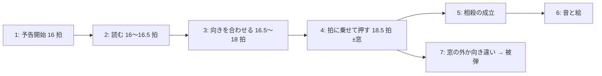

# 理想の 20 秒の動作イメージ (叩き台)
作成 2026-10-29 (Claude の下書き)。本人が直す前提。v3 (docs/plan/v3-phase1.md) とは独立の文書で、以後の版が「何が足りないか」を決めるときの基準にする。

## 1. この文書の位置づけ
- きっかけ: 本人の v2 の不満「なんか実際の動作イメージをめっちゃ細かく言語化して、多少まともなものを作るべきなのかな？」(vault:音楽アクション/v2 不満.md)。翌日の返事で「1 フレーズだと短すぎかも」「下書きは Claude が出して大丈夫」(docs/plan/v3-phase1.md「本人の返事」1)
- 範囲: 20 秒のシーン全体 (candidate-2、140 BPM、4/4、12 小節、phrase 0〜8)。1 拍 = 428.6 ms。敵 1 体、自機 1 体、常に浮いている (docs/concept.md「範囲」「初期案」)
- 振り付けの骨格 (X/Y/Z のモチーフと laser/burst/dash の割り当て、拍の位置) は今の v2 (assets/choreo/README.md) をそのまま使う。原本に「理想の振り付け」は無いので、ここでは「同じ振り付けが理想どおり動いたらどう見え、どう聞こえ、どう遊ぶか」を書く。骨格そのものを変えたい点は 6 節で本人に返す
- 出典の付け方: 各項目の末尾に (出典: ファイル名「見出し」)。原本と不満の言葉はできるだけそのまま使う。原本に無い Claude の補いは「(Claude の補い)」と明記する。原本に無く決められないものは「未決」と書く
- 出典の略記: 入り口 = vault:音楽アクション/入り口.md / 根本 = 同 根本コンセプトアイデア.md / FiHi = 同 既存ゲーム(Fi-Hi Rush).md / 得意不得意 = 同 リズム得意・アクション不得意向け.md / v0 不満・v2 不満 = 同 v0 不満.md・v2 不満.md / concept = docs/concept.md / choreo = assets/choreo/README.md / v3 = docs/plan/v3-phase1.md

## 2. 遊ぶ人が 20 秒で体験すること
曲が鳴り始めると同時に敵が拍に合わせてぽよぽよと上下しており、自機も曲に乗って立っている。曲は「少しずつ違うフレーズが繰り返されている」4 小節 1 周のモチーフ 3 つで、敵は同じフレーズには同じ攻撃を出すので、2 周目からは曲を聴けば次に何が来るか読める (docs/decisions/song-choice.md「選択」「構造」、concept「曲と音の役割」: 曲から敵の動きを読み取れる)。
敵の攻撃は全て自機を狙って来る。予告は「円の縁に被るタイミング」で当たりが分かる形で統一され、2 拍以上前なら内側に拍の数だけ薄い線が入るので、何拍後に来るかを数えなくても見える (FiHi「ネガティブ」、根本「攻撃予告を入れるなら」)。
プレイヤーは予告を見て、避けるか、来る方向へ向いて拍に乗せて攻撃を出し、敵の攻撃を弾き返す (相殺)。相殺できない範囲攻撃は避けるしかない。「敵の攻撃と自分の攻撃が衝突する」ことに音楽とリズムのガイドがあるのが、このゲームの捌きの中心 (v0 不満、得意不得意「難易度に合わせた要素」、choreo「v2 の狙い」)。
自分の攻撃は押した拍の位置 (表・裏・外) で別の音が鳴り、その音は曲 (敵の楽器) と区別できる別の楽器なので、敵のフレーズの合間に自分の音が入って一緒に曲になる。相殺は大きな閃光と自分の楽器の音で、見なくても分かる (concept「取り入れる要素」「曲と音の役割」、根本「ユーザーの行動が音楽になる」)。
HP バーは細く、残りが減ると色が変わるだけで、見に行かなくてよい。画面は敵・自機・予告・自分の扇だけで、視覚情報を増やさない (根本「基本的な画面イメージ」、FiHi「アクションゲームは視覚的な情報が本当に多い」)。

## 3. 時系列の動作イメージ
曲の土台 (全小節共通): キック 1 拍目・2.75 拍目・3.5 拍目、スネア 3 拍目だけ、ハット 8 分で刻み、2・4・6…小節目の 4 拍目は 16 分のハット。ベース (808 風、長く鳴る) は 1 拍目と 2.75 拍目。F マイナー、ベースは F1 を 2 小節、A♭1 を 2 小節 (scripts/gen-candidates.ts の candidate-2、`print-grid` の出力)。
メロディ: X = phrase 0,3,6 (A♭4→F4、拍 0 と 2)、Y = phrase 1,4,7 (E♭4→F4、裏拍 4.5 から)、Z = phrase 2,5,8 (C5→A♭4 のあと 1 小節休み) (choreo「モチーフ」)。
敵は攻撃していない間、拍の頭で持ち上がって戻る (docs/choreo-format.md `idle.amplitude`)。理想では自機も同じ拍で小さく揺れる (出典: 根本「テンポ把握」: 敵・自キャラなどから常にテンポと拍子を把握できる。自機の揺れ方は未決)。

### 3.0 小節ごとの曲と敵の攻撃 (全体の見取り図)
| 小節 | 拍 (秒) | メロディ | ベース | ドラムの特記 | 敵 (phrase、攻撃) | 遊ぶ人の局面 |
|---|---|---|---|---|---|---|
| 1 | 0〜4 (0.00〜1.71) | A♭4 (0)、F4 (2) | F1 | - | phrase 0、攻撃なし | 拍をつかむ。試しに振る |
| 2 | 4〜8 (1.71〜3.43) | E♭4 (4.5)、F4 (6) | F1 | 4 拍目に 16 分ハット | phrase 1、laser (予告 4 → 接触 6) | 射線を読む。避けるか弾き返す |
| 3 | 8〜12 (3.43〜5.14) | C5 (8)、A♭4 (10.5) | A♭1 | - | phrase 2、burst (予告 8 → 10.5 +80 ms) | 円の外へ歩く |
| 4 | 12〜16 (5.14〜6.86) | 休み | A♭1、B♭1 (13.75) | 4 拍目に 16 分ハット | 戻って待機 | 寄って叩く。自分の音が主役 |
| 5 | 16〜20 (6.86〜8.57) | A♭4 (16)、F4 (18) | F1 | - | phrase 3、dash (予告 16 → 接触 18.5) | 構えを読む。相殺の本命 |
| 6 | 20〜24 (8.57〜10.29) | E♭4 (20.5)、F4 (22) | F1 | 4 拍目に 16 分ハット | phrase 4、laser (20 → 22) | 2 回目。読めている |
| 7 | 24〜28 (10.29〜12.00) | C5 (24)、A♭4 (26.5) | A♭1 | - | phrase 5、burst (24 → 26.5 +80 ms) | 避ける |
| 8 | 28〜32 (12.00〜13.71) | 休み | A♭1、B♭1 (29.75) | 4 拍目に 16 分ハット | 戻って待機 | 叩く |
| 9 | 32〜36 (13.71〜15.43) | A♭4 (32)、F4 (34) | F1 | - | phrase 6、dash (32 → 34.5) | 相殺を狙いに行く |
| 10 | 36〜40 (15.43〜17.14) | E♭4 (36.5)、F4 (38) | F1 | 4 拍目に 16 分ハット | phrase 7、laser (36 → 38) | 弾き返す |
| 11 | 40〜44 (17.14〜18.86) | C5 (40)、A♭4 (42.5) | A♭1 | - | phrase 8、burst (40 → 42.5 +80 ms) | 避ける |
| 12 | 44〜48 (18.86〜20.57) | 休み | A♭1、B♭1 (45.75) | 4 拍目に 16 分ハット | 戻って待機 | 叩き込んで終わる (終わり方は未決) |

攻撃の間隔は最短 3.5 拍で、同時に 2 つを捌く場面は無い。難しさは予告の読みと、拍に乗せた向き合わせに置く (choreo「共通の注意」)。

### 3.1 phrase 0〜3 (1 周目、0〜8.79 秒)
| 拍 (秒) | 聞こえる音 | 敵の動きと予告 | プレイヤーが読むこと・やること / 入力 | 判定と結果 | 鳴る音と見える絵 |
|---|---|---|---|---|---|
| 0 (0.00) | A♭4、キック、ベース F1、ハット | 定位置 (右、中央の高さ) で拍にぽよぽよ | 曲が始まった。まだ攻撃は来ない。拍に合わせて 1〜2 回攻撃を振って、表と裏の音を聴いて拍をつかむ / × を拍の頭で | 敵に届かなければ空振り。音は鳴る | 表の音 (自分の楽器、高め)。扇が一瞬出る (concept「最小形は、攻撃したタイミングの拍の位置で鳴る音が変わる」) |
| 2 (0.86) | F4、スネア、ハット | 同上 | 「スネアは 3 拍目だけ」を体で覚える | - | - |
| 4 (1.71) | キック、ベース、ハット | **レーザーの予告開始** (phrase 1、Y)。この瞬間の自機位置に向けて射線が薄く出る。射線の上に 2 拍ぶんの線が走り、6 拍目で射線が縁に届く (choreo、根本「攻撃予告を入れるなら」) | 射線が自分に向いた。(a) 射線から外れる、(b) 射線上に残り、敵の方 (右) へスティックを倒して待つ / 左スティック | 自機狙いは予告開始の瞬間に決まり、追尾しない (choreo) | 予告は「相殺できる色」(v3「見え方・聞こえ方」) |
| 4.5 (1.93) | E♭4 (裏拍)、ハット | 裏拍で沈む (0.72, 0.78) | 沈んだ = 次の音で撃つ、と読む | - | 敵は音と同時に動き、0.25〜0.5 拍で止まる (docs/choreo-format.md「書き方の指針」) |
| 6 (2.57) | F4、スネア、ハット | 上がりつつ射線へレーザー。判定は 0.25 拍だけ (v0 不満「だらだらと残らない方がいい」) | (b) なら、スネアに乗せて × / 向きは右 | 相殺の窓は接触 −100 ms〜+50 ms (v3)。成立すれば当たりが消える。(a) なら何も起きない。立ったまま押さなければ被弾 | 成立: 大きい閃光、射線が途切れた形で 0.3 秒残る、自分の楽器で F5 (メロディ音 +12)。被弾: HP バーの色が変わる (根本「基本的な画面イメージ」)、自機の点滅 (Claude の補い) |
| 8 (3.43) | C5、キック、ベース A♭1、ハット | **叩きつけの予告開始** (phrase 2、Z)。自機の真上少し高い所へ 0.25 拍で移る。自機位置に同心円 (中心→中間→外側、拍ごと) が出る。色は「相殺できない色」 | 同心円が足元に出た = 避けるしかない。無音の間に円の外へ歩く / 左スティック | 「p-- p」の型: 最初の音で最終地点の少し上まで動き、無音は止まる (v0 不満 v1 節、docs/decisions/v1-feedback.md 1) | 素の移動速度は遅め (入り口「hollow knight みたいな感じ」) |
| 8.25〜10.5 | メロディ無し (ハット、9.75 のキックとベース、10 のスネア) | 止まっている | 円の外へ出終わる。余裕があれば拍に乗せて 1〜2 発 (当たらなくても音は鳴る) | - | 自分の音が曲の間を埋める (根本「ユーザーの行動が音楽になる」。Claude の補い: 休みの間に自分の音が入ることで曲が成立する) |
| 10.5 (4.50) + 80 ms | A♭4、キック、ハット | なり始めで叩きつけ、アタックが立ち上がりきった 80 ms 後に半径 0.22 の爆発。0.5 拍残る | 円の外にいる | 円の中なら被弾。相殺不可 | 爆発は四角と線の範囲でよい (v3「入れないもの」) |
| 12 (5.14) | キック、ベース、ハット (休みの小節の頭) | 定位置へ戻る (音に合わせて) | 休みの小節。攻めるならここ: 敵へ寄って拍に乗せて叩く / 左スティックで寄り、× を表拍で | 射程内なら少し補正して当たる (concept「初期案」) | 命中の絵 + 表の音。4 発入れば表の音が 4 拍の列になる (Claude の補い) |
| 15〜16 | 16 分のハット (次のフレーズへの合図) | 定位置でぽよぽよ | 16 分のハットで「次が来る」と構える | - | - |
| 16 (6.86) | A♭4、キック、ベース F1、ハット | **突進の予告開始** (phrase 3、X)。右上の構え位置へ 2 拍かけて移る (拍の頭に向けて加速し、最後の 1 拍で 9 割近く)。自機位置へ向かう輪が出て、18.5 拍目で縁に届く (v3: 接触の基準は突進の終点) | 右上に構えた = 突進。(a) 輪の外へ、(b) その場で右上を向いて待つ / 左スティック | 詳細は 4 節 | 予告は相殺できる色 |
| 18 (7.71) | F4、スネア、ハット | スネアで出発。0.5 拍で自機位置に届く | スネアが鳴った、次のハットで来る | - | 敵本体がぶれて見えるくらい速い (v0 不満「キビキビ」) |
| 18.5 (7.93) | キック、ハット (裏拍) | 自機位置に到達、そのまま 19 拍目まで通り過ぎる | (b) なら × を 18.5 に乗せる / 向きは右上 | 成立で当たりが消え、本体は通り過ぎる。遅れ 50 ms 以内なら被弾を取り消す (v3) | 成立: 閃光、本体の当たりが砕けた形で残る、自分の楽器で F5。「攻撃と攻撃が衝突する」の手応え (v0 不満) |

### 3.2 phrase 4〜8 (2〜3 周目、8.57〜20.57 秒)
同じモチーフには同じ攻撃 (choreo)。違いは始点だけで、2 周目からは「読めている」状態になるのが理想 (song-choice「予測できることを先に作る」)。

| phrase | 攻撃 | 予告 → 接触 (秒) | 1 周目との違い | プレイヤーの理想の振る舞い |
|---|---|---|---|---|
| 4 | laser (Y) | 20 → 22 (8.57 → 9.43) | 敵の始点が突進の着地点 (自機の近く)。近くから撃たれる | 曲を聴いた時点で「次は射線」と分かっているので、予告を見る前から向きを右に用意している (Claude の補い) |
| 5 | burst (Z) | 24 → 26.5 +80 ms (10.29 → 11.44) | 同形 | 無音の間に円を出て、休みの小節 (28〜32、12.00〜13.71 秒) で寄って叩く |
| 6 | dash (X) | 32 → 34.5 (13.71 → 14.79) | 同形 | 2 回目の突進。相殺を狙いに行く (v0 不満ノート v2 節の問い「捌きたくなるか」) |
| 7 | laser (Y) | 36 → 38 (15.43 → 16.29) | 同形 | 同上 |
| 8 | burst (Z) | 40 → 42.5 +80 ms (17.14 → 18.29) | 同形 | 避けて、最後の休みの小節 (44〜48、18.86〜20.57 秒) で叩き込む |
| 終わり | - | 48 (20.57) | - | 未決: 20 秒が終わったときに何が起きるか (敵を倒し切る / 倒せなくても終わる / 曲が終わると止まる)。原本に無い。今は結果画面 (README) |

### 3.3 入力と判定の一覧 (この文書で使う言葉)
| 言葉 | 意味 | 出典 |
|---|---|---|
| 移動 / 向き | 左スティック (WASD) の向きそのもの。無入力なら敵の方向。素の移動速度は遅めで、繊細な位置調整用 | README「遊ぶ」、入り口「hollow knight みたいな感じ」 |
| 攻撃 | × (Space / J)。前方 90 度の扇の中に敵がいれば命中。射程内なら少し補正して当たる | README、concept「初期案」、docs/plan/v2-phase2.md「既定値の決め」 |
| 表 / 裏 / 外 | 押した時刻が拍の頭 ±54 ms なら表、半拍 ±54 ms なら裏、どちらでもなければ外。それぞれ別の音 | concept「取り入れる要素」、src/config.ts `onBeatWindowBeats` |
| 命中 | 扇に敵本体が入っていた押下。敵 HP (12) が減る。1 発の減り幅は未確認で、理想の値は未決 | src/config.ts `enemyHp` |
| 相殺 | 敵の当たりの接触 −100 ms〜+50 ms に、来る方向の逆 ±30 度を向いて押した。当たりが消え、閃光と自分の楽器の音。「弾き返す」 | v3、得意不得意「攻撃で弾き返す」 |
| 取り消し | 接触の後 50 ms 以内の押下なら、既に受けた被弾を無かったことにする (HP が戻る)。「インチキかもしれないけど」本人の要望 | v2 不満、v3 T3 |
| 被弾 | 当たりに触れた。自機 HP (5) が減る。HP バーの色が変わる | 根本「基本的な画面イメージ」、src/config.ts `playerHp` |
| 相殺不可 | burst (叩きつけ)。予告の色が違い、避けるしかない | choreo「v2 の狙い」、v3 T4 |

3 周で変化を付けるか (フレーズの少しのアレンジ、同フレーズで別の攻撃) は原本に両方の方向がある: 入り口「行動のタイミングごとに取る行動を何パターンか設けておいて、読み合いが発生するようにする？」と、根本「難易度調整変数」の最も易しい段 (同じフレーズは同じ攻撃)。最初の実験は後者で固定 (song-choice)。前者は未決 (6 節)。

## 4. 1 回の「捌き」の拡大図 (phrase 3 の突進、相殺する場合)
前提: 接触 = 突進の終点の拍 18.5 (7928.6 ms)。相殺の窓は接触 −100 ms〜+50 ms (v3 既定値)。表・裏の判定窓は拍から ±0.125 拍 = ±54 ms (src/config.ts `onBeatWindowBeats`)。向きの許容は来る方向の逆から ±30 度 (config `cancelFacingDeg`)。

| 時刻 (ms、曲頭から) | 拍 | 曲 | 敵 | 予告 | プレイヤー |
|---|---|---|---|---|---|
| 6857 | 16.0 | A♭4、キック、ベース、ハット | 右上の構え位置へ動き始める。この瞬間の自機位置を狙いに固定 | 自機位置へ向かう輪が出る。内側に拍の線 (17、18)、縁 = 18.5 | 曲の A♭4 (X の頭) で「突進」と読む。右上に構える動きが見えて確信 |
| 6857〜7286 | 16〜17 | ハット | 構えへの移動の 1 割ほど (snap = t³) | 輪が中心から出る | スティックを右上 (敵の来る方向) へ倒し、そのまま保持。移動してしまうので、立ち位置を変えたくなければ倒し方は短く (未決、6 節 3) |
| 7286 | 17.0 | ハット | 移動の残り 9 割を 1 拍で | 輪が 1 本目の線に重なる | 待つ |
| 7607 | 17.75 | キック、ベース | 構え位置で静止 | - | 待つ。キックで次のスネアを数える |
| 7714 | 18.0 | F4、スネア、ハット | 出発。snap で加速し 0.5 拍で届く | 輪が 2 本目の線に重なる | スネアを聴いて押す準備。ここで押すと 215 ms 早い (窓の外)。表の音は鳴るが相殺にならない |
| 7829 | 18.27 | - | 自機へ向かう途中 | - | 窓の始まり (−100 ms) |
| 7875〜7983 | 18.375〜18.625 | - | - | - | 裏の判定窓 (18.5 ± 54 ms)。ここで押せば裏の音 + 相殺 |
| 7929 | 18.5 | キック、ハット | 本体が自機位置に到達 | 輪が縁に重なる | 押す。× / 向きは右上 (来る方向の逆、±30 度) |
| 7979 | 18.62 | - | 通り過ぎ中 | - | 窓の終わり (+50 ms)。この間の押下は、被弾していても取り消す (v3) |
| 7929〜8229 | 18.5〜19.2 | - | 19 拍目 (8143 ms) まで通り過ぎ、止まる | 消える | 成立: 当たりの位置に大きい閃光 (0.3 秒)、本体の当たりが砕けた形で 0.3 秒残る、自分の楽器で F5 (0.1 秒)。失敗 (向き違い・窓の外): 被弾、自機の点滅、HP バーの色 |

読みに使える手がかりは 3 つ重なる: 曲 (X の頭の A♭4 と 2 拍後のスネア)、敵の形 (右上に構える)、予告 (輪と線)。理想では曲だけで読めるのが先で、予告は確認用 (concept「曲と音の役割」: 曲から敵の動きを読み取れる。高難易度「攻撃予告は広範囲技のみあり」)。
注意: この突進の接触は裏拍 (18.5、3.5 拍目のキックとハット) に来る。相殺の押下を乗せる音がスネア (18) でなくキックになるのが意図どおりかは未決 (6 節 2)。レーザー (phrase 1) は接触がスネアの 6 拍目 (表) なので、スネアに乗せれば窓の中に入る (6 拍目 = 2571 ms、窓 2471〜2621 ms、表の窓 2517〜2625 ms)。

### 4.2 表拍で接触する場合 (phrase 1 のレーザー)
突進と違い、接触が 3 拍目のスネア (6 拍目 = 表) に来る。曲の強い音と相殺の窓が重なる「一番きれいな形」なので、比較のために置く。

| 時刻 (ms) | 拍 | 曲 | 敵 | 予告 | プレイヤー |
|---|---|---|---|---|---|
| 1714 | 4.0 | キック、ベース、ハット | 定位置で拍に揺れる。この瞬間の自機位置を狙いに固定 | 自機へ向かう射線が薄く出る。内側に拍の線 (5)、6 拍目で縁 | 射線が自分に向いた。残って弾き返すなら右へ向く |
| 1929 | 4.5 | E♭4 (裏拍)、ハット | 裏拍で沈む (0.5 拍で止まる) | - | 「沈んだ、次の音で撃つ」 |
| 2143 | 5.0 | ハット | 沈んだまま | 線 1 本目 | 待つ |
| 2464 | 5.75 | キック、ベース | - | - | キックで次のスネアを数える |
| 2471 | 5.77 | - | - | - | 窓の始まり (−100 ms) |
| 2517〜2625 | 5.875〜6.125 | - | - | - | 表の判定窓 (6 ± 54 ms)。ここで押せば表の音 + 相殺 |
| 2571 | 6.0 | F4、スネア、ハット | 上がりつつ射線へレーザー (0.25 拍 = 107 ms だけ判定) | 縁に届く | スネアに乗せて × / 向きは右 |
| 2621 | 6.12 | - | - | - | 窓の終わり (+50 ms)。被弾していれば取り消し |
| 2571〜2871 | 6〜6.7 | - | 6.5 で構えに戻る | 消える | 成立: 閃光、射線が途切れた形で 0.3 秒、自分の楽器で F5。失敗: 被弾 |

2 つの拡大図の差: レーザーは「スネアで押す」で済むが、突進は「スネアで出発、次のキックで接触」なので、押す拍が 1 つ後ろにずれる。曲から読むなら、X のフレーズは「2 拍目の F4 + スネアの半拍後」を体で覚えることになる (Claude の読み。意図どおりかは 6 節 2)。

## 5. 今の v2 と理想の差
### v3 で直すもの (docs/plan/v3-phase1.md)
| 理想 | 今の v2 | v3 |
|---|---|---|
| 拍に乗せて押せば相殺が成立する | 被弾より先に成立する幅が dash 27 ms、laser 8 ms (docs/decisions/v2-feedback.md F5) | 接触基準の窓 −100/+50 ms、遅れは被弾を取り消す |
| 予告の縁に被る瞬間 = 接触 | dash の輪は出発の 18 拍目に収束 (F7) | 終点の拍に収束 |
| 見えている扇・円・向きがそのまま判定 | 扇が横長、向きが最大 16 度ずれる、扇は判定より小さく描かれる (F1〜F3、F8) | 等方座標、描画 = 判定 |
| 自機と敵は小さく、攻撃判定は自機の直径 × 1.2 | 自機は画面幅の 8%、敵 10% | 0.6 倍、扇 1 値 |
| 相殺できる攻撃と不可の攻撃が予告で見分けられ、成立が音と絵で分かる | 同じ見た目、被弾後も相殺の演出が出る (F4) | 色分け、閃光と砕ける絵 |
| 自分の音は曲と別の楽器 | 曲と同じ矩形波・三角波の系統 (F9) | 減衰の速い撥弦 (候補) |
| 値を本人が探せる | 1 周 1 日の往復 | タイトル画面の調整パネル |

### v3 の後に残るもの
| 足りないもの | 出典 | 備考 |
|---|---|---|
| 相殺のメリット (敵の硬直、反撃の窓など)。今は「ゲーム性的に相殺判定にメリットが欲しい」 | v2 不満、docs/decisions/v2-feedback.md「後回し」 | 相殺が成立してから、捌きたくなるかの不満で決める |
| 自機も拍に乗って見える (テンポ把握を自機からも) | 根本「テンポ把握」 | 揺れ方は未決 |
| 予告の拍の線の統一 (円形は同心円、射線・輪は内側の線)。裏拍の表し方 | 根本「攻撃予告を入れるなら」、FiHi「裏拍をこれで表現するとおそらくユーザーが混乱する」 | v2 は burst だけ同心円。dash/laser の線は未確認 |
| 休みの小節で自分の音が曲を埋める手応え (音高が曲のコードに沿う、表拍の列がフレーズになる) | 根本「ユーザーの行動が音楽になる」(メロディを鳴らすのが理想、行動を制限する不安あり) | 今は表 880 Hz・裏 440 Hz・外 110 Hz の固定音高 (F9)。曲の音高に沿わせるかは未決 |
| 曲だけで次の攻撃が読める (予告は確認用) | concept「曲と音の役割」 | 今も同じモチーフ = 同じ攻撃。本人が読めているかは不満で確認 |
| 被弾の分かりやすさ、HP バーが主張しない | 根本「基本的な画面イメージ」 | 今の表示は未検証 |
| 座標の要素 (位置取りの意味) と、補正の強さ | 入り口「座標の要素も入れたい」「若干補正」 | 常に浮いていて敵 1 体では出番が薄い (concept「初期案」)。地面と空中は後回し |
| 読み合い (同フレーズで別の攻撃)、フレーズのアレンジ | 入り口、根本「難易度調整変数」 | 最初の実験は同じ攻撃で固定 |
| 20 秒の終わり方 | 無し | 未決 |
| 音楽と画像 (「音楽も画像も足りないんだよな」) | v2 不満 | concept「入れないもの」(曲の個性、キャラデザ)。入れないままにするか、最初の実験の範囲を広げるかは本人 |

## 6. 本人に直してほしい点 (迷った箇所)
1. 骨格を v2 のままにしてよいか。理想の振り付けが原本に無いので v2 の X/Y/Z を使ったが、「理想」として攻撃の種類や順番を変えたいなら、ここを先に直してほしい
2. 突進の接触が裏拍 (18.5、キックとハット) に来る。相殺の押下を乗せる音は、スネア (18) がよいか、キックでよいか。前者なら突進は 17.5→18 で出発を半拍早める (振り付けの変更、v3 の範囲外)
3. 向きと移動が同じスティック。相殺のために右上へ倒すと自機も右上へ動く。「向きの入力がストレスか」(v0 不満ノート v2 節の問い) は未回答。理想は、向きだけ変える手段がある (別の入力か、短い倒しは向きだけ) か、動いてしまうのを含めて位置取りにするか
4. 自機の拍の揺れ (根本「テンポ把握」の自キャラ側)。入れるか、入れるなら何で (上下、拡縮、光)
5. 休みの小節の自分の音。固定音高のままか、曲のコード (F マイナー、ベースの F / A♭) に沿わせるか。根本の「メロディを鳴らすのが理想だが行動を制限する不安」の側に寄せるか
6. 予告と曲のどちらを主の手がかりにするか。高難易度ノートは「予告は広範囲技のみ」、得意不得意ノートは「方向と範囲とタイミングで構成」。最初の実験はどちら寄りか
7. 20 秒の終わり方 (3.2 の最終行)
8. 3 周で変化を付けるか (3.2 の末尾)。付けるなら 3 周目だけか
9. 「音楽も画像も足りない」を最初の実験の範囲に入れるか。入れるなら concept「入れないもの」の変更になる
10. 2 節の散文は Claude の言い回しが多い。本人の言葉に置き換えてほしい箇所があれば直接書き換えてよい (この文書は本人のもの)
