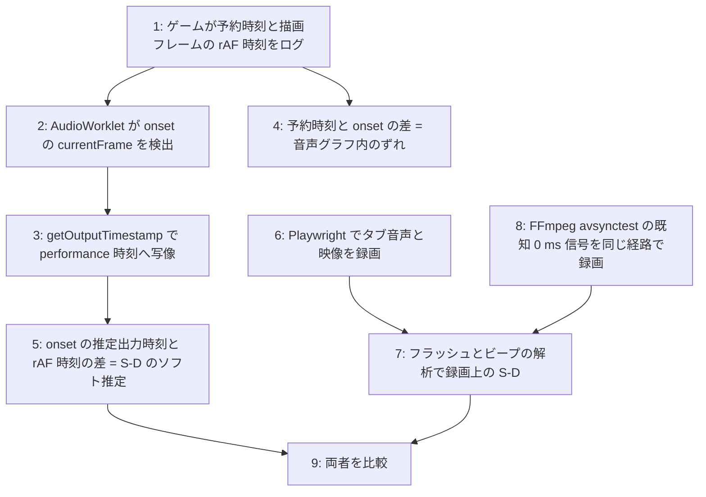

# 音と絵の同期を耳で聴かずに確かめる方法 (調査)
2026-10-23、サブエージェントのウェブ調査。Claude は出典の原文を開いていない。「確認済み」は出典に明記があるもの、「設計案」は複数の出典から組み立てたもので未検証。

## 結論
- ずれは 3 層ある。(a) ゲームの「鳴らすと決めた時刻」と「描くと決めた時刻」の差、(b) ブラウザ内の音のレンダリング遅延 (baseLatency) と OS・デバイスの出力遅延 (outputLatency)、(c) ディスプレイの表示遅延と人間の知覚。ソフトだけで測れるのは (a) と (b) の推定値まで。(c) は外部機材 (カメラ + マイクの録画) が無いと測れない
- リズムゲーム界の定説 (Bemuse、Rhythm Quest): 音遅延 S・映像遅延 D・入力遅延 I は個別に測れず、S+I (音に合わせてタップ)、S-D (見た目で合わせる)、D+I の組み合わせしか測れない。自動化で狙えるのは S-D の推定と (a) の整合性
- 現実的な構成は 2 段。ページ内: AudioWorklet で音の立ち上がりのサンプル時刻を取り、getOutputTimestamp で performance 時刻に写像し、rAF の時刻と比べる。ページ外: Playwright でタブの音声と映像を同じストリームで録り、フラッシュ + ビープをオフライン解析する。後者の完成品 OSS は見つからなかった

## このプロジェクトで既に持っているもの (2026-10-23 時点)
- (a) のデータ検査: `scripts/sync-report.ts` (音のアンカー・動き出し・当たり発生を ms で並べる)
- (b) の補正: AudioContext.outputLatency ぶんゲーム時計を遅らせ、結果画面に補正値を出す
- 処理の遅れ: 当たりが有効になる sim 時刻と処理フレームの音の時刻の差を結果画面に出す
- S+I の実測: 結果画面の「拍とのズレ 平均」(本人の攻撃入力と拍の差。2026-10-22 は -9 ms と -1 ms)

## 1. ページ内で測る
### 時刻系 (確認済み)
- `AudioContext.currentTime`: オーディオクロック。Chrome では一貫、Firefox は JS タスク間で古くなりうる
- `baseLatency`: 出力サブシステムに渡すまでの処理遅延。Firefox は 0 を返す
- `outputLatency`: バッファを OS に渡してからデバイスが出すまでの推定。Chrome 102+。実デバイスが無い環境 (headless、音声デバイス無しの CI) では信用できない。fingerprint 対策の丸めを仕様が許容 (Chrome の実装は未確認)
- `getOutputTimestamp()` → `{contextTime, performanceTime}`: オーディオクロックと performance.now() の唯一の公式な橋。Safari iOS で異常値の報告あり
- `requestVideoFrameCallback` は video 要素専用で Canvas には使えない。Canvas は rAF の引数 (フレーム開始時刻) しか無く、実際の表示は 1〜2 vsync 後

### 設計案: AudioWorklet で立ち上がりを検出 → performance 時刻へ → rAF 時刻と比較
1. マスター出力の直前に AudioWorkletNode を挿し、短時間エネルギーの閾値超えで onset の `currentFrame` を送る
2. 直近の `getOutputTimestamp()` から `tPerf = performanceTime + (tCtx - contextTime)` で写像
3. 当たり発生・着地を描いたフレームの rAF 時刻をログし、`tPerf - frameTimestamp` を集計
4. `start(when)` の `when` と検出 onset の差も記録すると、(a) と (b) を分離できる

AnalyserNode を rAF で polling する形でも可能だが、分解能が 16.7 ms に縛られる。精密に取るなら AudioWorklet。

測れる: 予約時刻 vs 実際にレンダされた onset / onset の推定出力時刻 vs 描画フレーム開始時刻 (S-D のソフト推定) / ジッタ分布
測れない: 出力デバイスの実遅延 (Bluetooth 等) / Canvas が実際に画面に出た時刻 / モニタ遅延 / 知覚

### 補助: CDP WebAudio ドメイン、Chrome tracing
- CDP `WebAudio.getRealtimeData`: renderCapacity (100 でグリッチ境界)、callbackIntervalMean など。音声レンダリングが健全かの監視に使える。onset は取れない
- tracing のカテゴリ `audio`, `webaudio` と compositor の `PipelineReporter` を同一トレースで取れば、原理的には音声コールバックとフレーム提示を同じ時計で突き合わせられる。実例は見つからなかった

## 2. ページ外で測る (Playwright / Puppeteer)
- Playwright の recordVideo と Puppeteer の screencast は映像のみ。音声は入らない
- 手法 A: `getDisplayMedia({video, audio: true})` + MediaRecorder でタブの音声 + 映像を同じストリームで録る。Chrome 起動フラグ: `--use-fake-ui-for-media-stream`, `--auto-select-desktop-capture-source=...` (QA Wolf の手順)。タブ単位の `--auto-select-tab-capture-source-by-title` も存在 (Chromium のコミットで確認、挙動は未確認)。ゲームにフラッシュ + ビープを埋め込めば録画解析で ms 単位のオフセットが出る
- 手法 B: puppeteer-stream (拡張機能ベース)。手軽だが遅延が増える可能性
- 測れる: ブラウザがコンポジタ出力と音声ループバックを取った時点での S-D (ユーザーが Chrome 上で見聞きするものに近い)
- 測れない: DAC 以降の出力デバイス遅延、スキャンアウト遅延、MediaRecorder 自体の A/V 同期精度 (既知 0 ms の信号で較正が要る)
- headless Chrome は音声デバイスが無いと fake 出力 (タイマー駆動) に落ちる。outputLatency は信用できない

## 3. リズムゲームの慣習
- Bemuse (Web): S+I をタップで推定 (56 サンプルで平均 14 ms、SD 22 ms。約 35 タップで安定)。`sound(t)`, `display(t+B)`, `judgment(t-A)`
- Rhythm Quest: 映像と入力の遅延は小さいと仮定し、S-D だけを 4 タップで較正。Rhythm Doctor は「音と映像を合わせる → 7 拍目タップで入力遅延」の 2 段階
- Clone Hero: 音 + 視覚キューに合わせてストラムし、平均を audio / video offset に適用。OS からハードウェア音声遅延を初期値として取得 (Web の outputLatency に相当)
- osu! Offset Wizard: メトロノームにタップ、手動調整
- 共通して人間のタップに依存する。自動化できるのは S-D のソフト計測への置き換えだけで、入力遅延 I は自動化対象外

## 4. 既存ツール (ソフトのみ)
- FFmpeg `avsynctest`: ビープ + フラッシュの既知オフセット信号を生成する。解析側は無い。録画経路の較正に使える
- obs-audio-video-sync-dock: OBS プラグイン。パターン動画をカメラで撮って遅延計測。ブラウザ出力を OBS に入れれば外部機材なしで使えるが OBS の遅延が乗る
- 音声同士のオフセット: bbc/audio-offset-finder、syncstart、SyncSink (相互相関)
- 解析の自作: 映像は輝度ジャンプのフレーム、音声は librosa.onset / aubio、`offset = audio_onset - flash_frame_time`。完成品 OSS は見つからなかった。許容値の慣習は半フレーム (±22 ms)、WebRTC のテストは 50 ms

## 推奨 (探索段階の提案)

- 音声デバイスの無い CI では 1〜5 を主にし、6〜8 は実機で定期実行
- 測れない残差 (出力デバイス遅延、ディスプレイ遅延、入力遅延、知覚) は Clone Hero / Rhythm Quest 流のユーザー較正に委ねるのが慣習

## 未確認事項
- Chrome の outputLatency / getOutputTimestamp に丸め・ジッタが入っているか
- new headless で AudioContext が fake 出力に落ちたときの currentTime の進みと outputLatency
- `--auto-select-tab-capture-source-by-title` の値と、タブ音声トラックが得られるか
- MediaRecorder (webm) の A/V タイムスタンプ精度
- puppeteer-stream の内部実装と new headless での動作

## 主な出典
- https://developer.mozilla.org/en-US/docs/Web/API/AudioContext/getOutputTimestamp
- https://developer.mozilla.org/en-US/docs/Web/API/AudioContext/outputLatency
- https://web.dev/articles/audio-output-latency
- https://github.com/WebAudio/web-audio-api/issues/2467
- https://groups.google.com/a/chromium.org/g/blink-dev/c/dTQniJNVVMY/m/LKo0cx7-CwAJ
- https://web.dev/articles/audio-scheduling
- https://web.dev/articles/profiling-web-audio-apps-in-chrome
- https://docs.qawolf.com/qawolf/web-speaker-capture
- https://chromium.googlesource.com/chromium/src/+/a3d001f7ff1b6120b7e6abf713658fb04647dfe6
- https://npmjs.com/package/puppeteer-stream
- https://github.com/bemusic/bemuse/pull/87
- https://rhythmquestgame.com/devlog/10.html
- https://wiki.clonehero.net/books/guides-and-tutorials/page/calibrating-audio-and-video
- https://ffmpeg.org/pipermail/ffmpeg-devel/2022-March/293844.html
- https://github.com/norihiro/obs-audio-video-sync-dock
- https://librosa.org/doc/main/generated/librosa.onset.onset_detect.html
