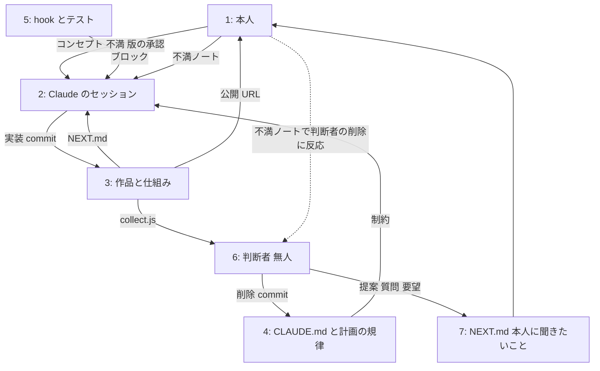

# 制御構造図 (STPA)
判断者が毎回保守する (docs/steward/judge.md 専門家 1)。初版 2026-10-29。実線は今ある経路、点線は欠けている経路。

## 制御器と制御動作
| 制御器 | 制御動作 | 出ない | 誤って出る | 遅い | 長すぎる |
|---|---|---|---|---|---|
| 本人 | 版の承認 | 承認待ちで止まる (v2 まで最大の摩擦。2026-10-27 に Phase 2 承認を廃止) | | 2 時間/日の枠に依存 | |
| 本人 | 不満 | 遊ばないと出ない | | | |
| 規律 (4) | 制約 | | 根拠の詰まりが消えても残る | | 増える一方で外す動作が無かった (判断者で補う) |
| hook とテスト (5) | ブロック | Bash 経由は止められない (guard-acceptance) | | | |
| 判断者 (6) | 削除 | 根拠が見つからず沈黙 (停止条件で検知) | 必要な規律を削る (不満ノートで返る) | PC が寝ていて飛ぶ (skips で検知) | |

## フィードバック経路
- ある: NEXT.md (状態)、不満ノート (本人の反応)、公開 URL (遊べる状態)、テスト (壊れていないか)、collect.js (在庫の数値)
- 欠けている: 判断者の削除への本人の反応は不満ノート経由を想定しているが、本人に通知する手段は後回し (docs/plan/loop-phase2.md「入れないもの」)
