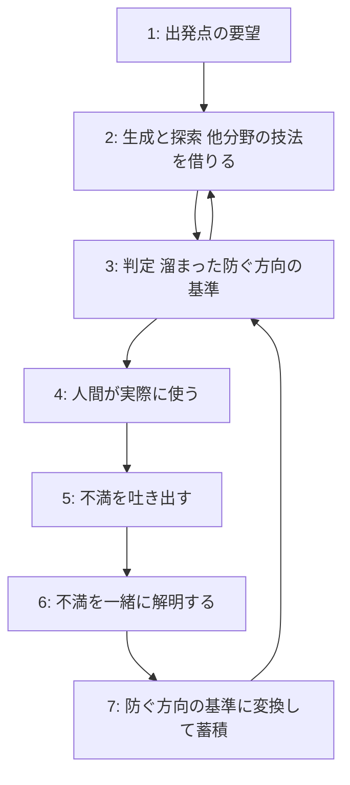

# 仕組みの設計
vault:with-codexの後継-人間を不満の源泉にする自律システム.md から、仕様になった部分を移したもの (2026-10-20)。出発点・問題意識・外部の意見など思索の経緯は元ノートに残っている。

# 最初の実験の方向 (この対話で決定)
- 題材: 音楽アクションの 20 秒の戦闘シーン (敵 1 体、曲 1 つ)
- 曲は仮置き。AI が候補を複数出し、自分は選んで理由を一言返す。作曲はしない。曲の個性は、手触りのループが回ると分かってから扱う
- 確かめる焦点はゲームの手触り
  - Claude の叩き台 (明示の合意はまだ): 不満が次の版の具体的な変更に変わるか / 自分の関わりが反応だけで済むか (2 時間/日 + スマホ 1 時間/日)
- 人間の役割: コンセプト、曲の条件 (言葉で)、手触りへの反応と不満
- 仕組みの進め方 (大まかに合意): 端から端まで通る一番細い仕組みを最初に作り、以後は実際に回して詰まった点からだけ育てる
  - 仕組みの変更には、実際に回して出た詰まりを根拠として紐づける
  - 作品が出ないのに仕組みの変更だけ増えたら refine_idea 型の兆候とみなす (git 履歴で見る)
- 手触りの伝え方: 自由記述より 2 案の比較と、ゲーム内の記録 (入力と拍のズレ等) で補う (Claude の提案)

# 設計の方向 (Claude の提案、未検証)
## 判定基準は最初に固定せず、不満から育てる

- 生成は開いたまま、判定は不満を解明した「防ぐ方向」の基準を溜めていくだけにする。改善や新規作成も、不満のたびに防ぐ問題へ分解される
- 弱点: 防ぐ基準は下限を上げるだけで、放っておくと無難なものに収束する。上に押し上げる力は、出発点の要望の高さと他分野の技法を借りる探索の側に持たせる

## 感性システム
- 感性を「実在の人間の反応の蓄積」として作る。最初の材料は自分の不満ログ、次に外部のレビューやコメント
- モデルには良し悪しを判定させない。「この背景の人ならここで何に不満を持つか」を記録された声に根拠を置いて予測させる
- 人間は毎回判定せず、新しい不満が出たときだけ呼ばれる。自律性が意味を持つのはこの部分
- 特定の誰かではなく反応の分布を使うので模倣にならない。個性の源は自分の不満の蓄積

## with-codex との関係
- 多様性の源をモデルから人間の背景へ移す
- 見落とし削減は手順の固定ではなく、道具と照合で担う

# 「不満」と「感性」の切り分け
## 自分の考え
- 何かを解決するのが目的のもの (業務改善、誰かの不足を助けるもの。出発点がそもそも不満) では、「不満の蓄積」を整理し、背景にある抽象的な理想像を現実に引っ張り出す作業が要る
- SNS に上げる、誰かのポジティブな感情を引き出すものには「感性」が合う
- ただしゲームでもどの形態の作品でも、本来あっていい快適性や最低限の水準が満たされていないと本来の価値をすごく下げる。なのである程度は「不満」も拾う必要がある。ただし育つ中で設定されたコンセプトを侵さない範囲で
- ありきたりは避ける必要があるので、ある程度は棄却する必要がある。AI ならできる気がする (コンテキストの連続性が保たれていれば)

## Claude の補足
- この構造は品質管理の狩野モデルとほぼ同じ
  - 当たり前品質: 満たされないと強い不満になるが、満たしても満足は生まない (快適性・最低限の水準)
  - 魅力品質: 無くても不満にならないが、あると喜ばれる (感性・コンセプト)
- 目的のタイプで主軸を変えるだけでなく、一つの作品の中で層を分けると扱いやすい
  - コンセプト (最上位・保護対象): 人間が決め、システムは侵さない
  - 当たり前品質: 不満から拾う。修正がコンセプトを侵すなら棄却する
  - ありきたりの棄却: よくある作りを先に列挙させ、それ以外を選ばせる
- 「AI ならできそう」は半分楽観。モデルは最もありそうなものを出すように作られているので、ありきたりの棄却は素の性質と逆向き。明示的な手順として組み込めばかなり効く
- コンテキストの連続性は本当のボトルネック。会話の中に頼るといずれ切れるので、コンセプトは文書として外に置き、毎回そこと照合する

# 時間の制約と人間の関わり方
## 自分の状況
生活の詳細は vault:with-codexの後継-人間を不満の源泉にする自律システム.md「時間の制約 (自分の状況)」に置く (2026-10-22 に公開リポジトリから移した)。設計に効く要点だけ残す。
- 曲やゲームを丸ごと 1 つ作るような作業はほぼできない。途中の道具を触ることはするが、自分がメインの駆動力にはなれない
- 必要なツールを繋ぎこんでできるだけ自律的にやってほしい
- 使える時間: 家で 2 時間/日、スマホ経由で 1 時間/日
- 手段: Obsidian モバイルと Claude Code の remote control は既に使える。スマホで扱えるようにさえすれば他のものでもいい
- トークン予算: これまでほど気にしなくていい

## Claude の見立て
- 時間が少ないのは設計上の一番大事な制約。「人間を外部ツールにする」はもともと人間の時間が少ない前提なので矛盾しない
- 一番の危険は、自律システムを作ること自体が大プロジェクトになること。with-codex も refine_idea も本題より仕組みの方が育った。最初は新しい基盤を作らず、既存の道具 (Claude Code、定期実行、vault) の組み合わせで回るものにする
- 人間が出すのは「制作」ではなく「反応」と「コンセプト」。制作は数時間かかるが、反応は数十秒で済む。時間当たりで一番効くのはコンセプト。ただし感性の源泉は人間なので、反応の時間がゼロになるとシステムの感性も痩せる
- 自律にするほどトークンを食う。曲やゲームを丸ごと自律で作るのは、今の道具では品質面でまだ厳しい (特に音楽)。まずは文章と簡単な映像が現実的

# 未決事項
- 「不満を解明する作業」の具体的な形 (v2 の質問の洪水にならない方法)
- 偏愛の記録も人間の役割に含めるか、不満に絞って試すか
- 外部の判定者と成功条件を、Codex 案とサブエージェント案のどちらで (または組み合わせて) 置くか (両案は元ノートの「外部の意見」)
- 曲の出どころを、仮置き (AI 候補から選ぶ) の後どうするか
